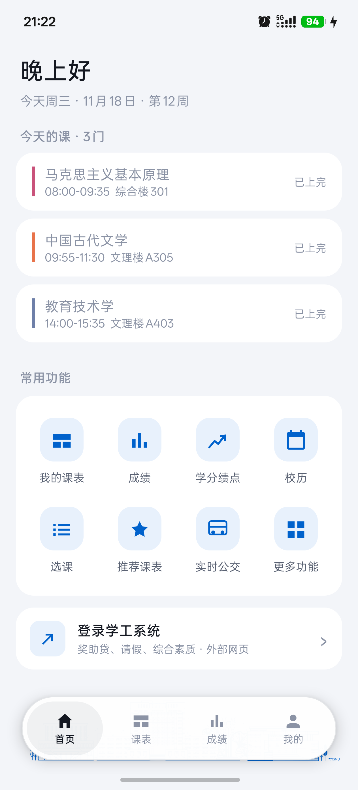
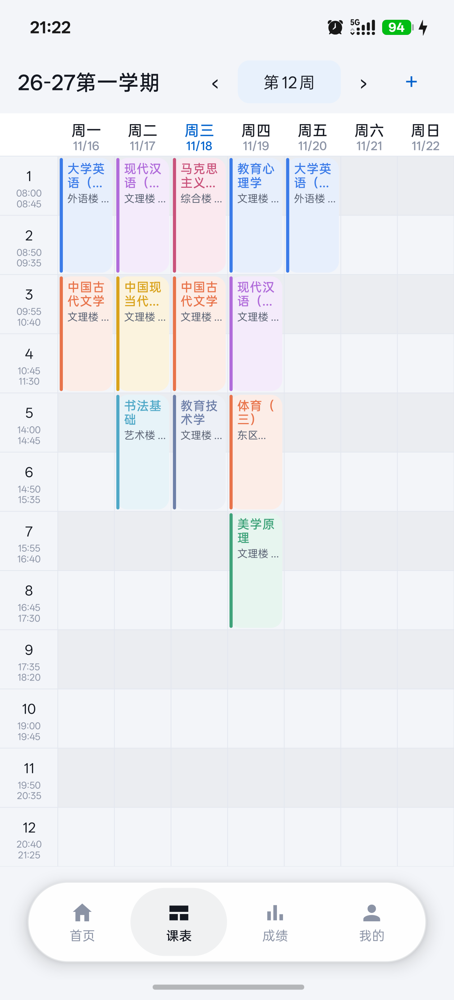
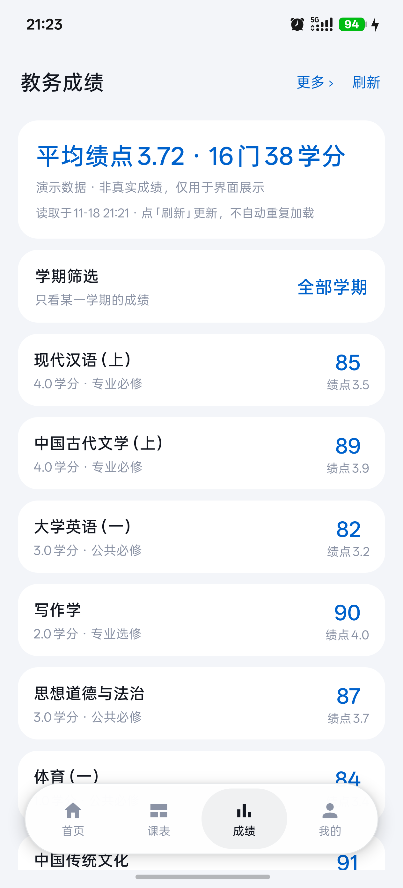
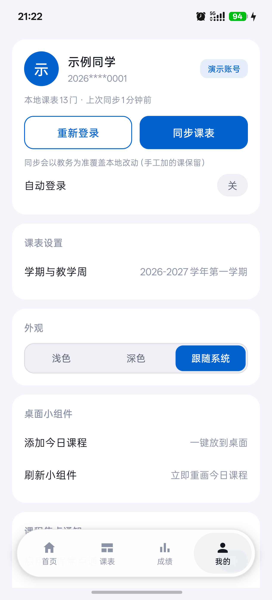
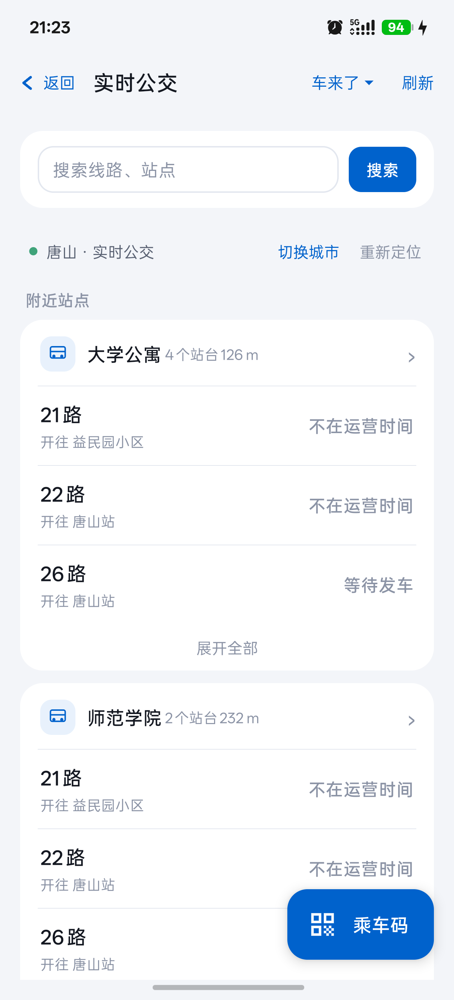
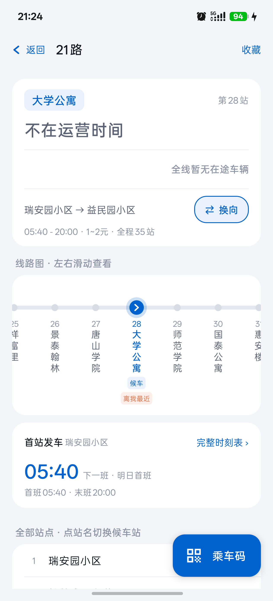
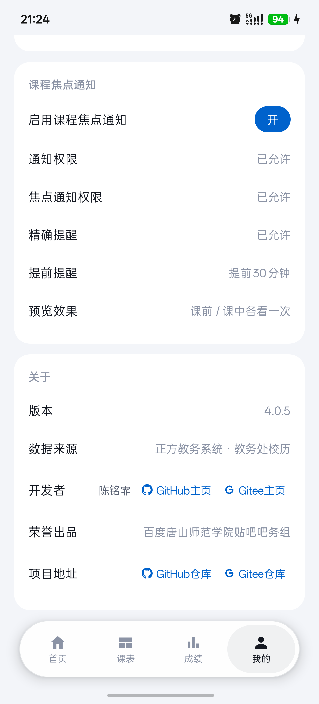
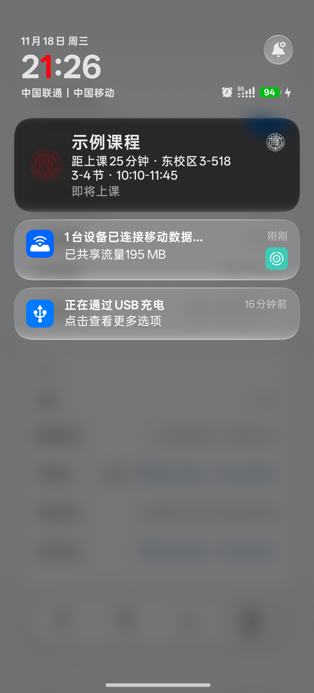

<div align="center">

<picture>
  <source media="(prefers-color-scheme: dark)" srcset="docs/assets/school-logo-dark.png" />
  
</picture>

# 掌上唐师 · ZSTangshi

**Campus companion for Tangshan Normal University — timetable, grades, live bus**

<p>
  <a href="https://github.com/Chanmingfei/zstangshi/releases/latest">
    
  </a>
  <a href="https://developer.android.com">
    
  </a>
  <a href="ios-kmp/">
    
  </a>
  <a href="harmony-android">
    
  </a>
  <a href="https://kotlinlang.org">
    
  </a>
  <a href="https://developer.apple.com/swift/">
    
  </a>
  <a href="native/build.sh">
    
  </a>
  <a href="LICENSE">
    
  </a>
</p>

<p>
  <a href="README.md">简体中文</a> · <a href="README.en.md"><b>English</b></a>
</p>

</div>

---

> An academic-systems client, a student-affairs entrance and a real-time bus tracker,
> packed into a **3.5 MB** APK (Android) with a feature-complete iOS port. The Android build is
> hand-written against the framework only — no AndroidX, no Gradle, zero third-party runtime
> dependencies. One command builds an installable package: `bash native/build.sh`. The iOS build
> shares the protocol / parsing layer via Kotlin Multiplatform and builds entirely in the cloud.
>
> **Current**: Standard **v4.0.7** (66) · HarmonyOS **v4.1.2-harmony** (67) ·
> iOS test build **v4.0.7** (unsigned).
> New in this release: **automatic update check on launch** (with "skip this version")
> and **course Live Updates** on HarmonyOS Live View, ColorOS Fluid Cloud,
> Xiaomi Focus Notifications and Android 16 Live Updates.
>
> **The iOS build is feature-complete against Android**: native `TabView` tabs
> (Home / Timetable / Grades / Profile), academic login & sync, grades / GPA / calendar /
> course selection / recommended schedule, timetable editing & adjustments, dual-source
> live bus, and an in-app WebView (academic / student affairs / repository pages).
> See the **iOS test build** section below.

---

## 📸 Screenshots

| Home | Timetable | Grades | Profile |
| :---: | :---: | :---: | :---: |
| <br/>Home | <br/>Timetable | <br/>Grades | <br/>Profile |
| <br/>Live bus | <br/>Line detail | <br/>Live update settings | <br/>Live update (ColorOS) |

> Captured from a **demo account** (示例同学 · 2026\*\*\*\*0001); all names, IDs and grades are sample data.
> Bus screenshots were taken at 21:24, after the last departure, hence “不在运营时间”.

---

## 📥 Download

Pick the package that matches your OS.

| Your device | Download | How to verify |
| --- | --- | --- |
| **HarmonyOS** (Huawei / HONOR, recent models) | **[⬇ HarmonyOS build](https://github.com/Chanmingfei/zstangshi/releases/tag/harmony-v4.1.2)**<br>`zstangshi-harmony-4.1.2.apk` | Launcher name **掌上唐师·鸿蒙版**<br>About page shows a "版本类型" row |
| **Any Android phone** (Xiaomi / OPPO / vivo / Samsung / OnePlus) | **[⬇ Standard build](https://github.com/Chanmingfei/zstangshi/releases/tag/v4.0.7)**<br>`zstangshi-v4.0.7.apk` | Launcher name **掌上唐师**<br>No "版本类型" row |
| **iPhone / iPad** (test) | **[⬇ iOS test build](https://github.com/Chanmingfei/zstangshi/releases/tag/ios-v4.0.7-test)**<br>`zstangshi-ios-4.0.7-tabview-test.ipa` | Unsigned, re-sign yourself<br>See the iOS test build section below |

The latest builds are always at <https://github.com/Chanmingfei/zstangshi/releases/latest>.

Check **Settings → About phone**: a "HarmonyOS version" entry means the HarmonyOS build,
an "Android version" (or MIUI / ColorOS / OriginOS / One UI) means the standard build.

### What differs

Feature parity, independent implementations. Since 4.1.0 the HarmonyOS build evolves separately,
because the HarmonyOS compatibility layer has a different capability surface.

| | Standard | HarmonyOS |
| --- | --- | --- |
| Features | all | all |
| Version | 4.0.7 (66) | 4.1.2-harmony (67) |
| Launcher name | 掌上唐师 | **掌上唐师·鸿蒙版** |
| Package | `com.tstc.zstangshi` | `com.tstc.zstangshi` (identical on purpose, keeps login & timetable) |
| Live Updates | Android 16 protocol | **protocol + persistent-countdown fallback** |
| HarmonyOS login crash | present | fixed |
| Source | [`native/`](native/) | [`harmony-android/`](harmony-android/) |
| Size | 3.60 MiB | 1.69 MiB |

> **⚠️ The two builds share a package name but not a signature**, so they cannot overwrite each other.
> Uninstall the old one first — that also clears the local timetable and login state.

> **Downloads from mainland China often time out on GitHub attachments — use the Gitee mirror:**
> [gitee.com/mingfei123/zstangshi/releases](https://gitee.com/mingfei123/zstangshi/releases)
> — release contents are identical in both repos, and the in-app update checker prefers Gitee.

Verify the download (optional):

```bash
sha256sum zstangshi-v4.0.7.apk          # macOS / Linux
certutil -hashfile zstangshi-v4.0.7.apk SHA256   # Windows
```

| Package | Size | SHA-256 |
| --- | --- | --- |
| `zstangshi-v4.0.7.apk` | 3,771,518 B | `ad155743…46e59ddc6` |
| `zstangshi-harmony-4.1.2.apk` | 1,768,581 B | `17fd08c6…3093bbcef` |
| `zstangshi-ios-4.0.7-tabview-test.ipa` | 1,885,558 B | `9e3a3d55…6a107f` |

---

## 🍎 iOS test build

The iOS build is a **feature-complete port of the Android mainline**, source in [`ios-kmp/`](ios-kmp/):
SwiftUI draws the interface, while protocols / parsing / algorithms / state rules are ported into a
shared Kotlin layer (KMP) and compiled to a static `Shared.framework` for the app to link.

**The current build is unsigned** (`ios-v4.0.7-test`) — the project has no Mac and no Apple signing
certificate, so it is built entirely in the cloud on Codemagic (XcodeGen generates the project →
xcodebuild without signing → package the ipa):

- the ipa is **unsigned** and cannot be installed on an iPhone as-is; re-sign it with your own
  certificate (or use TestFlight / enterprise distribution);
- re-sign with any of `ios-app-signer` / `AltStore` / `Sideloadly`; Bundle ID `com.tstc.zstangshi.app`.

**Feature parity** (checked item by item against Android Standard):

| Module | Notes |
| --- | --- |
| Navigation | Native iOS `TabView`: Home / Timetable / Grades / Profile; grid tiles switch tabs directly |
| Academic | RSA login, auto http/https detection with no manual switch, first-login auto-sync, later manual sync only from Profile |
| Timetable | Week grid, odd/even weeks, editing (weeks / 8 colours), cancel / move class, hide academic courses, back to current week |
| Grades / GPA | Term filter, weighted average, GPA summary |
| Calendar / selection / recommended | Month-view teaching weeks, selection-window notice, four-level cascading recommended schedule |
| Live bus | Chelaile + Mygolbs dual sources, nearby / search / stop / line / timetable / favourites / ride QR / bike-follow / breathing halo |
| Web pages | In-app `WKWebView`: academic / student affairs / GitHub / Gitee / release pages, two-way Cookie sharing, https→http fallback |

The Kotlin shared layer has 230 platform-independent assertions (nearby bus / academic parsing /
calendar / cascading), runnable locally with `bash ios-kmp/run-probe.sh`.

---

## 📖 What it is

The academic web portal needs landscape mode, pinch-zoom and three levels of menus to show one timetable.
Room numbers get forgotten. "Do I have class tomorrow" turns into counting teaching weeks by hand.
And the bus at the gate means opening a map app and searching the stop again.

This app flattens all of that onto the first screen: unlock and you see today's third class in room 3-518;
on the way out, 21路 is 3 stops and 7 minutes away.

No splash ads, no feed, no permissions beyond what the features need.

---

## ✨ Features

### Home
- Greeting, today's teaching week, and a timeline of today's classes — the ongoing one highlighted with a countdown.
- Eight quick actions: timetable, grades, GPA, academic calendar, course selection, recommended schedule, live bus, more.
- One-tap entrance to the academic system (the "more" tile) and to the student-affairs system (aid, leave requests, activity records).
- Native bottom tabs on both platforms (Home / Timetable / Grades / Profile); the grid's timetable/grades tiles switch tabs directly.

### Timetable
- Eight-colour course blocks, odd/even weeks, overlapping courses side by side, tap to edit.
- Swipe between weeks, one tap back to the current week; period times shown alongside.
- Manual courses, cancellations and moved classes survive a **sync** — sync only overwrites what the academic system owns.

### Grades & GPA
- Filter by term; each course shows score, credits, course type and grade point.
- Component breakdown (coursework / final) with weights, plus the data source and fetch time.
- A separate GPA page aggregates by term.

### Academic calendar
- Month view with teaching weeks, public holidays and make-up days, sourced from the university calendar.

### Live bus
- **Nearby stops** with per-stop arrival predictions, including multi-platform stops.
- **Line detail**: vertical stop line, your boarding stop, vehicles in transit, "closest to me"; reverse direction supported.
- **Predictions**: large countdown plus "N stops / N km", consistent wording between home and detail.
- **First-stop timetable**: next departure, today's predicted slots, yesterday's actual runs.
- **Search & favourites**: pinyin and Chinese fuzzy match; favourites grouped by stop.
- **Ride QR entry** as a floating button that collapses with scrolling.
- Polls every 20 seconds; refreshes on entry.

### Course Live Updates ⭐
- Pushes the current/next class onto the system capsule N minutes before it starts — ColorOS Fluid Cloud (Super Island),
  Xiaomi Focus Notification, HarmonyOS Live View, Android 16 Live Updates.
- Collapsed state shows "course · room"; during class it switches to a second-level countdown; breaks count separately.
- State transitions are driven by exact boundary alarms, no foreground service, no battery drain.
- Swiping the notification away silences that period only; it re-arms at the end of the lesson.
- Lead time, permission status and a live preview all live under **Profile → Course Live Updates**.

Implementation notes (reflection, field placement, permissions, HarmonyOS fallback) are in the
Chinese README section **「课程实况窗的实现」** — the code is language-neutral and applies as-is.

### Academic & student affairs
- Zhengfang (正方) login with RSA-encrypted password; timetable sync, grades, GPA, course selection, recommended schedule.
- Optional auto-login and password saving; switching accounts replaces everything, syncing keeps manual edits.
- Student-affairs pages open in an in-app WebView; nothing is parsed or stored.

### Updates
- **Checked once per launch, in the background** — 2.6 s after the first screen, on a low-priority thread,
  so it never competes with rendering or auto-login. No network, no check; a failed check stays silent.
- **Prompt only when there is a newer build** — date, size and a few lines of notes, with
  “Update now / Later / **Skip this version**”. Skipping records the version number, not a global switch:
  checks keep running and the next higher version is announced again.
- **Works from mainland China** — release metadata is fetched from Gitee, GitHub and gh-proxy in parallel,
  and the download URL is picked by a quick latency probe. The manual entry
  (Profile → About → Check for updates) is always available and reports the failure reason.

---

## 🏗️ Project layout

```text
.
├── native/            ★ Standard Android build (mainline, Kotlin + framework only)
│   ├── app/src/main/kotlin/com/tstc/zstangshi/
│   │   ├── MainActivity.kt …   Activity shell & lifecycle (8 files)
│   │   ├── jw/                 Zhengfang: login / timetable / grades / GPA / selection
│   │   ├── bus/                Live bus: Chelaile + Mygolbs protocols
│   │   ├── data/               Timetable model / calendar / periods / weeks / merge / storage
│   │   ├── notif/              Course Live Updates: plan / notification / scheduler / receiver
│   │   ├── pages/              Four main pages and editors
│   │   ├── ui/                 Hand-drawn widgets (capsule dock, grid, page deck, sheets)
│   │   └── widget/             Home-screen widget
│   ├── build.sh                aapt2 + kotlinc + d8 + apksigner → APK
│   └── typecheck.sh            Type check only
│
├── harmony-android/   ★ HarmonyOS build (Live View adaptation, compatibility hardening)
├── ios-kmp/            ★ iOS build (KMP): shared/ Kotlin layer + app-ios/ SwiftUI app
│   ├── shared/src/commonMain/   Protocol / parsing / algorithm / state logic (230 assertions)
│   ├── app-ios/Sources/         SwiftUI views, native TabView, WKWebView, system capabilities
│   ├── probe/ · run-probe.sh     Platform-independent assertion harness (runs on Windows)
│   └── codemagic.yaml workflow  Cloud-only build → unsigned ipa (no Mac required)
├── docs/              Architecture, PRD, protocol notes, screenshots, calendar
├── web/ · android/ · tools/ · server.js   legacy v2 (H5 + WebView shell)
└── reference/         Xiaoai timetable parser adapter (reference only, not built)
```

Conventions:

- Pages are stateless: state lives in `data/` stores, pages only read and draw.
- All navigation animation goes through one `PageDeck`; sub-pages use the rounded-card transition.
- One notification protocol for every vendor — never one implementation per ROM.
- The three builds may diverge on platform capability, but stay in sync on business logic.
- iOS puts every piece of portable logic in the Kotlin shared layer; SwiftUI keeps only the UI,
  system capabilities (notifications / location / Keychain) and session injection.

---

## 🛠️ Tech stack

| Layer | Choice | Why |
| --- | --- | --- |
| Language | Kotlin 1.9.24 | Null safety, extensions, `when` — ~30% less boilerplate than Java |
| UI | `android.view` + `Canvas` | No AndroidX/Material; full pixel control |
| Async | `Thread` + `runOnUiThread` | No coroutine framework (except inside `bus/`) |
| Network | `HttpURLConnection` | Only needs cookie-aware GET/POST with 302 handling |
| Storage | `SharedPreferences` | No Room/SQLite needed |
| Crypto | `javax.crypto` | RSA for the password, AES for bus payloads, MD5 signatures |
| Build | `aapt2` + `kotlinc` + `d8` + `apksigner` | No Gradle, no `maven.google.com` |
| Notifications | Notification API + reflection | compileSdk 34, API 36 probed at runtime |

iOS build (`ios-kmp/`):

| Layer | Choice | Why |
| --- | --- | --- |
| Shared logic | Kotlin/Native → `Shared.framework` | Same protocol / parsing / state code as Android, compiled statically |
| UI | SwiftUI + `TabView` | Native iOS tabs and sheets; 8-colour timetable, in-app `WKWebView` |
| Crypto | `platform.CoreCrypto` (CC_MD5 / CCCrypt) | MD5 signing + AES decryption matched to the Android implementation |
| HTTP | `URLSession` | K/N Foundation cannot set Referer/method — requests stay in Swift |
| Build | XcodeGen + xcodebuild + Codemagic | No Mac locally: generate project and build unsigned ipa in the cloud |

**Zero third-party runtime dependencies** on Android. Nothing beyond the Kotlin standard library.

```text
60 Kotlin files · 24,190 lines
jw/ 3 · bus/ 7 · data/ 15 · notif/ 5 · pages/ 6 · ui/ 13 · widget/ 3 · root 8
```

Not using AndroidX or Gradle is not a stunt: the build machine cannot reach `maven.google.com`,
so Gradle cannot resolve AGP or AndroidX. Everything was rewritten against the framework.

Upside: **3.5 MiB APK** (comparable apps ship 8–15 MiB), **20-second builds**, no dependency conflicts.
Downside: every widget is hand-drawn — hence those 2,754 lines in `ui/`.

---

## 🚀 Build

Requires **JDK 17**, **Android SDK** (build-tools 34.0.0 + platform android-34) and **Kotlin 1.9.24**.

```bash
# Standard build
bash native/typecheck.sh
bash native/build.sh          # → android/build/app-debug.apk

# HarmonyOS build
cd harmony-android
bash native/build.sh
node scripts/check-java-api.js native/build/dex/classes.dex   # scan for Java 9+ APIs
```

Version numbers are maintained in one place: `native/version.properties`.

> **⚠️ The project path must not contain non-ASCII characters** — `aapt2` fails with `failed to open directory`.

---

## 🔌 Protocol notes

Useful if you build a similar campus app. Constants live at the top of
`jw/JwClient.kt`, `bus/ChelaileClient.kt` and `bus/MygolbsClient.kt`.

| System | Key facts |
| --- | --- |
| Zhengfang (正方) | host `jwxt.tstc.edu.cn`; login `/xtgl/login_slogin.html`; RSA/ECB/PKCS1 on the raw password; success = `/xtgl/index_cxMenuList.html` contains `gnmkdm`; `JSESSIONID` ≈ 10 min |
| Chelaile (车来了) | `POST https://web.chelaile.net.cn/api`; signature = MD5 of ordered `"k"="v"` pairs + salt `qwihrnbtmj`; response wrapped in `**YGKJ{...}`, AES-256/ECB payload |
| Mygolbs (掌上公交) | `POST https://h5.mygolbs.com/ApiData.do` with `Origin`/`Referer`; CMD 101/103/104/105/106 |

---

## 🌱 Porting to another university

1. `jw/JwClient.kt` → `HOST` for your academic system.
2. `res/values/strings.xml` → app name and university name.
3. `native/version.properties`, launcher icon, login-page crest.
4. `data/AcademicCalendar.kt` → term start, exam weeks, holidays.

If your school also runs Zhengfang, the field names (`kcmc`, `xqj`, `jcor`, `zcd`) and login flow apply unchanged.
For other systems (Qingguo, Qiangzhi, URP, Jinzhi), rewrite the login in `jw/` and the parser in
`data/JwglxtFetcher.kt`; timetable model, week maths, periods and storage stay as they are.

Bus data is nationwide — only `DEFAULT_CITY_ID` in `bus/ChelaileClient.kt` needs changing.
City ids are listed at `https://web.chelaile.net.cn/wwd/ncitylist`.

---

## 🔐 Privacy

- The password is RSA-encrypted before it reaches the academic system. Saving it locally is optional
  (`SharedPreferences`), and it is never sent to a third-party server. All academic traffic goes to the school domain only.
- **Live bus and update checks are the only outbound requests**: the bus sends coordinates to the bus data
  provider to look up nearby stops — no name, no student ID (location can be denied; manual search still works);
  the update check only reads release metadata and package URLs, and uploads nothing.
- APKs are signed with a local debug key and are not distributed through any app store. Download only from this repo's Releases.
- Arrival times are provider predictions — treat them as estimates.

> This project is not affiliated with Tangshan Normal University or any vendor mentioned above.

---

## 📄 License

[GNU General Public License v3.0](LICENSE). Derivative works must stay open under the same license.

---

## 🔗 Links

- [中文 README](README.md)
- [CHANGELOG.md](CHANGELOG.md) — full per-version history
- [native/README.md](native/README.md) — standard build internals
- [harmony-android/README.md](harmony-android/README.md) — HarmonyOS compatibility work
- [ios-kmp/README.md](ios-kmp/README.md) — iOS / KMP build, shared layer and cloud build
- [docs/ARCHITECTURE.md](docs/ARCHITECTURE.md) — architecture, data model and motion
- [docs/RELEASE.md](docs/RELEASE.md) — release flow: auto-sync to Gitee after GitHub release
- [docs/remote-api-map.md](docs/remote-api-map.md) — measured academic-system API notes
- [Releases](https://github.com/Chanmingfei/zstangshi/releases) — packages and release notes
- [iOS test build](https://github.com/Chanmingfei/zstangshi/releases/tag/ios-v4.0.7-test) — unsigned ipa

<div align="center">

Developed by 陈铭霏 · Not an official university release

</div>
