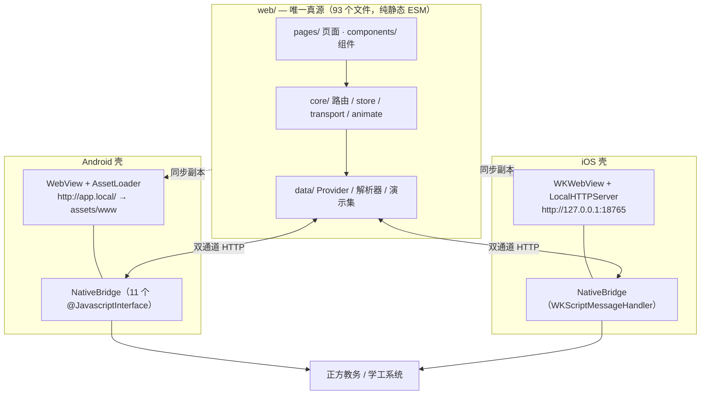

# 掌上唐师

面向唐山师范学院在校生的校园服务 App（个人开发，**非学校官方发布**）。用一套原生壳把教务系统与学工系统的常用功能装进手机：成绩、绩点、课表、推荐课表、选课、校历、奖助贷与请假。

**当前源码 v1.6.1（versionCode 14）· 已发布 Release v1.6.0** · 零第三方运行时依赖 · 纯静态 ESM，无打包步骤 · `npm run verify` 全绿

---

## 下载与安装

> **Android 用户直接去 Releases 下载，不需要自己编译。**
>
> - 始终拿最新版：<https://github.com/Chanmingfei/zstangshi/releases/latest>
> - 本次版本：<https://github.com/Chanmingfei/zstangshi/releases/tag/v1.6.0>
> - APK 直链：<https://github.com/Chanmingfei/zstangshi/releases/download/v1.6.0/ZhangShangTangShi-1.6.0.apk>

| 项目 | 值 |
| --- | --- |
| 版本 | 1.6.0（versionCode 13） |
| 文件 | `ZhangShangTangShi-1.6.0.apk`，959,011 字节（约 937 KiB） |
| 系统要求 | Android 8.0（API 26）及以上，目标 Android 14（API 34） |
| 权限 | 仅 `INTERNET`、`ACCESS_NETWORK_STATE` |
| 签名 | 本地调试密钥，与近期版本一致，**可直接覆盖安装** |
| SHA-256 | `58185d827b85cf332e281580491b39e4c894d6c83bb87fbd4b1cbb22edb561cc` |

**安装步骤**

1. 从上面的 Releases 页面下载 APK，在手机上点开。
2. 系统提示「未知来源」时，允许当前浏览器／文件管理器安装即可（调试签名、未上架应用商店，属正常现象）。
3. 已装旧版可直接覆盖，登录状态与本地数据会保留；若提示「应用未安装」，卸载旧版后重装。

校验下载完整性（可选）：

```bash
certutil -hashfile ZhangShangTangShi-1.6.0.apk SHA256   # Windows 终端
sha256sum ZhangShangTangShi-1.6.0.apk                   # macOS / Linux
```

**iOS 没有预编译包。** iOS 的可执行文件必须由 Xcode 编译，且免费 Apple ID 只能自签 7 天。两条路：

- 有 Mac：`bash ios/scripts/build-ipa.sh`，再用 Sideloadly 重签。
- 无 Mac：用 [Codemagic](https://codemagic.io) 导入本仓库，自动识别根目录 `codemagic.yaml` 产出未签名 ipa；也可用 `.github/workflows/ios-ipa.yml`。详见 [ios/README.md](ios/README.md)。

---

## 这个 App 解决什么问题

学校教务系统（正方）和学工系统都是为 PC 浏览器设计的页面：手机上要缩放、要反复登录、课表与成绩散在多个菜单里。这个 App 做三件事：

1. **把页面变成接口。** 由原生层代发 HTTP 请求，把教务返回的页面解析成结构化数据，再按手机端的信息层级重新呈现，而不是把网页塞进一个小窗口。
2. **把多系统合成一个入口。** 首页 7 个宫格直达常用功能；登录页可「仅登录学工系统」，只想办奖助贷、请假时不必登录教务；「更多功能」则在 App 内 WebView 打开原教务系统，覆盖尚未适配的长尾功能。
3. **处理移动端特有的网络问题。** 校外移动数据下教务的 443 端口常常被阻断而 80 可用，App 会自动探测并选用可用协议，避免「浏览器能开、App 登不上」。

### 功能清单

| 场景 | 功能 |
| --- | --- |
| 首页 | 今日课程、常用功能 7 宫格、下拉刷新、深浅色主题 |
| 成绩 | 按学期成绩列表、五级制文字成绩（优秀／良好…）、平时分／期末分明细、已获学分与绩点 |
| 课表 | 个人课表（周视图）、单双周精确周次、同格多课切换、板块课占位行、推荐课表、选课 |
| 本地课表 | 从教务导入后存本地；手动新建／编辑／删除课程、单周停课；**未登录、断网也能看**；导入只在唐山师范学院校本口径下做，不做多学校适配 |
| 推荐课表 | 按年级／院系／专业／班级查全校推荐课表；**一键把整份导入自己的课表**（推荐课表常比个人课表先出炉） |
| 恢复与同步 | 个人课表左上角「重新与教务同步」：以教务为准覆盖手改（二次确认 + 失败不动本地），改错了能回退 |
| 桌面小组件 | 「今日课程」默认 4×2 放在桌面上：第几周、今天几门、每门几点在哪上、哪门正在上；点一下直接进课表 |
| 日历 | 教学周换算、学期校历、自定义学期 |
| 学工 | 奖助贷、请假、综合素质（App 内 WebView 打开原站点） |
| 体验 | 冷启动加载页、应用内返回栈、骨架屏、多级字号、读屏标签、对比度 ≥ 4.5、深色模式（含小组件） |

**数据来源与账号**：正式数据来自 `jwxt.tstc.edu.cn`（正方教务）与 `sws.tstc.edu.cn`（学工系统），需要本人学号与密码；App 不保存明文密码，凭据交给系统安全区（Android `SecurePrefs` / iOS Keychain），会话 Cookie 由原生层维护。仓库内还带一套**演示数据**，浏览器里跑 `node server.js` 无需账号即可预览全部界面；演示数据是抓取失败时的降级副本，不是默认数据源。

---

## 技术逻辑

### 1. 总体架构：一套 H5，两个原生壳



- **`web/` 是唯一真源**，改功能只改这里。Android 的 `android/app/src/main/assets/www/` 是构建产物、不入库，由 `android/build-manual.sh` 第 0 步同步；iOS 的 `ios/ZhangShangTangShi/Resources/www/` 是已提交的同步副本，用 `bash ios/scripts/sync-web.sh` 刷新。
- **为什么需要虚拟源**：直接用 `file://` 加载时 origin 为 null，ESM 模块、`localStorage`、`crypto.subtle` 全部受限。Android 用 `AssetLoader`（`shouldInterceptRequest`）把 `http://app.local/` 映射到 assets，首屏用 `loadDataWithBaseURL` 灌入 HTML 以保证 origin 正确；`.js/.mjs` 的 MIME 必须是 `text/javascript`，否则 Chromium 会拒绝 `<script type="module">` 导致白屏，且找不到文件时必须返回 404 而不能 `return null`。iOS 用 Network.framework 起一个只监听 `127.0.0.1` 的本地 HTTP 服务，**固定优先端口 18765**——`localStorage` 按「scheme + host + port」隔离，端口一变主题、记住的学号、课表缓存全丢。
- `detectEnv()` 只判断 `window.NativeBridge.httpRequest` 是否为函数，因此**协议自适应、原生通道等逻辑在 iOS 壳里自动生效**，H5 不需要写 iOS 分支。

### 2. 数据层：Provider 契约与降级

`web/data/provider.js` 是「数据 → 界面」的唯一通道，页面只认 `ProviderResult`（`{ok:true,data,meta?}` / `{ok:false,error:{code,message,retryable}}`），不关心数据来自哪里。

- 所有异步方法**永不 throw**，失败一律归一成结果对象，上层不用 `try/catch`，一次网络抖动不会白屏。
- `demoProvider` 每次带 120–320 ms 随机延迟，保证骨架屏与转场在演示模式下也能被验收；`remoteProvider` 的每个异步方法对应教务的一个功能模块：`loadSlot(name)` → 抓该模块页面 → 解析 → 映射成 App 模型。
- `withFallback()` 在远程失败时降级到演示数据，并置 `meta.degraded = true`，页面据此标注「当前为缓存／演示数据」，不把编造的结论冒充实时数据。

### 3. 网络层：双通道、原生桥与协议自适应

| 环境 | 通道 | 说明 |
| --- | --- | --- |
| 浏览器预览 | `fetch` + `server.js` 的 `/jwxt/` 正向代理 | 否则跨域必被拦 |
| Android WebView | `NativeBridge.httpRequest()` | 原生代发，走系统证书／明文策略，Cookie 由 `CookieJar` 维护 |
| iOS WKWebView | `WKScriptMessageHandler` → `HTTPClient` | 等价桥协议，`reqId` 配对 Promise |

- 桥协议：JS 调 `httpRequest(reqId, url, method, headersJson, body)`，原生回 `window.__nativeHttpCallback({reqId, status, headers, body})`。超时 20 s（实测校外移动数据下教务单次请求要 15–16 s，15 s 会把「慢」误判成「不通」）。
- **手动跟随重定向**，不交给系统自动跟随：正方教务登录是两级 302，POST 会换发新的 `JSESSIONID`，自动跟随沿用旧 Cookie 会被静默踢回登录页。
- **登录**：`yhm` + RSA（PKCS#1 v1.5）加密的 `mm` + `csrftoken(uuid,uuid)` + `language`；RSA 由原生 `rsaEncrypt` 完成。多节点负载均衡会让同一凭据前两次误报「密码不正确」，重试放在 Provider 层。
- **协议自适应**（`data/jwxtOrigin.js`）：只探 `https`，通就用、不通直接降 `http`；探针用 favicon 这类静态小文件（404 也算连通），避免用 19 KB 登录页当探针时被 3 s 上限误杀。结果缓存 3 天，全失败后冷却 60 s。`WebActivity` 在主框架加载失败时也会做 http/https 互换重试。
- **端点不猜**：`data/jwxtClient.js` 维护已实测端点表（成绩、课表、推荐课表打印、选课等），未实测的一律留 `null`，命中即明确报 `NOT_IMPLEMENTED`。全部实测记录见 [docs/remote-api-map.md](docs/remote-api-map.md)。

### 4. 教务解析：纯函数、精确周次、冲突判定

`data/jwxtParse.js` 系列是零 DOM 依赖的纯解析器，页面 → 模型全靠它，因而可以脱离浏览器单测。

- **周次是课表正确性的根**。正方 `kbList` 每行同时带三份周次：`zcd`（中文文案，如 `10-16周(双)`）、`zcds`（精确列表，如 `10,12,14,16`）、`oldzc`（位掩码，第 w 周 = 第 `w-1` 位）。`data/jwxtWeekParse.js` 的 `weeksFromRow()` 按 `zcds → oldzc → zcd` 取用，生成精确 `Course.weeks`；`weekRange` / `weekParity` 一律由 `weeks` 现算，不从中文文案反推。
- `mergeSplitRows()` 合并教务按周次拆成多行的同一门课；`isPlaceholder` 标记 `pkbj === '-1'` 的板块课占位行（未排地点、0 学分）。
- `pages/timetableUtils.js` 的 `coursesInCell()` 把同格课程分成 `active`（本周有课）与 `rotating`（本周无课、周次互补的另一半），得出 `relation = single | conflict | alternating | placeholder`：**只有两门以上真实课在同一周重叠才算时间冲突**。本周该时段无课时不画任何课程卡。

### 5. 路由、返回栈与 UI 系统

- `core/router.js` 是 hash 路由，按路由 `import()` 懒加载页面；页面契约固定为 `{name, title, tab, requiresAuth, render(ctx), mount(el,ctx), unmount()}`——`render` 必须同步返回骨架保证首屏不白屏，数据在 `mount` 里异步填充。
- WebView 里 hash 导航不是可靠的「一页一条记录」：`history.back()` 会让成绩详情直接跳回 App 首页。因此用 `core/navStack.js` 的应用内返回栈实现「谁打开我，返回就回谁」，浏览器历史只作兜底。
- 样式以 `styles/tokens.css` 为**唯一颜色来源**，`base.css` 的分层重置配合组件／页面样式；动效集中在 `core/animate.js`（`stagger()` 入场、可打断转场）。课表右下角三角是课程卡的真实子节点 `.c-course__corner` 而不是格子伪元素，这样才能跟着卡片一起淡入。
- 无障碍：所有前景/背景组合对比度 ≥ 4.5（最低 4.71），读屏标签包含课程类型与单／双周信息，交互热区不小于 44 px。

### 6. 构建链与质量保障

- **Android**：`bash android/build-manual.sh` 绕过 AGP，直接用 `aapt2 + javac + d8 + zipalign + apksigner` 产出 `android/build/app-debug.apk`，零 Gradle 依赖。版本号从 `android/app/build.gradle` 读取（单一真源），`debug.keystore` 沿用同一签名以支持覆盖安装。
- **iOS**：Xcode 工程 + `project.yml`，`ios/scripts/sync-web.sh` 同步 H5 副本，云端 macOS 编译出未签名 ipa。
- **测试**：`npm run verify` 串起 7 组脚本 —— 教学周算法 214 项、绩点解析 53 项、教务解析器 144 项、本地课表 66 项（同步合并规则／编辑／单周停课／批量导入／按教务恢复／存储往返／清缓存保活）、小组件快照 36 项（节次换算／今日筛选／下发）、页面契约 45 项（10 页 / 21 样式 / 80 个 ESM，import 图零断链）、五条规则守卫（颜色字面量、外链白名单、单文件 400 行上限、校历副本一致性、对比度）。测试以纯函数为主，因此解析规则改动能被逐条断言锁住。

### 7. 本地课表与桌面小组件

教务只给「现在排成这样」，不给「老师昨天调了课」。这一层要解决的就是这件事：**课表以自己的本地数据为准，教务同步只做合并**。

- **三态来源**（`data/localTimetable.js`，纯函数、零 DOM）：`jwxt`（教务导入、未改动）、`custom`（手动新建）、`edited`（导入后被改过）。每学期一条 `zsts.timetable.<semesterId>`，`weeks` 永远是唯一真源，`weekRange` / `weekParity` 只由它现算。
- **合并规则**（`mergeImported`）：教务有本地无 → 新增；教务有、本地是 `jwxt` → 覆盖但保留配色与备注；教务有、本地是 `edited` → **保留学生版本**；教务没有、本地是 `custom`/`edited` → 保留；教务没有、本地是 `jwxt` → 删除（教务已取消这门课）。改过的课自动升级为 `edited`，下次同步不会被覆盖回去。
- **编辑体验**：周次按 1..19 逐格勾选（教务的周次是任意集合，`起止 + 单双周` 两段式装不下）、节次只选起止存连续区间、长按空白格直接在该格新建（500 ms 判定，位移 > 10 px 取消）、详情层可「本周停课」（只摘那一周）。
- **免登录**：课表页 `requiresAuth: false`，有本地数据就直接看；连本地数据都没有才回登录页 —— 否则新用户会盯着一张空课表，比登录页更费解。两个容易失效的点已经堵住：① 首屏不只查「当前学期那个 key」，还按 `readLatestLocal()` 跨学期兜底（校历跨学期、或校历没加载出来时 `semesterId` 是 undefined，只查当前 key 就会误判成「没有课表」打回登录页）；② `storage.clearAll` 默认**保留 `timetable.` 前缀**，退出登录与清缓存都不会删掉学生自己改出来的课表（那是数据，不是缓存）。
- **落盘时机**：教务课表一拿到就写本地（`appActions.loadSlot` → `data/timetableSync.js`），不依赖「用户正好打开课表页」；演示态、降级到演示数据、空课表三种情况一律不落盘。
- **桌面小组件**（Android `ClassWidget` + `WidgetData`）：H5 算好「今日课程」快照 → `NativeBridge.pushWidget(json)` → 落 `SharedPreferences` → `RemoteViews` 渲染。之所以必须落盘：小组件在 App 进程之外也要能画（开机、零点、上课时刻），那时 WebView 不存在。快照里**只下发课程类型、不下发色值**，深色模式由 `values-night` 资源决定；也**不下发「正在上」这类状态**，由原生按当前时钟现算。
- **刷新**：四条路径都不依赖精确闹钟权限 —— 系统 `onUpdate`、H5 推完立刻重画、`updatePeriodMillis` 30 分钟兜底、`AlarmManager.set`（非精确）在下一个「上课／下课／零点」边界重画。布局里只出现「正在上」「下一节 14:00」这类**在某区间内恒成立**的文案，没有「还有 12 分钟」这种一刷新就过期的倒计时，所以闹钟晚一两分钟也不会显示错。
- **尺寸与封面**：默认 **4×2**（4 列 250dp × 2 行 110dp），`maxRows()` 按实际高度现算行数（`(height-70)/26`），拉高自动多画几行。选择器封面用 `previewImage`（`drawable-nodpi/widget_preview.png`，真机渲染后裁出的圆角卡片图）—— ColorOS / HyperOS 只认这个，不认 `previewLayout`，缺了就退化成应用图标。
- **入口**：「我的 → 桌面小组件 → 添加到桌面」走 API 26+ 的 `requestPinAppWidget` 让系统弹确认框（`NativeBridge.addWidget`）；桌面不支持时给降级文案。点小组件直达课表页（`MainActivity.EXTRA_PATH` → 改写 `location.hash`，路由的 `hashchange` 就是它认识的入口）。

---

## 仓库结构

```
.
├── web/           H5 业务代码（唯一真源：core / data / pages / components / styles / assets）
├── android/       Android 工程（WebView 壳、11 个 @JavascriptInterface、桌面小组件、手动构建脚本）
├── ios/           iOS 工程（WKWebView 壳、桥接层、本地 HTTP 服务、Xcode 工程与云构建配置）
├── docs/          架构设计、PRD、接口实测记录、验收与解析器适配规格
├── tools/         纯函数单测与规则守卫脚本
├── reference/     小爱课程表学校适配脚本（设计参考，不参与构建；文件名沿用早期前缀）
├── server.js      本地预览服务器 + /jwxt/ 正向代理（仅开发时用）
└── .github/       GitHub Actions：macOS runner 编译 iOS
```

## 本地开发

```bash
node server.js          # http://127.0.0.1:5173，可用 PORT=8080 改端口；演示数据，无需账号
npm run verify          # 全部单测 + 规则守卫
bash android/build-manual.sh                    # 产出 APK
bash ios/scripts/sync-web.sh --check           # 检查 iOS 副本与 web/ 是否一致
node ios/scripts/verify-project.mjs            # 校验 Xcode 工程结构
node ios/scripts/test-bridge.mjs               # 桥协议断言
node ios/scripts/test-shell-smoke.mjs          # 按 iPhone 视口逐 Tab 冒烟
```

`package.json` 的 `dependencies` 与 `devDependencies` 都是空的；Node.js ≥ 18 只用于本地服务器和测试脚本，不参与 App 运行时。

---

## 第三方来源与致谢

**先说结论：本项目没有 fork、复制或 vendoring 任何 GitHub 仓库的代码**，没有 git submodule，运行时零 npm 依赖。课表数据与交互**同时参考了 WakeUp 课程表与小米小爱课程表**——这是两个不同产品：前者是独立第三方课程表 App，后者是小米的课程表服务。下列是被引用、参考或作为分析素材的外部来源，按性质分别列出：

| 来源 | 关系 | 说明 |
| --- | --- | --- |
| **WakeUp 课程表** · [官网](http://www.wakeup.fun/) | 数据与交互参考 | 独立的第三方课程表 App，**不是小米产品**。项目对照了它的课表数据与交互手感：课程卡配色思路、长按 500 ms 判定、详情层左右滑动切换、复制课表文案的字段顺序等（见 `courseCard.js` / `clipboard.js` / `timetableView.js` / `timetableDetail.js` 注释）。 |
| **小爱课程表**（小米）· [解析器格式文档](https://open-schedule-prod.ai.xiaomi.com/docs/#/help/?id=parser) | 解析器规范参考 | `reference/wakeup-parser-tstc.js` 是**本项目作者本人**为唐山师范学院写给小爱课程表的学校适配脚本（277 行），遵循小爱 `scheduleHtmlParser(html) → {courseInfos, sectionTimes}` 规范（出处见该文件 L268 注释）。**文件名沿用早期 `wakeup-` 前缀，容易误解：它不是 WakeUp 课程表的解析器。** 该文件只作设计参考，不参与构建与运行；移植分析见 [docs/parser-adapter-spec.md](docs/parser-adapter-spec.md)。 |
| **正方教务系统** `jwxt.tstc.edu.cn` | 页面样本与接口分析素材 | `docs/diagnostics/` 下的 jQuery 插件与页面 JS 是从教务站点抓取的原文样本，仅用于逆向确认端点与字段口径，**不参与 App 构建或运行**，版权归原系统所有。 |
| **唐山师范学院公开资料** | 数据／素材来源 | 校历来自教务处 [校历查询](https://jwc.tstc.edu.cn/xlcx.htm)，作息时间来自 [教务处公告](https://jwc.tstc.edu.cn/info/1247/2699.htm)，校徽为学校官网公开素材；校历 JSON 副本在 `docs/school-calendar.json` 与 `web/data/school-calendar.json`。 |
| **学工系统** `sws.tstc.edu.cn` | 外链入口 | 仅在 App 内 WebView 打开原页面，不解析、不复制其代码。 |
| **工具链** | 构建／分发工具，非代码引用 | Android SDK build-tools（`aapt2` / `d8` / `zipalign` / `apksigner`）、Xcode、Node.js、[Codemagic](https://codemagic.io)、[Sideloadly](https://sideloadly.io)、GitHub Actions。 |

「掌上唐师」及校徽为说明性使用，本项目与学校、正方软件、WakeUp 课程表、小米（小爱课程表）均无官方关联。

---

## 隐私与安全提示

- **本仓库是公开仓库**，`web/data/demo/user.js`、`web/pages/mine.js`、`docs/remote-api-map.md`、`docs/diagnostics/`、`tools/test-gpa.mjs` 与 `reference/wakeup-parser-tstc.js` 中含演示用的真实姓名、学号、班级、成绩统计与联系方式。若要对外分发，请先脱敏或把仓库转为私有。
- Release 中的 APK 使用本地调试密钥签名，**仅供自用／测试**，不要当作官方包传播；正式发布需更换签名。
- 演示数据与真实成绩统计仅用于界面和算法验收，**不作为学业认定依据**，一切以学校系统为准。
- 仓库尚未添加开源许可证（LICENSE），默认保留所有权利；如需开源授权请单独声明。

## 相关文档

- [docs/ARCHITECTURE.md](docs/ARCHITECTURE.md) — 完整架构、数据结构、时序图与动效系统
- [docs/remote-api-map.md](docs/remote-api-map.md) — 教务接口实测记录（端点、字段、周次、协议可达性）
- [docs/PRD.md](docs/PRD.md) / [docs/ACCEPTANCE.md](docs/ACCEPTANCE.md) — 产品需求与验收口径
- [android/README.md](android/README.md) / [ios/README.md](ios/README.md) — 双端构建细节
- [Releases](https://github.com/Chanmingfei/zstangshi/releases) — 各版本安装包与更新说明
