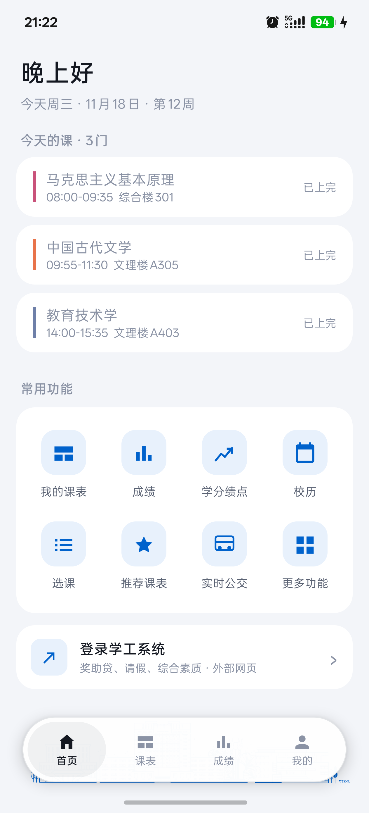
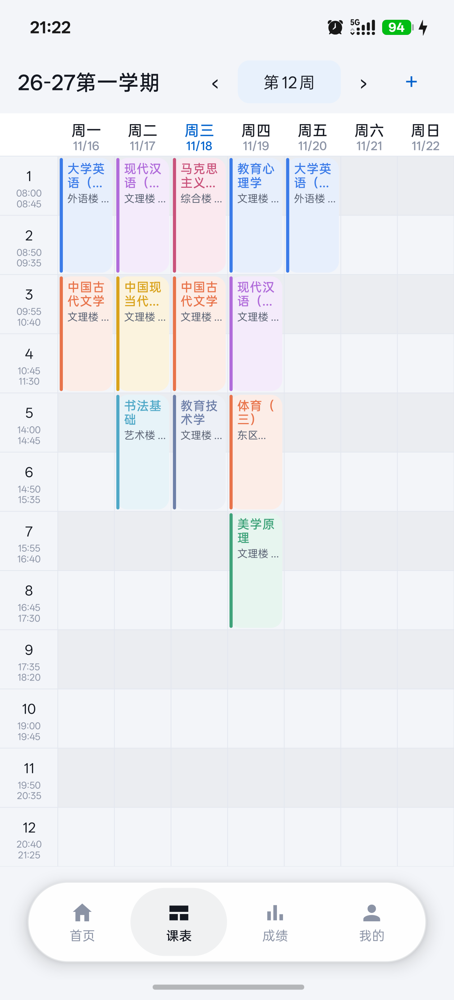
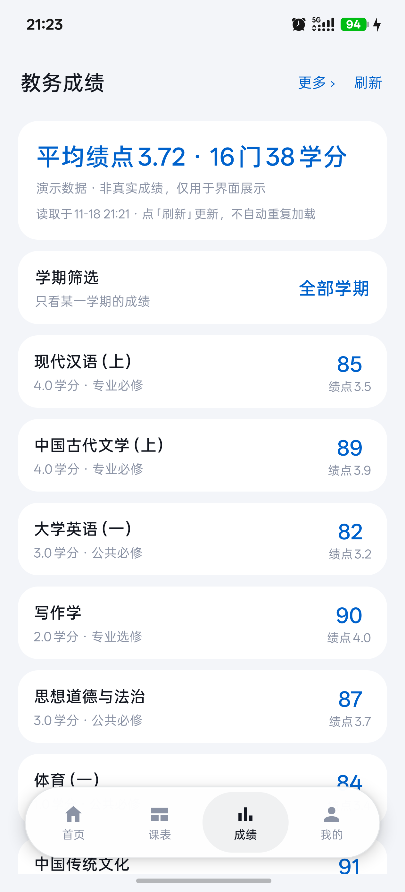
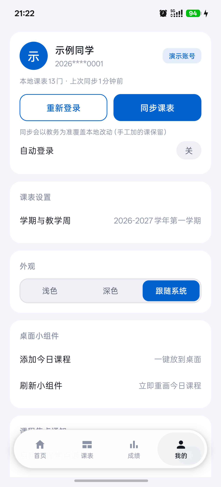
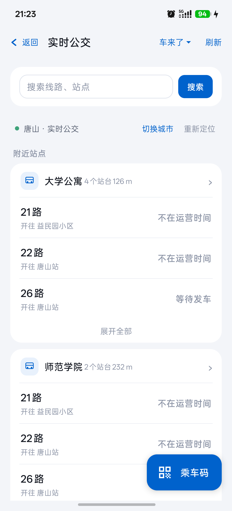
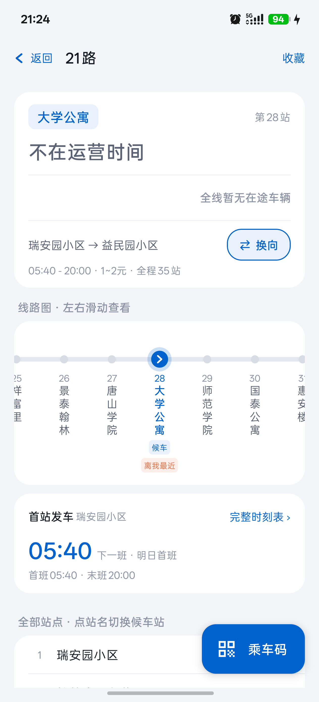
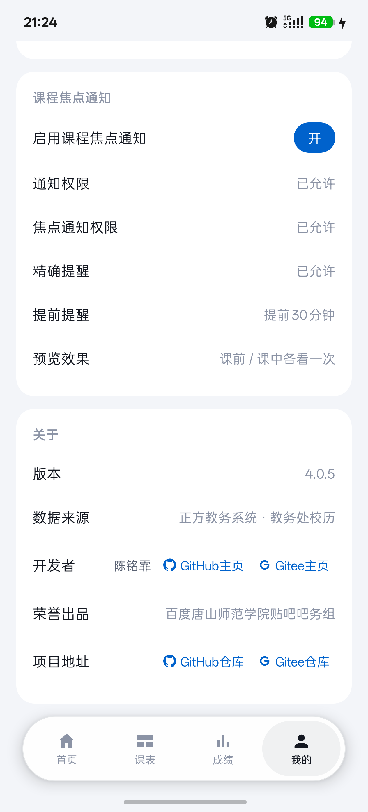
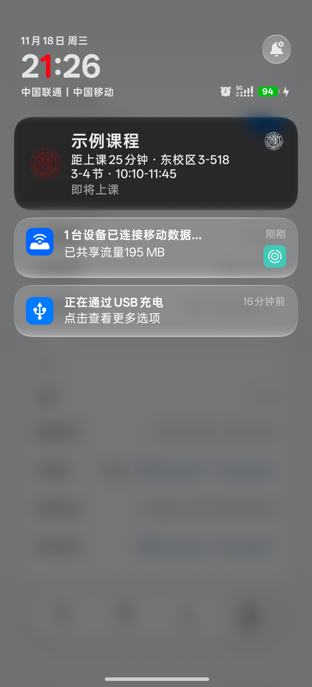

<div align="center">

<picture>
  <source media="(prefers-color-scheme: dark)" srcset="docs/assets/school-logo-dark.png" />
  
</picture>

# 掌上唐师 · ZSTangshi

**唐山师范学院校园服务 · 课表 / 成绩 / 实时公交**

<p>
  <a href="https://github.com/Chanmingfei/zstangshi/releases/latest">
    
  </a>
  <a href="https://developer.android.com">
    
  </a>
  <a href="harmony-android">
    
  </a>
  <a href="https://kotlinlang.org">
    
  </a>
  <a href="native/build.sh">
    
  </a>
  <a href="LICENSE">
    
  </a>
</p>

<p>
  <a href="README.md"><b>简体中文</b></a> · <a href="README.en.md">English</a>
</p>

</div>

---

> 把教务系统、学工系统和校门口的实时公交，装进一个 **3.5 MB** 的 APK。
> 纯 Android framework 手写，不引 androidx、不引 Gradle、运行时零第三方依赖，
> 一条 `bash native/build.sh` 直接出可安装包。
>
> **当前版本**：标准版 **v4.0.7**（66）· 鸿蒙专版 **v4.1.2-harmony**（67）·
> 新增**启动自动检查更新**（可「忽略此版本」）与**课程实况窗** ——
> 上课信息推到鸿蒙实况窗、ColorOS 流体云、小米焦点通知与 Android 16 实况通知。

---

## 📸 界面预览

| 首页 | 课表 | 成绩 | 我的 |
| :---: | :---: | :---: | :---: |
| <br/>首页 | <br/>课表 | <br/>成绩 | <br/>我的 |
| <br/>实时公交 | <br/>线路详情 | <br/>课程实况窗设置 | <br/>实况窗（ColorOS 流体云） |

> 截图取自**演示账号**（示例同学 · 2026\*\*\*\*0001），姓名、学号、成绩均为示例数据。
> 公交截图拍于 21:24，末班已过，因此显示「不在运营时间」。

---

## 📥 下载与安装

**先确认手机系统，再选包。**

| 你的设备 | 下载 | 认准这些标识 |
| --- | --- | --- |
| **鸿蒙 / HarmonyOS**<br>华为、荣耀新机型 | **[⬇ 鸿蒙专版（实况窗版）](https://github.com/Chanmingfei/zstangshi/releases/tag/harmony-v4.1.2)**<br>`zstangshi-harmony-4.1.2.apk` | 桌面名 **掌上唐师·鸿蒙版**<br>关于页有「版本类型：鸿蒙专版」 |
| **普通安卓**<br>小米 / OPPO / vivo / 三星 / 一加 | **[⬇ 标准版](https://github.com/Chanmingfei/zstangshi/releases/tag/v4.0.7)**<br>`zstangshi-v4.0.7.apk` | 桌面名 **掌上唐师**<br>关于页无「版本类型」行 |

最新版永远在 <https://github.com/Chanmingfei/zstangshi/releases/latest>。

### 不确定自己是不是鸿蒙

打开 **设置 → 关于手机**：

- 看到「HarmonyOS 版本」或「鸿蒙版本」→ 装**鸿蒙专版**
- 看到「Android 版本」或「MIUI / ColorOS / OriginOS / One UI」→ 装**标准版**

### 两个版本的区别

**功能对齐，实现各自独立。** 鸿蒙专版从 4.1.0 起按鸿蒙的能力边界改造，允许与标准版分叉演进，避免互相牵制。

| | 标准版 | 鸿蒙专版 |
| --- | --- | --- |
| 功能 | 全部 | 全部 |
| 版本 | 4.0.7（66） | 4.1.2-harmony（67） |
| 桌面名 | 掌上唐师 | **掌上唐师·鸿蒙版** |
| 包名 | `com.tstc.zstangshi` | `com.tstc.zstangshi`（故意相同，保留课表与登录态） |
| 课程实况窗 | Android 实况通知协议 | **实况窗协议 + 常驻倒计时双档降级** |
| 鸿蒙登录兼容 | 会闪退 | 已修复 |
| 源码 | [`native/`](native/) | [`harmony-android/`](harmony-android/) |
| 体积 | 3.60 MiB | 1.69 MiB |

### 安装

1. 从 Releases 下载 APK，在手机上点开。
2. 提示「未知来源」时允许当前浏览器／文件管理器安装 —— 调试签名、未上架商店，属正常现象。
3. 已装 v3.x 可直接覆盖，登录状态与本地课表保留；若提示「应用未安装」，卸载旧版后重装。

> **国内网络下载 GitHub 附件经常超时，可走 Gitee 镜像：**
> [gitee.com/mingfei123/zstangshi/releases](https://gitee.com/mingfei123/zstangshi/releases)
> —— 两个仓库的 Release 内容一致，App 内「检查更新」也会优先走 Gitee。

> **⚠️ 鸿蒙专版会与标准版签名冲突。** 两版包名相同、签名不同，系统会拒绝覆盖安装。
> 先卸载旧版 → 装鸿蒙专版 → 重新登录一次。**卸载会清掉本地课表与登录态。**

校验下载完整性（可选）：

```bash
certutil -hashfile zstangshi-v4.0.7.apk SHA256   # Windows
sha256sum zstangshi-v4.0.7.apk                   # macOS / Linux
```

| 包 | 大小 | SHA-256 |
| --- | --- | --- |
| `zstangshi-v4.0.7.apk` | 3,771,518 B | `ad155743…46e59ddc6` |
| `zstangshi-harmony-4.1.2.apk` | 1,768,581 B | `17fd08c6…3093bbcef` |

---

## 📖 这是什么

教务网页版在手机上要「横屏 + 缩小 + 反复缩放」，查一次课表得点三层菜单；最后一节课的教室总记不住；
明天有没有课，得翻教学周历对着数是第几周；门口的公交到哪了，还得打开地图 App 重新搜站名。

这个 App 把这些摊平到第一屏：解锁就能看到「今天第 3 门课在 3-518」，
通勤路上点开就是「21 路还有 3 站，7 分钟到」。

**它没有开屏广告，没有信息流，不申请与功能无关的权限。**

---

## ✨ 功能

### 首页

- **问候与教学周**：按时间给问候语，右上角直接标「第 12 周」，不用自己数。
- **今日课程**：时间轴列出今天的课，正在上的课高亮并带下课倒计时；没课的日子给一句休息提示。
- **8 格功能宫格**：课表、成绩、学分绩点、校历、选课、推荐课表、实时公交、更多。
- **学工系统入口**：奖助贷、请假、综合素质，一条链接进原页面。

### 课表

- 四色课程块，**单双周**、**冲突并排**、**点击编辑**。
- 左右滑动翻周，顶部一键回到本周；节次与作息时间同屏对照。
- 支持手动加课、停课、调课 —— 这些**不会被「同步课表」冲掉**。

### 成绩与绩点

- 按学期筛选，逐门列出成绩、学分、课程性质、绩点。
- 明细分项（平时 / 期末）与占比一并显示，成绩来源与查询时间写在顶部。
- 学分绩点页单独汇总，支持按学期看变化。

### 校历

- 月视图 + 教学周次，法定节假日与调休补课日标注。
- 校历数据来自教务处公开校历，学期开始日、考试周都能对上。

### 实时公交

- **附近站点**：按距离列出站台，直接展开多条线路的到站预测；一个站多个站台也能分开看。
- **线路详情**：竖向站线，标出候车站、在途车辆位置与「离我最近」；支持换向、全部站点列表。
- **到站预测**：大字倒计时 +「几站 / 几公里」，到站文案统一口径，首页与详情页不会互相打架。
- **首站发车时刻表**：下一班发车、今日分时段预测、昨日实际班次。
- **搜索与收藏**：拼音、汉字模糊匹配；收藏线路按站点分组。
- **乘车码**：右下角悬浮按钮，与滚动联动收放（小程序码入口，需自行在微信中打开）。
- 20 秒轮询刷新，进页面即取最新数据。

### 课程实况窗 ⭐

- **课前 N 分钟**把课程推上系统胶囊：ColorOS 流体云（超级岛）、小米焦点通知、鸿蒙实况窗、Android 16 实况通知。
- 收起态显示「课程名 · 地点」；上课后切成秒级倒计时，课间单独计时。
- 上课中、课间、下一节，全部按边界时刻自动切换，不常驻后台、不耗电。
- 划掉本节即「本次不再提醒」，到下课自动失效。
- 提前提醒时长、权限状态、效果预览都在「我的 → 课程实况窗」。

实现原理与「套用到自己项目」的步骤见下方 **「课程实况窗的实现」** 一节。

### 教务与学工

- 正方教务系统登录（RSA 加密密码），课表同步、成绩查询、学分绩点、自主选课、推荐课表。
- 自动登录、记住密码可选；切账号整体覆盖，同步课表保留手工改动。
- 学工系统走应用内 WebView 打开原页面，不解析、不留存。

### 更新

- **启动自动检查**：每次打开 App、且有网络时，在后台查一次 —— 延后 2.6 秒、低优先级线程，
  不挡首屏渲染、不抢自动登录的资源；同一个进程只查一次，切页、换深色、回前台都不会重复查。
- **有新版本才提示**：弹层给出日期、体积和几行更新说明，三个出口「立即更新 / 稍后 / **忽略此版本**」。
  忽略的是**这个版本号**：自动检查照常进行，等更高的版本发布再提醒。
- **连不上就安静**：自动检查失败不弹任何东西，想确认版本可以走「我的 → 关于 → 检查更新」，
  那里一直可用，并且会说明失败原因。
- **国内可用**：检查走 Gitee / GitHub / gh-proxy 三源并发，下载前对三条地址测速挑最快的一条，
  不需要代理；三源都不通时还能一键打开发布页手动下载。

---

## 🏗️ 工程结构

```text
.
├── native/            ★ Android 标准版（主线，纯 Kotlin + 纯 framework）
│   ├── app/src/main/kotlin/com/tstc/zstangshi/
│   │   ├── MainActivity.kt …       Activity 壳与生命周期（8 文件）
│   │   ├── jw/                     正方教务：登录 / 课表 / 成绩 / 绩点 / 选课
│   │   ├── bus/                    实时公交：车来了 + 掌上公交两套协议
│   │   ├── data/                   课表模型 / 校历 / 作息 / 周次 / 合并 / 存储
│   │   ├── notif/                  课程实况窗：计划 / 通知 / 调度 / 广播 / 反射
│   │   ├── pages/                  四个主页面与各类编辑器
│   │   ├── ui/                     自绘控件（胶囊 Dock / 课表网格 / 页面带 / 弹层）
│   │   ├── update/                 检查更新 / 多源测速下载 / 启动自动检查
│   │   └── widget/                 桌面小组件
│   ├── build.sh                    出 APK（aapt2 + kotlinc + d8 + apksigner）
│   └── typecheck.sh                只做类型检查
│
├── harmony-android/   ★ 鸿蒙专版（实况窗适配 + 兼容层加固，独立演进）
├── docs/              架构、PRD、接口实测、截图素材、校历
├── web/ · android/ · tools/ · server.js   legacy · v2 的 H5 与 WebView 壳
└── reference/         小爱课程表学校适配脚本（设计参考，不参与构建）
```

约定：

- **页面无状态化**：数据在 `data/` 的 Store 里，页面只负责读与画。
- **动效统一走页面带**：切页是整条 `PageDeck` 平移，二级页是圆角卡片转场，不各写一套。
- **通知只认一套协议**：不为每家 ROM 写一套，见下文。
- **两版允许分叉**：业务逻辑保持同步，平台能力各自实现。

---

## 🛠️ 技术栈

| 层面 | 选择 | 为什么 |
| --- | --- | --- |
| 语言 | Kotlin 1.9.24 | 空安全、扩展函数、`when` 表达式，比 Java 少约 30% 样板 |
| UI | 纯 `android.view` + `Canvas` 自绘 | 不引 androidx / Material，每个像素自己控制 |
| 异步 | `Thread` + `runOnUiThread` | 不引协程框架；`bus/` 内部例外 |
| 网络 | `HttpURLConnection` | 只需要「带 Cookie 的 GET/POST + 跟随 302」 |
| 存储 | `SharedPreferences` | 键值对够用，不引 Room / SQLite |
| 加密 | `javax.crypto` | RSA 加密密码、AES 解密公交响应、MD5 签名 |
| 构建 | `aapt2` + `kotlinc` + `d8` + `apksigner` | 不依赖 Gradle / maven.google.com |
| 通知 | Notification API + 反射 | 编译 SDK 锁 34，API 36 接口运行时探测 |

**运行时依赖：0。** 除 Kotlin 标准库外没有任何第三方库。

```text
60 个 Kotlin 文件 · 24,190 行

jw/        3 文件  1,745 行   正方教务接口
bus/       7 文件  4,517 行   实时公交（两套协议）
data/     15 文件  2,928 行   课表 / 校历 / 作息 / 周次 / 存储
notif/     5 文件    953 行   课程实况窗
pages/     6 文件  3,446 行   主页面与编辑器
ui/       13 文件  2,754 行   自绘控件
widget/    3 文件    337 行   桌面小组件
根目录      8 文件  7,510 行   Activity 壳与生命周期
```

### 为什么不用 androidx / Gradle

不是「秀技术」，是构建环境的硬约束：开发机访问不了 `maven.google.com`，Gradle 拉不到 AGP 和 androidx。
既然拉不到，就全部用 framework API 重写。

意外的好处：**APK 只有 3.5 MiB**（同类 App 通常 8–15 MiB）、**20 秒出包**、**没有依赖冲突**。
代价是所有控件都得自己画 —— 这就是 `ui/` 那 2,754 行的由来。

---

## 🚀 本地构建

需要 **JDK 17** + **Android SDK**（build-tools 34.0.0 + platform android-34）+ **Kotlin 编译器 1.9.24**。

```bash
# 标准版
bash native/typecheck.sh                      # 只做类型检查，快
bash native/build.sh                          # → android/build/app-debug.apk

# 鸿蒙专版
cd harmony-android
bash native/build.sh
node scripts/check-java-api.js native/build/dex/classes.dex   # 扫 Java 9+ API 引用
```

版本号只在 `native/version.properties` 一处维护（`versionCode=66` / `versionName=4.0.7`）。

> **⚠️ 工程路径不能含中文** —— `aapt2` 会报 `failed to open directory`。两个版本都要放在纯 ASCII 路径下编译。

legacy（v2）仍可运行：

```bash
node server.js                                # 本地预览 http://127.0.0.1:5173
npm run verify                                # v2 单测 + 规则守卫
```

---

## 📡 课程实况窗的实现

系统厂商的叫法五花八门，**协议只有一个**：写 Android 的实况通知，系统自己决定长什么样。

| 厂商 / 系统 | 用户看到的名字 | 开发者拿到的接口 |
| --- | --- | --- |
| Android 16 原生 | 实况通知（Live Updates） | `setShortCriticalText` + `requestPromotedOngoing` |
| 鸿蒙 HarmonyOS 5 | 实况窗 | 同名协议的 Android 兼容层 |
| OPPO ColorOS 16 | 流体云 / 超级岛 | 系统侧映射 |
| 小米 HyperOS 3 | 焦点通知 | 系统侧映射 |
| 华为 HarmonyOS 4.x | 实况窗（ArkUI 原生能力） | ❌ APK 调不到 → 走降级形态 |

### 一条通知怎么变成实况窗

```kotlin
val builder = Notification.Builder(ctx, CHANNEL_ID)
    .setContentTitle(courseName)          // 第一行：课程名
    .setContentText(mainLine)             // 主行：距上课 25 分钟 · 东校区 3-518
    .setSubText(phaseLabel)               // 副文本：即将上课 / 上课中 / 课间
    .setSmallIcon(R.drawable.ic_focus_emblem)        // 岛上图标（单色 alpha 遮罩）
    .setLargeIcon(colorEmblem)                       // 通知栏大图（彩色）
    .setOngoing(true)                     // 不可划掉
    .setOnlyAlertOnce(true)               // 反复重发不响铃
    .setTimeoutAfter(deadline - now)      // 到点自动消失

builder.addExtras(Bundle().apply {        // ① 请求提升为实况通知
    putBoolean("android.requestPromotedOngoing", true)
})
builder.setShortCriticalText("$courseName · $place")   // ② 胶囊短文本（API 36）
builder.setColorized(true)                             // ③ 部分版本要求 colorized 才肯提升
```

**编译 SDK 34 也能用。** 本工程构建链锁在 android-34，API 36 的接口全部走反射，失败就静默降级成普通通知：

```kotlin
fun setShortCriticalText(builder: Notification.Builder, text: CharSequence): Boolean {
    if (Build.VERSION.SDK_INT < 36) return false
    return try {
        Notification.Builder::class.java
            .getMethod("setShortCriticalText", CharSequence::class.java)
            .invoke(builder, text)
        true
    } catch (t: Throwable) { false }   // 低版本 / 精简 ROM 直接跳过
}
```

### 字段落位表（踩坑最集中的地方）

同一个字段在不同 ROM 上渲染位置不同，下表是实测结果：

| 想显示的内容 | 放哪个字段 | 实测表现 |
| --- | --- | --- |
| 课程名 | `setContentTitle` | 第一行（所有 ROM 都认） |
| 剩余时间 + 地点 | `setContentText` | 实况窗主行 |
| 阶段标签 | `setSubText` | 副文本行 |
| 节次 / 上下课时间 | `bigText` 第二行 | 详情行 |
| 收起态短文本 | `setShortCriticalText` | 胶囊右侧 |

> **地点只写一次。** 我们踩过：地点同时写进 `contentText` 和 `subText`，
> ColorOS 在「文本形态」下会把两处都画出来，展开后地点重复两遍。
> 现在固定只有主行带地点，`subText` 只放阶段标签。

### 三个绕不过去的系统限制

1. **`setUsesChronometer` 是全局开关**：它同时管「展开态大号倒计时」和「收起态胶囊显示计时器还是文字」，
   没有 API 能只关一处。所以课前关掉计时器换文字胶囊，上课后再打开。
2. **胶囊只有一个文本槽**：「课程名 + 地点」和「倒计时」只能二选一，做不出左右并排。
3. **通知必须有终点**：`setTimeoutAfter` 用剩余时间，`deadline` 变了必须重发，否则会在错误时刻消失。

```kotlin
// 课前：关计时器 → 胶囊显示「课程名 · 地点」，代价是展开态大数字也没了
builder.setShowWhen(false); builder.setUsesChronometer(false)
builder.setShortCriticalText("$courseName · $place")

// 上课中 / 课间：开计时器 → 秒级走秒
builder.setShowWhen(true); builder.setWhen(deadline); builder.setUsesChronometer(true)
```

课前的「距上课 25 分钟」是**自己算的文本**，靠每分钟一次的 tick 闹钟刷新，不会停在旧数字上。

### 调度：边界闹钟 + 每分钟 tick

课程状态只有三个，切换点都是确定时刻，用 `AlarmManager` 在边界醒来重算即可，不需要常驻服务：

```text
课前 N 分钟 ──→ 上课 ──→ 下课（或课间）──→ 下一节上课 ──→ 下课
   UPCOMING      IN_CLASS      BREAK          IN_CLASS      （通知结束）
```

```kotlin
if (Build.VERSION.SDK_INT >= 31 && !am.canScheduleExactAlarms()) {
    am.setAndAllowWhileIdle(AlarmManager.RTC_WAKEUP, at, pi)      // 无精确权限 → 降级
} else {
    am.setExactAndAllowWhileIdle(AlarmManager.RTC_WAKEUP, at, pi) // 准点
}
```

再叠三件事：

- **每分钟 tick**：只在课前阶段跑，下一个整分钟 +2s 唤醒，进入上课自动取消。
- **划掉屏蔽**：`setDeleteIntent` 收到 `ACTION_DISMISS` → 本节内不再提醒，用 `lessonEnd` 过期。
- **状态对齐**：`BOOT_COMPLETED`、`TIME_SET`、`MY_PACKAGE_REPLACED` 重新排闹钟。

课程数据直接复用 `DayPlan.of()`，**调课、停课、补课、自定义作息都能正确参与**，不用为通知另算一遍课表。

### 权限是两套，别混

| 权限 | protectionLevel | 怎么申请 | 没开的后果 |
| --- | --- | --- | --- |
| `POST_NOTIFICATIONS` | dangerous | 运行时弹窗（Android 13+） | 通知根本发不出来 |
| `POST_PROMOTED_NOTIFICATIONS` | `normal\|appop` | ❌ 运行时弹窗无效 | 通知能发，但**永远不会被提升** |
| `SCHEDULE_EXACT_ALARM` | appop | 跳系统授权页 | 闹钟退化为不精确，晚几分钟 |

第二条最容易搞错 —— 它**安装时就已授予**，真正的闸门是 AppOp。所以 UI 上必须**分开显示两行状态**，
未允许时点一下直达设置页（`APP_NOTIFICATION_PROMOTION_SETTINGS` → `ACTION_APP_NOTIFICATION_SETTINGS` → 应用详情，三级降级），
返回时用 `onResume` 续上流程，别让用户再点一遍开关。

### 鸿蒙：两档降级

鸿蒙的 Android 兼容层版本跨度很大，**不能只看 `SDK_INT`**：

| 设备 | 兼容层 | 判定 | 呈现 |
| --- | --- | --- | --- |
| HarmonyOS 5.x | API 36+ | `MODE_LIVE` | 实况窗协议直连 |
| HarmonyOS 4.x / 3.x | API 29~33 | `MODE_PERSISTENT` | 常驻通知 + 系统计时器，等效实况窗 |
| 通知被关闭 | — | `MODE_NONE` | 提示去开通知 |

鸿蒙原生「实况窗」是 ArkTS（LiveViewKit / 服务卡片）能力，**APK 创建不了**。
`MODE_PERSISTENT` 就是这种设备上的等效做法：`setOngoing(true)` 不可划掉 +
`setUsesChronometer(true)` 交给系统走秒 + `setVisibility(VISIBILITY_PUBLIC)` 锁屏可见。
设置页会把当前形态写出来（`显示形态：常驻倒计时 · 等效实况窗`），用户不会以为功能没生效。

### 套用到自己的项目（约 30 分钟）

1. **拷 5 个文件**：`native/app/src/main/kotlin/com/tstc/zstangshi/notif/`
   （`Api36` / `FocusPlan` / `FocusNotification` / `FocusController` / `FocusReceiver`，鸿蒙版再加 `HarmonyLive`）
2. **改数据入口**：`FocusPlan.build()` 里把 `DayPlan.of(...)` 换成你的课表模型，
   输出 `Reminder{title, place, detail, phase, deadline, lessonEnd}`
3. **Manifest**：4 个权限 + `.notif.FocusReceiver`（`BOOT_COMPLETED` 等 5 个 action）
4. **图标**：一张单色带 alpha 的 PNG（透明底、图形纯白），出 24/36/48/72/96px 五个密度做 `smallIcon`，
   系统按深浅色自动染色；另留一张彩色版给 `largeIcon`
5. **设置页**：开关 + 提前分钟数 + 两行权限状态 + 「预览效果」（能立刻验形态，不用等真实课程）
6. **验证**：先点「预览效果」看形态，再等一节真实课看边界切换

> 调试建议：把 `preview()` 做成可指定阶段（课前 / 课中），比改系统时间快得多。

---

## 🔌 数据协议速查

自己做类似校园 App 时，这些协议事实可以直接复用。协议随时可能变，
常量都集中在 `jw/JwClient.kt`、`bus/ChelaileClient.kt`、`bus/MygolbsClient.kt` 顶部。

**正方教务系统**

| 项 | 值 |
| --- | --- |
| 主机 | `jwxt.tstc.edu.cn`（**不是** `jwglxt`） |
| 登录入口 | `/xtgl/login_slogin.html` |
| 公钥接口 | `/xtgl/login_getPublicKey.html` → `{"modulus","exponent"}` |
| 密码加密 | `RSA/ECB/PKCS1Padding`，加密密码原文 |
| 登录表单 | `yhm` / `mm`（密文）/ `hidMm` / `csrftoken` / `language` / `mmsfjm` |
| 成功判定 | 再拉 `/xtgl/index_cxMenuList.html`，必须含 `gnmkdm` |
| 会话 | `JSESSIONID` Cookie，约 10 分钟有效 |

**车来了（实时公交）**

| 项 | 值 |
| --- | --- |
| 接口 | `https://web.chelaile.net.cn/api` |
| 签名 | 参数按插入顺序拼 `"k"="v"&…`，加盐 `qwihrnbtmj`，MD5 小写 → `cryptoSign` |
| 响应壳 | `**YGKJ{"jsonr":{"data":{"encryptResult":"…"}}}` |
| 解密 | Base64 → `AES-256/ECB/PKCS5Padding`，密钥 32 个 ASCII 字符 |
| 唐山 cityId | `056` |

**掌上公交（备用数据源）**

| 项 | 值 |
| --- | --- |
| 接口 | `POST https://h5.mygolbs.com/ApiData.do` |
| 必需头 | `Origin` / `Referer` |
| CMD | `101` 城市 / `103` 站表+首末班 / `104` 实时车辆 / `105` 站点线路 / `106` 附近站点 |

---

## 🌱 换一所学校

大部分逻辑是通用的，换学校主要改这几处。

### 必须改的（约 10 分钟）

| # | 文件 | 改什么 |
| --- | --- | --- |
| 1 | `jw/JwClient.kt` 顶部 | `HOST` 改成你学校教务的主机名 |
| 2 | `res/values/strings.xml` | `app_name`、学校名 |
| 3 | `native/version.properties` | `versionCode` / `versionName` |
| 4 | `res/mipmap-xxxhdpi/ic_launcher.png` | 应用图标 |
| 5 | `res/drawable-nodpi/login_badge.png` | 登录页校徽 |
| 6 | `data/AcademicCalendar.kt` | 学期开始日、考试周、节假日 |

### 可能要改的

- **同样是正方教务（jwxt 系）** → 大概率开箱即用，只需改 `HOST`；
  课表字段 `kcmc` / `xqj` / `jcor` / `zcd` 是正方标准字段。
- **其他教务系统（青果、强智、URP、金智等）** → 重写 `jw/JwClient.kt` 的登录与
  `data/JwglxtFetcher.kt` 的解析；`data/` 下的课表模型、周次计算、作息、存储都是通用的。

### 不用改的

| 模块 | 为什么通用 |
| --- | --- |
| `data/Timetable.kt` · `WeekRange.kt` · `WeekMath.kt` | 课表结构与周次表达式与教务系统无关 |
| `data/Store.kt` · `ui/` 全部 | 本地存储与自绘控件都与业务无关 |
| `bus/` 全部 | 车来了与掌上公交是全国性服务，只改 `DEFAULT_CITY_ID` |

```kotlin
// bus/ChelaileClient.kt
const val DEFAULT_CITY_ID: String = "056"   // 唐山；换成你所在城市的编号
```

城市编号可从 `https://web.chelaile.net.cn/wwd/ncitylist` 查到（`ChelaileClient.cities()` 已封装）。

### 建议的改动顺序

1. 先只改校名和图标，编译能装上、界面正常显示
2. 再改 `HOST`，试登录能不能成功（这一步最容易卡住）
3. 登录通了再看课表能不能解析
4. 最后改校历、作息

> 每改一步就编译一次。教务协议出问题时，一次只改一件事才能快速定位。

---

## ❓ 常见问题

**装不上 / 提示「应用未安装」**
签名不同。先卸载旧版再装；鸿蒙专版与标准版包名相同，必须二选一。

**收不到课程实况窗**
去「我的 → 课程实况窗」看两行状态：通知权限、实况窗权限。后者只能在系统设置里开，
点状态行会直达对应页面。标准版还需 Android 16（API 36）及以上。

**实况窗只有倒计时，没有课程名**
收起态只有一个文本槽。课前显示「课程名 · 地点」，上课后才是倒计时 —— 这是系统限制，不是 bug。

**同步课表把我的课冲掉了**
4.0.5 起改为「教务为准、手工保留」：`source=custom` 的课与手动调停课不会被覆盖；
切换账号仍会整体覆盖（这是预期行为）。

**鸿蒙上一点登录就闪退**
装鸿蒙专版。标准版用了三处鸿蒙兼容层没有的 Android 专有 API，且是 `Error` 而非 `Exception`，
`catch` 抓不住。崩溃日志在 `Android/data/com.tstc.zstangshi/files/crash/harmony-*.log`。

**公交数据不动 / 显示等待发车**
数据来自第三方公开接口，可能限流或变更。下拉刷新或稍后重试；首班前显示「等待发车」属正常。

---

## 🔐 隐私与安全

- 登录密码 RSA 加密后提交给教务，本地可选保存（SharedPreferences），**不上传任何第三方服务器**；
  所有教务请求只到学校域名。
- **实时公交与更新检查是仅有的两处对外请求**：公交只把坐标发给数据服务商用于查附近站点，
  不携带学号、姓名等身份信息（可拒绝定位，改用手动搜索线路）；更新检查只读取 Releases 的
  版本号与安装包地址，不上传任何本机信息，也不携带设备标识。
- 公开仓库中的 `docs/` 含演示用样本数据，如需大范围对外分发请先脱敏。
- Release 中的 APK 使用本地调试密钥签名（与 v3.x 一致，可直接覆盖升级），**未上架应用商店**；
  请只从本仓库 Releases 下载。
- 公交到站时间为服务商预测，仅供参考，以实际车辆为准。

---

## 🙏 致谢

本项目**没有 fork、复制或 vendoring 任何 GitHub 仓库的代码**，没有 submodule，运行时零第三方依赖。

| 来源 | 关系 |
| --- | --- |
| [**追客 Trackr**](https://github.com/5151561/Trackr)（MIT） | 4.0.0 起实时公交的交互与文案口径参考：线路主卡三态、到站文案、乘车码悬浮按钮、站线光晕。在纯 framework 的 View 体系里自行重写，未复制源码、未引入依赖。 |
| [**烫梨 tangli**](https://github.com/augustlies/tangli)（GPL-3.0） | 本地课表、桌面小组件、免登录查看的产品思路；底部悬浮胶囊导航按其视觉语言用 Kotlin 重写。 |
| **WakeUp 课程表** | 课程卡配色、课程详情层与复制课表文案的字段顺序参考（与小米无关）。 |
| **小爱课程表**（小米） | `reference/wakeup-parser-tstc.js` 是为本校写的小爱解析器适配脚本，仅作设计参考，不参与构建。 |
| **正方教务系统** | 页面样本与接口分析；`docs/diagnostics/` 下为抓取原文，仅用于逆向确认端点与字段。 |
| **唐山师范学院** | 校历、作息来自教务处公开资料；校徽与校园素材为学校公开素材。 |
| **车来了 / 掌上公交** | 实时公交数据来源，版权归原数据提供方。 |
| **工具链** | Android SDK build-tools、Kotlin 编译器、GitHub Actions。 |

「掌上唐师」及校徽为说明性使用，本项目与学校、正方软件及各厂商均无官方关联。

---

## 📄 许可证

本项目以 **GNU General Public License v3.0** 开源，全文见 [LICENSE](LICENSE)。

| 你可以 | 你必须 | 你不能 |
| --- | --- | --- |
| 自由使用、修改、分发 | 保留版权声明与许可证 | 把修改后的版本闭源分发 |
| 用在商业场景 | 衍生作品同样以 GPL-3.0 开源 | 用作者名义为衍生品背书 |
| 私有地自己改着玩 | 说明修改内容与日期 | 附加额外限制条款 |

> 只想**参考实现思路**（比如实况窗那套「反射 + 降级」写法）拿去写自己的项目没问题；
> 直接复用本仓库代码时请遵循 GPL-3.0。

---

## 🔗 相关文档

- [CHANGELOG.md](CHANGELOG.md) — 逐版本、逐条修补的完整更新日志
- [native/README.md](native/README.md) — 标准版：构建、目录、自绘控件与踩坑
- [harmony-android/README.md](harmony-android/README.md) — 鸿蒙专版：兼容性问题分析、加固清单、构建与自检
- [docs/ARCHITECTURE.md](docs/ARCHITECTURE.md) — 架构、数据结构与动效系统
- [docs/RELEASE.md](docs/RELEASE.md) — 发版流程：GitHub 发布后自动同步 Gitee（含 `GITEE_TOKEN` 配置）
- [docs/remote-api-map.md](docs/remote-api-map.md) — 教务接口实测记录
- [Releases](https://github.com/Chanmingfei/zstangshi/releases) — 安装包与更新说明
- [English README](README.en.md) — English version

---

<div align="center">

**开发者**：陈铭霏 · **荣誉出品**：百度唐山师范学院贴吧吧务组

个人开发项目，**非学校官方发布** · 校历数据来自 [教务处](https://jwc.tstc.edu.cn/)

</div>
