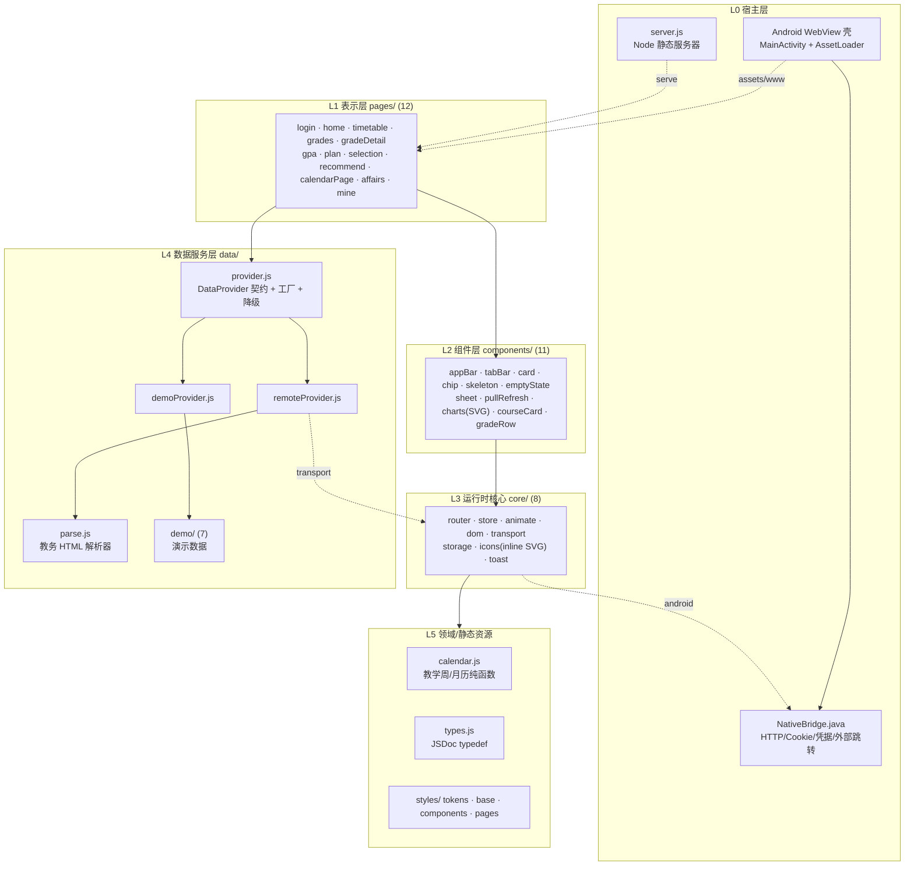
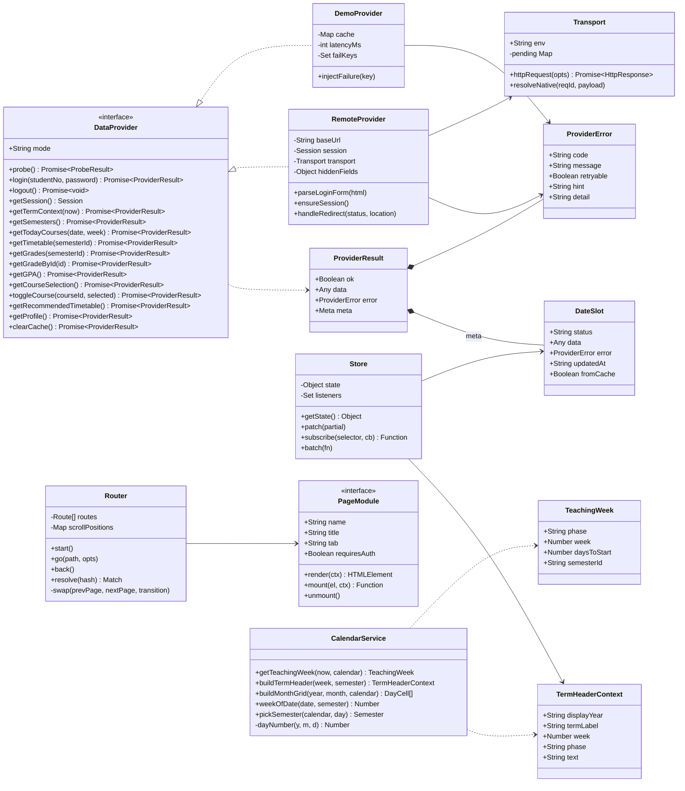
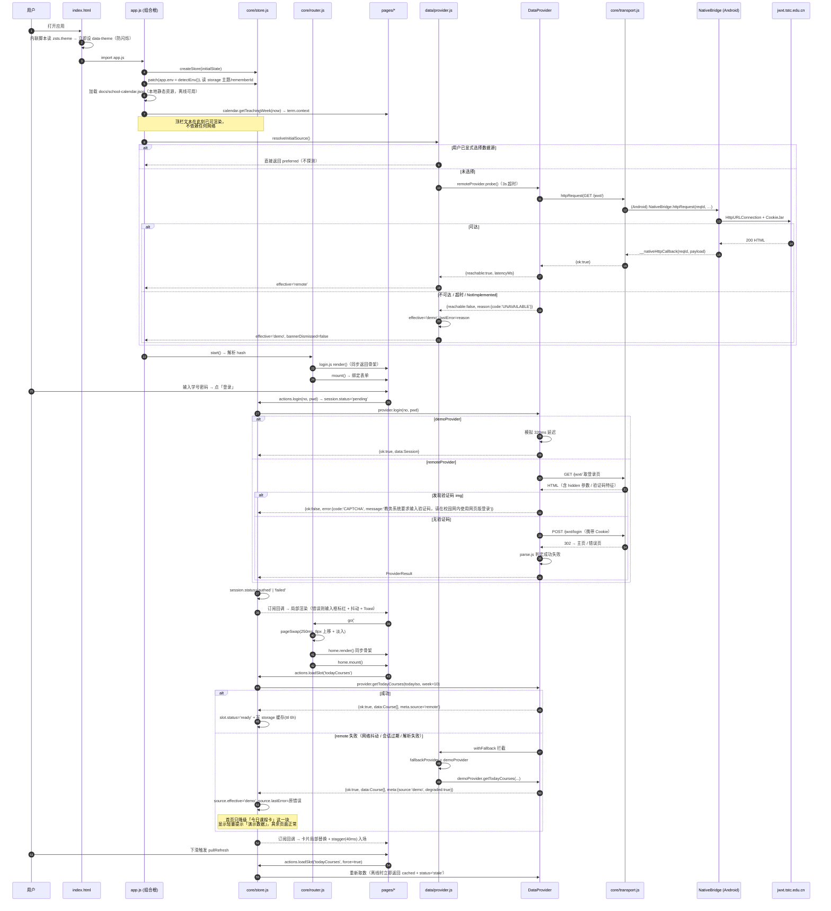
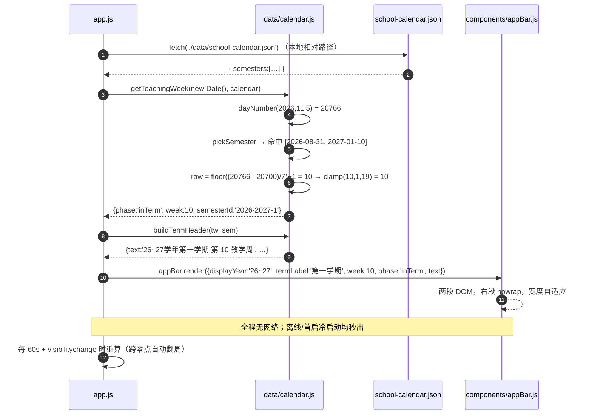
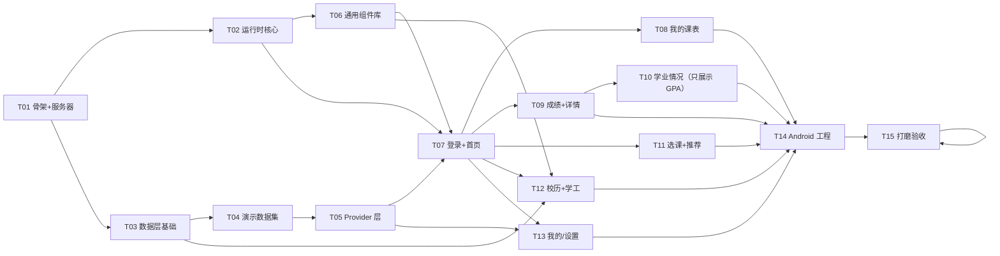
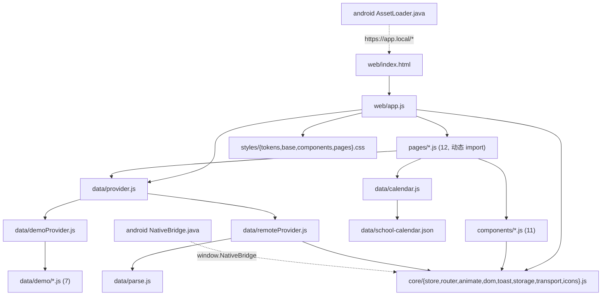

# 掌上唐师 · 系统架构设计（ARCHITECTURE）

| 项 | 内容 |
|---|---|
| 文档 | 系统架构 + 任务分解（架构师 高见远） |
| 版本 | v1.0 / 2026-11-05 |
| 上游输入 | `docs/PRD.md`（v1.0）、`docs/school-calendar.json`（已核实） |
| 交付形态 | ① Web 静态站点（127.0.0.1 立即可验） ② 手写 Android Gradle 工程（用户自行出 APK） |
| 技术栈 | **原生 HTML5 + CSS3 + ES Modules，零依赖、零构建、纯静态** |
| 代码规模预估 | 约 **82 个文件**、约 **9,600 行**（含演示数据 ~1,800 行、Android ~1,200 行） |
| 任务数 | **15 个**，按依赖顺序可直接分批交付 |

---

## 0. 与 PRD 的两处架构偏差（必须先读）

| # | PRD 原文 | 架构决策 | 原因 |
|---|---|---|---|
| D1 | 前端 Vite + React + MUI + Tailwind；Android 用 Capacitor 封装 | 改为原生 ESM 零依赖 + **手写 WebView 壳 + `@JavascriptInterface` 原生桥** | 构建机 npm registry 不可达（curl 502 / `npm view` 超时），Vite/React/Capacitor 全部无法安装。手写 WebView 壳在能力上覆盖 Capacitor 的 `WebView + Bridge + 本地资源托管` 三个真实用途，**不是功能降级** |
| D2 | WebView 加载 `file:///android_asset/www/index.html` | 默认加载虚拟源 **`https://app.local/index.html`**，由 `shouldInterceptRequest` 从 `assets/www` 读取并注入 MIME；`file://` 仅作降级开关 | **`file://` 协议下 `origin` 为 `null`，`<script type="module">` 会被 CORS 拒绝，整套 ESM 架构直接白屏**；同时 `localStorage` 在部分 WebView 版本的 `file://` 下不可写。虚拟 https 源一次性解决 ESM、Storage、secure-context 三个问题，且零依赖（无需 androidx.webkit 的 WebViewAssetLoader） |

---

## 0.1 2026-11-06 实测后的口径更正（后文早期推测以此为准）

> 本文写于 2026-11-05，当时教务系统**尚未实测**，所以正文里凡涉及「登录协议未知」
> 「域名公网不可达」「remote 可能永远跑不通」「留待校园网抓包」的描述都属于当时的风险预案，
> 现已不成立。完整实测报告见 **`docs/remote-api-map.md` §6**。保留正文原文作设计推演存档，
> 但实现与验收一律以下表为准。

| 项 | 早期推测（本文正文） | **实测结论 / 当前实现** |
|---|---|---|
| 域名与登录 | R1：「登录协议未知、可能无法跑通」 | 真实域名 `https://jwxt.tstc.edu.cn`；登录页取 `csrftoken` → 公钥接口 → RSAES-PKCS1-v1_5（`RSA/ECB/PKCS1Padding`，无字节反转）→ 6 字段表单提交 → 两级 302 到 `index_initMenu.html`。**程序化登录已打通**，R1 风险关闭 |
| 会话失败归因 | 推测多节点 `csrftoken`/`route` 绑定 | 主因是本地代理跟随 302 时复用了旧 `Cookie`，POST 换发的 `JSESSIONID` 丢失。每个 hop 重建 Cookie 后单次即成功；3 次重试保留为兜底 |
| 文件命名 | 正文写 `data/parse.js`、`ensureSession()`、`resolveInitialSource()` | 实际拆为 `web/data/jwxtClient.js`（端点 / HTTP / 登录 / 加密）+ `web/data/jwxtParse.js`（纯解析器）+ `web/data/remoteProvider.js`（组装）；`web/app.js` 用动态 Proxy 按会话状态在 demo 与 remote+fallback 间切换，**没有** `ensureSession` / `resolveInitialSource` |
| 端点地址 | 「4 步补丁流程，待抓包后补」 | 首页 `clickMenu` / 菜单 JSON / 「我的应用」三处实测补齐 11 个端点。**页面 ≠ 数据接口**：课表走 `xskbcx_cxXsKb.html`、成绩走 `cjcx_cxXsgrcj.html?doType=query`、推荐课表清单走 `bjkbdy_cxBjkbdyTjkbList.html` |
| 学期码 | 从 `#ajaxForm` 读 `xnm.value` / `xqm.value` | 页面上是 `<select><option selected>`，不是 `<input value>`；**`xqm=3/12/16` 才是第 1/2/3 学期**。旧正则永远读不到，POST 空参只会拿到 `null` |
| 仍诚实降级 | — | `ENDPOINTS.recommend`（预览网格解析未实测）、`ENDPOINTS.selectionData`（选课课池 AJAX 未实测）仍为 `null`，`toggleCourse()` 不开放写操作。未实测不猜地址、不伪造数据 |
| 产品口径 | 正文 T10 曾含「教学计划页」双页 | 用户 2026-11-06 决定：**学生学业情况查看只展示 GPA 一个数字**，教学执行计划查看整条下线；推荐课表是教务「推荐课表打印」的一张周课表，不是 App 生成的多套方案 |

---

## 1. 技术选型与理由

**为什么"零依赖"是当下最优解，而不是妥协？** 因为本产品的技术难度全部集中在「数据适配」和「交互质感」，而不在「组件拼装」。React/MUI 的价值是提供 100+ 个现成组件与虚拟 DOM 差分，但代价是 Node 工具链、约 300MB `node_modules`、一次不可控的 npm 安装——而当前环境连 `npm view` 都超时，这条链路是**确定死路**。反过来看本项目真实需要的抽象只有四样：① 一个 60 行的 observable store，② 一个 80 行的 hash 路由，③ 一套 CSS 变量 + 30 个 CSS 类，④ 一个 200 行的 SVG 图表函数集。这四样手写总成本约 900 行，且**完全可读、可改、可离线跑、首屏零 JS 依赖地狱**——实测首次可交互时间会优于 React 方案（无 hydrate、无框架 runtime 约 140KB）。ES Modules 原生支持模块化、按路由 `import()` 懒加载、浏览器原生缓存，缺失的只是 tree-shaking 与类型检查，用「单文件 ≤400 行 + JSDoc typedef + 规则守卫脚本」补偿即可。所以这是**在约束下反而更优的解**：交付物是一个 2MB 的静态目录，双击 `node server.js` 就能验，拷进 Android 就能出包。视觉与动效的上限由 CSS 变量和 transform/opacity 决定，与框架无关——PRD 要求的 250/350ms 缓动曲线、stagger、数字滚动、SVG 图表，全部原生可做到 60fps。

**分层架构（6 层，单向依赖，禁止反向 import）**



| 层 | 目录 | 允许 import | 禁止 |
|---|---|---|---|
| L1 表示层 | `web/pages/` | L2、L3、L4、L5 | 禁止彼此 import；禁止直接 `fetch`/`localStorage` |
| L2 组件层 | `web/components/` | L3、L5 | 禁止 import `data/`（只收 props）；禁止访问全局 store |
| L3 运行时 | `web/core/` | L5 | 禁止 import `pages/`、`components/`、`data/` |
| L4 数据服务 | `web/data/` | L3（仅 transport/storage）、L5 | 禁止 import 任何 DOM 相关模块（保证可被 node 单测） |
| L5 领域/资源 | `web/data/calendar.js`、`types.js`、`styles/` | 无 | 禁止 import 其他层 |

> 唯一例外：`web/app.js`（组合根）可 import 全部层，是整个应用唯一允许"知道所有事"的文件。

---

## 2. 完整文件树（每文件一行职责）

```
2026-11-05-23-09-53/
├─ server.js                                  # 零依赖静态服务器：MIME 白名单、ESM 的 text/javascript、SPA 回退、目录穿越防护、禁用缓存开关
├─ docs/
│  ├─ PRD.md / ARCHITECTURE.md / school-calendar.json            # 已有
│  ├─ class-diagram.mermaid                   # 类图（本文档 §4 抽取）
│  └─ sequence-diagram.mermaid                # 时序图（本文档 §5 抽取）
├─ tools/
│  ├─ test-week.mjs                           # 教学周断言：40 个抽样日期逐一比对 calendar.json，node 直接跑，退出码即结论
│  └─ check-rules.mjs                         # 规则守卫：非 tokens.css 出现 hex 色值/外部外链/单文件 >400 行 即报错退出
├─ web/                                       # ★ Web 站点根目录（= Android assets/www 的唯一真源）
│  ├─ index.html                              # 唯一入口：viewport-fit=cover、theme-color、防闪烁内联脚本、#app 骨架、module 引入 app.js
│  ├─ app.js                                  # 组合根：读配置→建 store→建 provider→注册 12 条路由→全局错误边界→暴露 window.__appBack
│  ├─ core/
│  │  ├─ dom.js                               # h()/qs()/qsa()/on()/delegate()/setText()/clear() 等 DOM 微工具；全站事件委托的基础
│  │  ├─ store.js                             # observable store：createStore/getState/patch/subscribe/select/batch（约 60 行）
│  │  ├─ router.js                            # hash 路由：路由表编译、参数解析、转场调度、滚动位置恢复、硬件返回、按路由懒加载
│  │  ├─ animate.js                           # 动效原语：pageSwap/stagger/countUp/moveIndicator/sheetIn/pullSpin/skeleton；统一 reduced-motion 降级
│  │  ├─ transport.js                         # 网络抽象：detectEnv() + httpRequest()；web 走 fetch，android 走 NativeBridge（reqId ↔ Promise 注册表）
│  │  ├─ storage.js                           # localStorage 命名空间封装：命名空间前缀、TTL、JSON 容错、体积统计、清空；凭据不落本地（除 rememberId）
│  │  ├─ icons.js                             # 手写内联 SVG 图标注册表：icon(name, size) 返回 SVG 字符串；30+ 图标，无字体无 CDN
│  │  └─ toast.js                             # Toast（顶部滑入）/ Confirm（二次确认）/ setBusy（按钮级 loading）
│  ├─ data/
│  │  ├─ types.js                             # 全部 JSDoc typedef（Semester/Course/Grade/GPA/…/DataSlot/ProviderError），零运行时代码
│  │  ├─ calendar.js                          # 纯函数域：getTeachingWeek/buildTermHeader/buildMonthGrid/weekOfDate/pickSemester/dayNumber
│  │  ├─ provider.js                          # DataProvider 契约文档 + createProvider(mode) 工厂 + withFallback() 降级包装 + resolveInitialSource()
│  │  ├─ demoProvider.js                      # 演示实现：内存数据 + 120~320ms 人工延迟 + 可注入失败（?fail=grades 供验收降级）
│  │  ├─ remoteProvider.js                    # 真实实现：探测→登录（GET 登录页取 hidden 参数→POST）→Cookie 会话→分页抓取→parse
│  │  ├─ parse.js                             # 教务 HTML/JSON → 结构化：表格解析、成绩行解析、课表解析、错误页特征识别（纯函数，可单测）
│  │  ├─ localTimetable.js                    # 本地课表真源（可写）：三态来源 jwxt/custom/edited + mergeImported 五条规则 + weeks 唯一真源
│  │  ├─ timetableBulk.js                     # 本地课表批量写：importCourses（推荐课表导入，只增不改）/ restoreFromJwxt（以教务为准恢复，手改被覆盖、custom 保留）
│  │  ├─ timetableSync.js                     # 教务课表 → 本地 → 小组件 的同步泵：只认 ok 且非降级、非空的结果才落盘
│  │  ├─ slotFetchers.js                      # 数据槽 → provider 方法的对照表（业务口径集中在数据层，action 只喊槽名）
│  │  ├─ widget.js                            # 「今日课程」快照：节次换算 / 今日筛选 / 下发（纯函数 + NativeBridge 桥接）
│  │  └─ demo/
│  │     ├─ index.js                          # demo 数据集汇总出口（唯一被 demoProvider import 的文件）
│  │     ├─ user.js                           # 学生档案 + 3 个学期元数据（2025-2026-1/2、2026-2027-1）
│  │     ├─ courses.js                        # 全学期 ~26 门课程 + 第 10 周（11-02~11-08）真实作息样本 + 单双周/冲突样本
│  │     ├─ grades.js                         # 3 学期 ~34 条成绩，含 score:null / 缓考 / 重修 / 及格线边界样本
│  │     ├─ (plan.js 已删除)                  # 教学执行计划查看已整条下线
│  │     ├─ selection.js                      # 选课轮次（open/closed 两种）+ 22 门课程池（余量 0 / 紧张 / 充足）
│  │     └─ recommended.js                    # 推荐课表演示快照（1 张周课表 10 门，与个人课表同构）
│  ├─ components/
│  │  ├─ appBar.js                            # 顶部栏：学年学期+教学周（caption 13px/600，不换行）、演示提示条（36px，可关）、滚动 64→56 收缩
│  │  ├─ tabBar.js                            # 底部 4 Tab：SVG 图标+文字、滑动指示器 250ms 位移+宽度插值、44px 热区、安全区适配
│  │  ├─ card.js                              # 通用卡片 / 分区标题 / 键值行 / 进度条（原子分子复用件）
│  │  ├─ chip.js                              # 横向滚动 chip 选择器（学期筛选、选课筛选），选中态插值
│  │  ├─ skeleton.js                          # 骨架屏三种形态：列表行 / 卡片 / 图表；1200ms 微光扫过（linear）
│  │  ├─ emptyState.js                        # 统一空态/错误态/离线态：图标+主文+次文+可选按钮（重试/演示模式/复制地址）
│  │  ├─ sheet.js                             # 底部弹层：spring 350ms 上滑、遮罩 0→0.4、下滑关闭手势、焦点回退、Esc 关闭
│  │  ├─ pullRefresh.js                       # 下拉刷新容器：触摸位移阻尼、阈值 64px、指示器旋转 200ms、刷新中锁
│  │  ├─ charts.js                            # 手写 SVG 图表：lineChart(通用折线)/barChart(成绩分布)/ringProgress(学分环)/stackedBar(学分构成)；统一坐标映射与点位点击
│  │  ├─ courseCard.js                        # 课表卡片：类型配色（12% 填充 + 3px 左条）、冲突并排 50%、周次外半透明
│  │  └─ gradeRow.js                          # 成绩列表行：课程名/学分/绩点/成绩/类型；长按复制成绩文本；共享元素名 data-shared
│  ├─ pages/
│  │  ├─ login.js                             # P01 登录：校验、可见切换、loading、失败抖动、演示模式、记住学号
│  │  ├─ home.js                              # P02 首页：顶栏上下文、今日课程、6 宫格 stagger 40ms、倒计时数字滚动、下拉刷新
│  │  ├─ timetable.js                         # P07 我的课表：周次切换器、7 列表头、12 大节时间轴、今日列高亮、左右滑动、详情弹层、回到本周
│  │  ├─ grades.js                            # P03 成绩查询：概览三门指标、学期 chip、搜索、列表淡入位移、长按复制、缓存标注
│  │  ├─ gradeDetail.js                       # P04 成绩详情：全字段 + 成绩构成 + 大号数字滚动 350ms + 未录入态
│  │  ├─ gpa.js                              # P05 学生学业情况查看：**只展示一个 GPA 数字** + 统计时间 + 教务来源 + 免责原文（学分树/门次统计不上屏）
│  │  ├─ selection.js                         # P09 选课：轮次窗口条（开放中/未开始/已结束+倒计时）、搜索筛选、乐观更新+回滚、余量进度
│  │  ├─ recommend.js                         # P08 推荐课表：复用 timetableView.buildGrid 的周网格、周次切换、来源说明条、课程详情
│  │  ├─ calendarPage.js                      # P10 校历：月份切换、月历网格+第 N 周角标、今日高亮、节点色点+图例、当日事件浮层、原图全屏
│  │  ├─ affairs.js                           # P11 学工：说明卡+地址+打开按钮；Android 走 WebView 承载页（返回/刷新/关闭）；Web 提示需在 App 内打开
│  │  └─ mine.js                              # P12 我的：账号卡、数据源切换、清缓存（体积+二次确认）、深色模式、关于、退出登录
│  ├─ styles/
│  │  ├─ tokens.css                           # 设计 token 唯一来源：亮/暗双套 CSS 变量（色彩/字号/间距/圆角/阴影/缓动/时长）+ 安全区变量
│  │  ├─ base.css                             # reset、系统字体栈、排版阶梯、滚动条隐藏、点击高亮去除、reduce-motion 全局降级
│  │  ├─ components.css                       # 原子与分子组件样式（c- 前缀），约 60 个类
│  │  └─ pages.css                            # 页面级布局（p- 前缀），每页一节
│  └─ assets/
│     ├─ logo.svg                             # 校徽示意 + 掌上唐师字标（手写 SVG）
│     └─ calendar-archive.svg                 # 校历存档图（按 calendar.json 手绘的离线 SVG，替代易失效的外链）
└─ android/                                   # ★ 手写 Gradle 工程，零第三方依赖（不用 androidx）
   ├─ settings.gradle                         # pluginManagement + dependencyResolutionManagement + include ':app'
   ├─ build.gradle                            # 根：仅声明 AGP 插件版本
   ├─ gradle.properties                       # AndroidX=false、jvmargs、nonTransitiveRClass
   ├─ gradle/wrapper/gradle-wrapper.properties# Gradle 版本固定（用户机器首次构建需下载，见风险 R6）
   ├─ local.properties.example                # sdk.dir 示例（不提交真实 local.properties）
   ├─ .gitignore                              # 忽略 build/、.gradle/、local.properties、app/src/main/assets/www/
   └─ app/
      ├─ build.gradle                         # compileSdk 34/minSdk 26/targetSdk 34、namespace、依赖块为空、syncWebAssets Copy 任务挂 preBuild
      ├─ proguard-rules.pro                   # 保留 @JavascriptInterface 方法名（release 混淆时必需）
      └─ src/main/
         ├─ AndroidManifest.xml               # INTERNET/ACCESS_NETWORK_STATE、networkSecurityConfig、configChanges、singleTask、exported
         ├─ java/com/tstc/zstangshi/
         │  ├─ MainActivity.java              # WebView 装配：JS/DOM Storage/虚拟源、addJavascriptInterface、onBackPressed→__appBack、生命周期
         │  ├─ AssetLoader.java               # shouldInterceptRequest：从 assets/www 读文件、MIME 映射、404 兜底、Cache-Control
         │  ├─ NativeBridge.java              # @JavascriptInterface：httpRequest(异步+reqId回调)/clearSession/saveCredential/loadCredential/openExternal/getAppVersion/isNative
         │  ├─ CookieJar.java                 # unified cookie：请求前 CookieManager.getCookie 注入、响应 Set-Cookie 回写 + flush
         │  └─ SecurePrefs.java               # AndroidKeyStore AES/GCM 加密后存 SharedPreferences（框架 API，零依赖）
         └─ res/
            ├─ xml/network_security_config.xml# 基础禁明文；tstc.edu.cn 子域允许明文 + 信任 system&user 证书
            ├─ values/strings.xml             # app_name 等文案
            ├─ values/colors.xml              # 品牌色（与 tokens.css 同值）
            ├─ values/themes.xml              # android:Theme.Material.Light.NoActionBar（框架主题，不引 appcompat）
            ├─ drawable/ic_launcher_background.xml
            ├─ drawable/ic_launcher_foreground.xml
            ├─ drawable/splash_bg.xml          # windowBackground 冷启动底色，避免白屏
            └─ mipmap-anydpi-v26/ic_launcher.xml # 自适应图标（引上面两个 drawable）
```

> **`app/src/main/assets/www/` 不入库**，由 `app/build.gradle` 的 `syncWebAssets` Copy 任务从 `../web` 复制，`preBuild.dependsOn` 保证每次构建最新。**`web/` 是唯一真源**，杜绝双端不一致。

---

## 3. `server.js` 设计要求（Web 预览通道）

| 关注点 | 要求 |
|---|---|
| 依赖 | 仅 `node:http`、`node:fs`、`node:path`、`node:url` |
| 端口 | `process.env.PORT || 5173`，绑定 **`127.0.0.1`**（禁止 `0.0.0.0`） |
| MIME | 必须包含 `.html→text/html; charset=utf-8`、**`.js/.mjs→text/javascript; charset=utf-8`**（ESM 必需，写错会 `Failed to load module script`）、`.css→text/css`、`.json→application/json`、`.svg→image/svg+xml`、`.webmanifest`、`.png/.jpg/.webp/.woff2`；未知后缀一律 `application/octet-stream` 且带 `Content-Disposition: inline` 拒绝 |
| SPA 回退 | 无扩展名或指向目录 → 返回 `index.html`（hash 路由本身不依赖它，但保证 `/`、`/grades` 等直链不 404） |
| 目录穿越 | `resolve()` 后必须 `startsWith(WEB_ROOT + sep)`，越界返回 403；`..%2f` 编码穿越同样拦截 |
| 缓存 | 默认 `Cache-Control: no-store`（开发期避免改了 CSS 看不到效果）；`?cache=1` 时给 1 小时 |
| 日志 | 单行 `GET /styles/tokens.css 200 3ms`，便于排查 404 与 MIME 错误 |
| 其它 | 只处理 GET/HEAD（其它 405）；监听失败（端口占用）打印明确提示而非堆栈；`WEB_ROOT` 指向 `<repo>/web` |

验收：`node server.js` 后访问 `http://127.0.0.1:5173/#/home`，DevTools Network 中 `app.js` 类型必须为 `text/javascript`，控制台无模块加载错误。

---

## 4. 数据结构与接口

### 4.1 类图（完整版见 `docs/class-diagram.mermaid`）



### 4.2 `DataProvider` 契约（TS 风格签名 / JS 按此实现）

```ts
type ProviderMode = 'demo' | 'remote';
type ErrorCode =
  | 'NETWORK'      // 网络不可达 / DNS 失败
  | 'CORS'         // Web 端被浏览器跨域策略拦截（仅 web 环境会出现）
  | 'AUTH'         // 学号密码错误 / 会话过期
  | 'CAPTCHA'      // 出现验证码，无法程序化登录
  | 'TIMEOUT'      // 15s 超时
  | 'PARSE'        // 页面结构与预期不符（教务改版）
  | 'UNAVAILABLE'  // 服务不可用 / 需校园网
  | 'NOT_IMPLEMENTED' // remote 尚未接入该校真实接口
  | 'UNKNOWN';

interface ProviderError {
  code: ErrorCode;
  message: string;   // 面向用户的中文文案，直接可上屏
  retryable: boolean;
  hint?: 'campus-network' | 'check-credential' | 'use-demo' | 'later';
  detail?: string;   // 调试信息，禁止上屏
}

interface ProviderMeta {
  source: ProviderMode;
  fetchedAt: string;   // ISO
  fromCache: boolean;
  degraded?: boolean;  // true 表示发生了 remote → demo 降级
}

interface ProviderResult<T> {
  ok: boolean;
  data: T | null;
  error?: ProviderError;
  meta: ProviderMeta;
}

interface Session {
  studentNo: string;
  name: string;
  mode: ProviderMode;
  acquiredAt: string;
  expiresAt?: string;
}

interface ProbeResult {
  reachable: boolean;
  latencyMs: number | null;
  reason?: ProviderError;
}

interface SemesterOption { semesterId: string; label: string; isCurrent: boolean }
interface Timetable { semesterId: string; weeks: number[]; courses: Course[] }
interface Profile { name: string; studentNo: string; college: string; className: string; major: string; grade: string; avatarText: string }

interface DataProvider {
  readonly mode: ProviderMode;

  probe(): Promise<ProbeResult>;
  login(studentNo: string, password: string): Promise<ProviderResult<Session>>;
  logout(): Promise<void>;
  getSession(): Session | null;

  getTermContext(now: Date): Promise<ProviderResult<TermHeaderContext>>;
  getSemesters(): Promise<ProviderResult<SemesterOption[]>>;
  getTodayCourses(dateIso: string, week: number): Promise<ProviderResult<Course[]>>;
  getTimetable(semesterId: string): Promise<ProviderResult<Timetable>>;
  getGrades(semesterId: string): Promise<ProviderResult<Grade[]>>;
  getGradeById(id: string): Promise<ProviderResult<Grade | null>>;
  getGPA(): Promise<ProviderResult<GPA>>;   // 无参：教务「学生学业情况查询」是累计快照
  getCourseSelection(): Promise<ProviderResult<CourseSelection>>;
  toggleCourse(courseId: string, selected: boolean): Promise<ProviderResult<{ courseId: string; isSelected: boolean; enrolled: number }>>;
  getRecommendedTimetable(): Promise<ProviderResult<RecommendedTimetable>>;  // 教务「推荐课表打印」，与个人课表同构
  getProfile(): Promise<ProviderResult<Profile>>;
  clearCache(): Promise<ProviderResult<{ freedBytes: number }>>;
}
```

**契约硬性约定**

1. 所有方法**永不 throw**，一律返回 `ProviderResult`。任何 `throw` 视为实现缺陷。
2. `demoProvider` 必带 120–320ms 随机延迟（否则骨架屏与转场验收不到）。
3. `demoProvider` 必须保留 P07 第 10 周的课程与 `docs/school-calendar.json` 的周次一致（11-02~11-08）。
4. `remoteProvider` 所有方法首行调用 `ensureSession()`；无会话时返回 `{ok:false, error:{code:'AUTH'}}`，由 UI 引导登录。
5. `toggleCourse` 是唯一写操作：`demoProvider` 纯内存 + 失败率可注入；`remoteProvider` **v1 一律返回 `NOT_IMPLEMENTED`**（PRD Q2：不做真实提交），UI 需能优雅展示"仅记录意向"。

**降级包装 `withFallback(primary, fallback)`**：包装 remote 时，任一调用返回 `ok:false` → 记 `source.lastError` → 调用 fallback 拿数据 → 返回时把 `meta.degraded = true`、`meta.source = 'demo'`，并在 store 中置 `source.effective='demo'` + `lastFallbackAt`。**页面永不感知降级**，只有 appBar 多一条提示。

**数据源解析顺序 `resolveInitialSource()`**：① 用户显式选择（storage `zsts.source`）→ 用它，不做探测；② 无选择 → `navigator.onLine` 为 false 直接 `demo`；③ 否则 `remoteProvider.probe()` 3s 超时，可达 → `remote`，不可达 → `demo` 且 `bannerDismissed=false`（首页弹提示条，文案「当前网络无法访问教务系统，已切换为演示数据」）。

### 4.3 Store state 形状（唯一真源，写在 `core/store.js` 顶部注释 + `data/types.js`）

```js
const initialState = {
  /* ── 应用外壳 ───────────────────────────── */
  app: {
    booted: false,          // 启动流程完成
    env: 'web',             // 'web' | 'android'
    version: '1.0.0',
    theme: 'light',         // 'light' | 'dark'（生效值）
    themeSource: 'system',  // 'system' | 'user'
    offline: false,         // !navigator.onLine || 最近一次 NETWORK 错误
    reducedMotion: false    // prefers-reduced-motion
  },

  /* ── 会话 ───────────────────────────────── */
  session: {
    status: 'guest',        // 'guest' | 'pending' | 'authed' | 'demo' | 'failed'
    studentNo: '',          // 明文仅存内存，绝不落 localStorage
    rememberId: false,      // 只持久化学号
    name: '',
    error: null             // ProviderError | null
  },

  /* ── 数据源 ─────────────────────────────── */
  source: {
    preferred: 'demo',      // 用户在「我的」中的选择
    effective: 'demo',      // 实际生效（探测/降级结果）
    probing: false,
    probe: { reachable: false, latencyMs: null, reason: null },
    bannerDismissed: false, // 演示提示条（本次启动有效）
    lastFallbackAt: null,
    lastError: null         // ProviderError
  },

  /* ── 学期与时间（顶栏唯一来源） ───────────── */
  term: {
    calendar: null,         // 解析后的 school-calendar.json
    context: {              // TermHeaderContext，由 calendar.js 计算
      displayYear: '26~27', termLabel: '第一学期', week: 10,
      phase: 'inTerm', text: '26~27学年第一学期 第 10 教学周',
      semesterId: '2026-2027-1'
    },
    todayIso: '2026-11-05',
    semesters: []           // SemesterOption[]，成绩页筛选用
  },

  /* ── 数据槽（8 个，形状统一） ────────────── */
  slots: {
    profile:      { status:'idle', data:null, error:null, updatedAt:null, fromCache:false, degraded:false },
    todayCourses: { status:'idle', data:null, error:null, updatedAt:null, fromCache:false, degraded:false },
    timetable:    { status:'idle', data:null, error:null, updatedAt:null, fromCache:false, degraded:false },
    grades:       { status:'idle', data:null, error:null, updatedAt:null, fromCache:false, degraded:false }, // data:{ bySemester:{} }
    gpa:          { status:'idle', data:null, error:null, updatedAt:null, fromCache:false, degraded:false },
    plan:         { status:'idle', data:null, error:null, updatedAt:null, fromCache:false, degraded:false },
    selection:    { status:'idle', data:null, error:null, updatedAt:null, fromCache:false, degraded:false },
    recommend:    { status:'idle', data:null, error:null, updatedAt:null, fromCache:false, degraded:false }
  },
  // status ∈ 'idle' | 'loading' | 'ready' | 'stale' | 'error'
  // 'stale' = 有缓存但本次刷新失败（UI 展示缓存 + 「上次同步 …」标注）

  /* ── UI 局部状态（不入缓存） ─────────────── */
  ui: {
    route: '/home',
    params: {},
    activeTab: 'home',          // 'home' | 'timetable' | 'grades' | 'mine'
    weekNo: 10,                 // 课表当前周
    semesterFilter: '2026-2027-1',
    gradesQuery: '',
    selectionFilter: { type:'all', dept:'all', onlyAvailable:false },
    selectionIntent: [],        // 本地意向课程 id（不提交教务）
    calendarMonth: '2026-11',
    sheet: null,                // 当前弹层 { id, payload }
    busy: {},                   // { 'select:C001': true } 按钮级 loading
    toasts: []
  },

  /* ── 缓存 ───────────────────────────────── */
  cache: { totalBytes: 0, lastClearedAt: null }
};
```

**Action 表**（`store.patch` 的语义化封装，全部集中在 `app.js` 的 `actions` 对象，页面只调用 action 不直接 patch）

| Action | 签名 | 说明 |
|---|---|---|
| `boot` | `() => Promise<void>` | 读 storage/主题/会话，装配 provider，计算 term.context |
| `setTheme` | `(mode, source?)` | 写 `data-theme` + 持久化 + 更新 theme-color meta |
| `setSource` | `(mode) => Promise<void>` | 切换数据源 → 全量失效所有 slot → 重新加载当前页 |
| `dismissBanner` | `()` | 关演示提示条 |
| `login` | `(studentNo, pwd)` | session.status 流转 guest→pending→authed/failed |
| `enterDemo` | `()` | 直达首页，source.effective='demo'，banner 可见 |
| `logout` | `() => Promise<void>` | 清 session + provider.logout + 清敏感缓存，回 `#/login` |
| `loadSlot` | `(name, force?)` | 统一取数：置 loading → provider 调用 → ready/stale/error；带 TTL 缓存 |
| `invalidateAll` | `()` | 所有 slot 回 idle |
| `navigate` | `(path)` | 委托 router.go |
| `setUi` | `(partial)` | 合并 ui 子树的局部状态 |
| `toggleIntent` | `(courseId)` | 选课本地说意（乐观更新+回滚） |
| `clearCache` | `() => Promise<void>` | 清 storage 业务缓存，保留主题与 rememberId |

**渲染策略（关键决策）**：**不使用虚拟 DOM，不做整体重渲染。**
- 路由切换 = 销毁旧页 DOM + 挂载新页 DOM（一次）；
- 页内更新 = `store.subscribe(selector, cb)` 细粒度订阅，`cb` 里做**目标 DOM 局部替换**（如只重建 `#grade-list` 的 `innerHTML`，或只动一个 `textContent`）；
- 所有交互走 `document` 事件委托 + `data-action` 属性（`app.js` 统一分发到当前页的 `actions` 映射），页面模块不绑定零散 listener，`unmount` 只需清空订阅；
- 好处：无 diff 开销、DOM 节点可控在 1500 内、滚动不掉帧；代价：需要 discipline，用 `check-rules.mjs` + code review 保证。

### 4.4 路由表

| hash | 页面模块 | 归属 Tab | 转场 | 需会话 | 说明 |
|---|---|---|---|---|---|
| `#/login` | `pages/login.js` | — | fade | 否 | 启动页；已 authed/demo 则重定向 `#/home` |
| `#/home` | `pages/home.js` | home | fade | 否 | 演示态可直接进 |
| `#/timetable` | `pages/timetable.js` | timetable | fade | 是 | Tab 切换保留滚动位置 |
| `#/grades` | `pages/grades.js` | grades | fade | 是 | 同上 |
| `#/mine` | `pages/mine.js` | mine | fade | 是 | 同上 |
| `#/grades/:id` | `pages/gradeDetail.js` | (grades) | push（8px 上移+淡入） | 是 | 共享元素：课程名 |
| `#/gpa` | `pages/gpa.js` | `gpa` | push | 是 | 只展示 GPA 一个数字 |
| `#/selection` | `pages/selection.js` | — | push | 是 | 支持 `?from=recommend` |
| `#/recommend` | `pages/recommend.js` | — | push | 是 | |
| `#/calendar` | `pages/calendarPage.js` | — | push | 否 | 离线可看（数据来自本地 JSON） |
| `#/affairs` | `pages/affairs.js` | — | push | 否 | |
| `*` | 重定向 `#/home` | — | — | — | 未匹配一律兜底 |

**路由机制要求**
- 解析：`#/grades/2026-1-g01?tab=detail` → `{ path:'/grades/:id', params:{id:'2026-1-g01'}, query:{tab:'detail'} }`；路由表用 `/grades/:id` 编译成正则（只支持 `:param`，不实现通配符，保持 80 行内）。
- **懒加载**：路由表里 `load: () => import('./pages/grades.js')`，首次进入才请求该页 JS。这就是不打 bundle 也不拖慢首屏的办法。
- **转场**：`animate.pageSwap(prevEl, nextEl, kind)` — 新旧同时存在但 `prevEl` 立即 `pointer-events:none`；**不做横向位移**（PRD 硬要求），仅 8px 上移 + opacity；总时长 250ms，**任何情况下 ≤400ms**；`prefers-reduced-motion` 时直接 `replaceChildren`。
- **滚动恢复**：`#app-main` 是唯一滚动容器（`overflow-y:auto; -webkit-overflow-scrolling:touch`）。`Map<routeKey, scrollTop>`，`routeKey = path + JSON(params)`；`beforeLeave` 存 `scrollTop`，`afterEnter` 用 `requestAnimationFrame` 两次后 `scrollTop = saved`。Tab 页命中缓存页面实例时复用滚动位置。
- **硬件返回**：`app.js` 暴露 `window.__appBack()` 返回 `true/false`；逻辑顺序 —— 关弹层 → 关月度事件浮层 → 当前是 Tab 根页则 `history.back()` 交给系统 → 次级页 `router.back()`。Android 端 `MainActivity.onBackPressed()` 用 `evaluateJavascript("window.__appBack()")` 取回调值，`false` 才执行 `super`/`finish`。
- **页面模块契约**：`{ name, title, tab, requiresAuth, render(ctx): HTMLElement, mount(el, ctx): cleanupFn, unmount() }`。`render` 必须**同步**返回骨架（首屏不白屏），数据在 `mount` 里异步填充。

### 4.5 教学周算法（`data/calendar.js`，纯函数，无副作用）

```
// ── 关键：用 UTC 日序号消掉时区/夏令时/闰秒差异 ──
dayNumber(y, m, d) = Date.UTC(y, m - 1, d) / 86400000

getTeachingWeek(now, calendar):
  today = dayNumber(now.Y, now.M, now.D)
  sem   = pickSemester(calendar, today)          // 见下

  start = dayNumber(...sem.semesterStart)
  end   = dayNumber(...sem.semesterEnd)

  // ① 学期前
  if today < start:
      days = start - today
      return { phase:'beforeTerm', week:null, semesterId:sem.id, daysToStart:days }

  // ② 学期后 → 假期
  if today > end:
      nextSem = 日历中 start > today 的最近学期
      return { phase:'vacation', week:null, semesterId:sem.id,
               daysToNextTerm: nextSem ? dayNumber(nextSem.start) - today : null,
               nextSemesterId: nextSem ? nextSem.id : null }

  // ③ 学期内
  raw  = floor((today - start) / 7) + 1
  week = clamp(raw, 1, sem.totalWeeks)           // 防御：数据错也不越界
  return { phase:'inTerm', week, semesterId:sem.id, daysToStart:0 }


pickSemester(calendar, today):
  // 优先级 1：today ∈ [start, end] 的学期
  hit = semesters.find(s => today >= dn(s.start) && today <= dn(s.end))
  if hit: return hit
  // 优先级 2：最近的「未来」学期（开学前场景）
  future = semesters.filter(s => dn(s.start) > today).sort(by start)[0]
  // 优先级 3：最近的「已结束」学期（假期场景）
  past   = semesters.filter(s => dn(s.end)   < today).sort(by end desc)[0]
  // 两者取距离更近者
  return nearer(future, past)


buildTermHeader(tw, sem):
  left = `${sem.displayYear}学年${sem.termLabel}`      // "26~27学年第一学期"
  switch tw.phase:
    'inTerm'     : right = `第 ${tw.week} 教学周`       // 注意「第」后与「周」前各一个半角空格
    'beforeTerm' : right = tw.daysToStart <= 30 ? `距开学 ${tw.daysToStart} 天` : `假期中`
    'vacation'   : right = `假期中`
  return { displayYear, termLabel, week, phase, semesterId,
           text: `${left} ${right}`,
           // inTerm 时为 "26~27学年第一学期 第 10 教学周"
           compact: `${left}  ${right}` }               // 390px 紧张时的两段式渲染用
```

> 顶栏渲染必须用 **两段 DOM**（`<span class="c-appbar__term">` + `<span class="c-appbar__week">`）而非单串文本，`week` 段右侧留 `--space-16`，`white-space:nowrap` + `min-width:0` + `flex-shrink` 让左段可省略号截断，右段永不截断（PRD：「不得撑破一行」）。

**已实测的边界基准**（写进 `tools/test-week.mjs` 断言）

| 日期 | 期望 |
|---|---|
| 2026-08-30 | `beforeTerm`，距开学 1 天 |
| 2026-08-31 | 第 1 教学周 |
| 2026-09-25（中秋） | 第 4 教学周 |
| **2026-11-05** | **第 10 教学周**（周四，`getUTCDay()===4`） |
| 2027-01-01（元旦，跨年） | 第 18 教学周 |
| 2027-01-10 | 第 19 教学周 |
| 2027-01-11 | `vacation`，假期中 |

`test-week.mjs` 还需覆盖 40 个抽样日期（每周一/每周日/每个 milestone 当天前后各一天），逐条断言 `week` 与 `calendar.json.weeks[]` 完全一致，并断言顶栏拼接串严格等于 `26~27学年第一学期 第 10 教学周`（用 `===` 比对含空格字节）。

### 4.6 时序图

**A. 启动 → 探测 → 登录 → 取数 → 降级（完整链路，见 `docs/sequence-diagram.mermaid`）**



**B. 教学周顶栏计算（纯本地，零网络）**



### 4.7 动效系统（`tokens.css` + `animate.js`）

`tokens.css` 中的动效变量（**时长只允许 150/250/350/200/1200 五档，PRD 硬约束**）：

```css
--ease-spring:   cubic-bezier(0.34, 1.56, 0.64, 1);
--ease-standard: cubic-bezier(0.2, 0, 0, 1);
--ease-linear:   linear;
--dur-press: 150ms;  --dur-page: 250ms;  --dur-enter: 350ms;
--dur-pull: 200ms;   --dur-skeleton: 1200ms;
--stagger-step: 40ms; --stagger-max: 8;
```

`animate.js` 暴露（全部**只动 transform / opacity**，且在 `reducedMotion` 时把时长置 0 并直接落到终态）：

| API | 用途 | 实现要点 |
|---|---|---|
| `pageSwap(prevEl, nextEl, kind)` | 页面转场 | `translateY(8px)→0` + `opacity 0→1`；`prevEl` 绝对定位叠放并 `pointer-events:none`；`Promise` 在 `transitionend` 或 350ms 兜底 resolve |
| `stagger(els, {step=40, max=8, from=12})` | 卡片交错入场 | 超过 8 个后 `delay=0`；用 `animation` + `animation-delay`（CSS 侧驱动，主线程不参与） |
| `countUp(el, to, {dur=350, decimals=0})` | 数字滚动（倒计时/成绩/GPA） | `requestAnimationFrame` + `easeOutCubic`；`to` 为 null 时显示 `--`；同一元素重复调用先 cancel |
| `moveIndicator(indicatorEl, targetEl, {dur=250})` | Tab 指示器 | 同时插值 `translateX` 与 `scaleX`（宽度用 scale 避免 reflow） |
| `sheetIn(panelEl, maskEl)` / `sheetOut` | 底部弹层 | `translateY(100%)→0` + 遮罩 `opacity 0→0.4` |
| `pullSpin(el, phase)` | 下拉指示器 | 阶段 'pull'/'ready'/'loading' 三态旋转角；200ms |
| `skeleton(el, on)` | 骨架微光 | 切 `.c-skel` 的 `--running`；1200ms linear 循环的 `background-position` 动画 |
| `sharedElement(fromEl, toEl)` | 课程名共享元素过渡 | 读取 `getBoundingClientRect` + `transform` 补间（仅成绩列表→详情一处使用，不滥用） |

约束：① 所有动画元素加 `will-change` 仅在动画前 1 帧加、结束后移除；② 动画期间 `pointer-events` 必须可用（PRD：不得阻塞点击）；③ `@media (prefers-reduced-motion: reduce)` 在 `base.css` 里统一 `* { animation-duration:.01ms !important; transition-duration:.01ms !important }`，`animate.js` 同时读 `matchMedia` 跳过 countUp 的补间。

### 4.8 样式架构与命名约定

| 文件 | 内容 | 允许硬编码色值 |
|---|---|---|
| `tokens.css` | `:root` 亮色全套 + `[data-theme="dark"]` 暗色全套 + `@media (prefers-color-scheme: dark)` 默认 + 安全区变量 `--safe-t/b/l/r` + 动效曲线 | ✅ 唯一允许 |
| `base.css` | reset、`html{font-size:100%}` 支持 130% 字号、系统字体栈、`body` 排版、`-webkit-tap-highlight-color:transparent`、图标基线、reduce-motion 降级 | ❌ |
| `components.css` | 原子/分子：`c-card` `c-btn` `c-input` `c-chip` `c-tab` `c-list` `c-skel` `c-sheet` `c-badge` `c-progress` `c-empty` | ❌ |
| `pages.css` | `p-login` `p-home` `p-timetable` `p-grades` `p-gpa` `p-plan` `p-selection` `p-recommend` `p-calendar` `p-affairs` `p-mine` 各一节 | ❌ |

**命名约定：语义前缀 + BEM，不使用 Tailwind 式原子类**

```
.c-card            组件块（c- = component）
.c-card__header    元素（__）
.c-card--flush     修饰符（--）
.p-home__grid      页面块（p- = page）
.u-sr-only         工具类（u-，仅允许 5 个：sr-only/nowrap/ellipsis/hidden/scroll-x）
.is-active / .is-loading / .is-disabled / .has-error  状态类（is-/has-）
[data-action] [data-route] [data-shared]              JS 钩子（样式表禁止以它们为选择器）
```

- 变量命名与 PRD 完全一致：`--brand-primary` `--brand-accent` `--bg-page` `--bg-surface` `--text-primary/secondary/tertiary` `--border-subtle` `--success/warning/danger/info`；间距 `--space-4..40`；圆角 `--r-xs/sm/md/lg/full`；阴影 `--e1/--e2`；字号 `--fs-display/h1/h2/body/body-strong/caption/micro` + 配套 `--lh-*`。
- **禁止硬编码色值**：`web/**/*.css` 除 `tokens.css` 外出现 `#` + 3/6 位十六进制、`rgb(`、`hsl(` 即判失败，由 `tools/check-rules.mjs` 在 CI/收尾任务中强制。
- 深色模式只切 `[data-theme]`，**组件里不允许写媒体查询做深色**，避免两套逻辑漂移。
- 移动适配：`html,body{height:100%}`, `#app-main{overflow-y:auto; overscroll-behavior-y:contain}`，`padding-bottom: calc(56px + var(--safe-b))` 给 Tab 让位；`100dvh` 带 `100vh` 兜底。

### 4.9 Android 工程清单（手写，**零第三方依赖**）

**为什么零 Gradle 依赖**：`androidx.appcompat` / `androidx.webkit` / Material Components 都需要从 `google()` 仓库下载 aar。构建机网络受限的前提下，减少一层不确定性；且本项目所需能力（Activity、WebView、SharedPreferences、KeyStore、HttpsURLConnection）**全部在 Android Framework 内**。代价是放弃 `WebViewAssetLoader` 和 `AppCompatActivity`，用 60 行自写 `shouldInterceptRequest` 替代——这是划算的交换。

| 文件 | 职责与关键点 |
|---|---|
| `android/settings.gradle` | `pluginManagement{google();mavenCentral();gradlePluginPortal()}`、`dependencyResolutionManagement`、`rootProject.name='ZhangShangTangShi'`、`include ':app'` |
| `android/build.gradle` | 仅 `plugins { id 'com.android.application' version '8.5.2' apply false }` |
| `android/gradle.properties` | `org.gradle.jvmargs=-Xmx2048m`、`android.useAndroidX=false`（无 androidx 依赖）、`android.nonTransitiveRClass=true` |
| `android/gradle/wrapper/gradle-wrapper.properties` | 锁定 Gradle 8.7（与 AGP 8.5 匹配） |
| `app/build.gradle` | `namespace 'com.tstc.zstangshi'`；`compileSdk 34`、`minSdk 26`（PRD：Android 8.0+）、`targetSdk 34`、`versionCode 1`、`versionName '1.0.0'`；`compileOptions` Java 17；`buildFeatures.buildConfig false`；**`dependencies {}` 为空**；关键片段：<br>`tasks.register('syncWebAssets', Copy){ from rootProject.file('../web'); into "$projectDir/src/main/assets/www" }`<br>`preBuild.dependsOn 'syncWebAssets'` |
| `app/proguard-rules.pro` | `-keepclassmembers class com.tstc.zstangshi.NativeBridge { public *; }`（`@JavascriptInterface` 方法名不可被混淆） |
| `AndroidManifest.xml` | `<uses-permission INTERNET/ACCESS_NETWORK_STATE>`；`<application android:networkSecurityConfig="@xml/network_security_config" android:usesCleartextTraffic="true" android:allowBackup="false" android:hardwareAccelerated="true" android:theme="@style/AppTheme">`；`<activity android:name=".MainActivity" android:exported="true" android:launchMode="singleTask" android:configChanges="orientation|screenSize|keyboardHidden|smallestScreenSize|uiMode" android:windowSoftInputMode="adjustResize">` 带 LAUNCHER intent-filter |
| `MainActivity.java` | `WebSettings`：`setJavaScriptEnabled(true)`、`setDomStorageEnabled(true)`、`setDatabaseEnabled(true)`、`setSupportZoom(false)`、`setTextZoom(100)`（**防止系统字号放大破坏布局**）；`setMixedContentMode(MIXED_CONTENT_ALWAYS_ALLOW)`；`setMediaPlaybackRequiresUserGesture(true)`；`WebView.setWebContentsDebuggingEnabled(BuildConfig.DEBUG \|\| true)` 便于用户自查；`addJavascriptInterface(new NativeBridge(this, webView), "NativeBridge")`（API≥17 才安全，minSdk 26 满足）；**加载 `https://app.local/index.html`**；`onBackPressed()` → `evaluateJavascript("window.__appBack?window.__appBack():false", value -> { if(!"true".equals(value)) super.onBackPressed(); })`；`onPause/onResume` → `webView.onPause/onResume` + `CookieManager.flush()`；`onDestroy` → `webView.destroy()`；`WebViewClient.shouldOverrideUrlLoading` 拦截非 `app.local` 的 http(s) 用 `Intent.ACTION_VIEW` 外开（学工/教务处链接） |
| `AssetLoader.java` | 实现 `shouldInterceptRequest(view, request)`：仅处理 host==`app.local`；路径 → `assets/www` + path；`path` 含 `..` 直接 403；按后缀映射 MIME（`.html→text/html; charset=utf-8`、**`.js→text/javascript; charset=utf-8`**、`.css→text/css`、`.json→application/json`、`.svg→image/svg+xml`、`.webmanifest`、`.png/.jpg/.webp`）；`WebResourceResponse(mime, "UTF-8", 200, "OK", headers, stream)`；找不到 → 返回 404 空流（**不要 return null**，否则会真的发起网络请求）；响应头加 `Cache-Control: no-cache`（开发期）与 `Access-Control-Allow-Origin: *` |
| `NativeBridge.java` | 见下表 API；内部 `ExecutorService` 处理网络，UI 回调用 `webView.post` |
| `CookieJar.java` | 统一 cookie 存储：请求前 `CookieManager.getInstance().getCookie(url)` 注入 `Cookie` 头；响应遍历 `getHeaderFields().get("Set-Cookie")` 逐条 `setCookie(url, v)`；结束 `flush()`。**这是 WebView 与 HttpURLConnection 共享会话的关键**（两者默认不共享 cookie） |
| `SecurePrefs.java` | `AndroidKeyStore` 生成 AES-256/GCM key（`setUserAuthenticationRequired(false)`），`encrypt(json)` → Base64 存 `SharedPreferences(MODE_PRIVATE)`；`decrypt()` 失败（换机/清 key）返回 null 由 JS 重新登录 |
| `res/xml/network_security_config.xml` | 见下 |
| `res/values/themes.xml` | `parent="android:Theme.Material.Light.NoActionBar"`（框架主题，不引 appcompat）；`android:statusBarColor=@color/brand_primary`、`android:windowLightStatusBar=false`、`android:windowBackground=@drawable/splash_bg`、`android:navigationBarColor=@color/bg_page` |
| `res/values/colors.xml` | `brand_primary #1B3A6B`、`bg_page #F6F7F9`、`ic_launcher_background #1B3A6B`（与 `tokens.css` 同值，注释标注"改这里必须同步 tokens.css"） |
| `res/values/strings.xml` | `app_name=掌上唐师` |
| `res/drawable/ic_launcher_foreground.xml` | 手写 vector drawable（"唐"字标或书本图形） |
| `res/drawable/splash_bg.xml` | `<layer-list>` 纯品牌色，消除冷启动白屏 |
| `res/mipmap-anydpi-v26/ic_launcher.xml` | `<adaptive-icon>` 引 background/foreground |

**`NativeBridge` 暴露的 JS API**

```java
@JavascriptInterface public boolean isNative()
@JavascriptInterface public String  getAppVersion()
/** 异步 HTTP：完成后回调 window.__nativeHttpCallback(reqId, jsonString) */
@JavascriptInterface public void    httpRequest(String reqId, String method, String url,
                                                String headersJson, String body)
@JavascriptInterface public void    clearSession()                       // 清 cookie + 凭据
@JavascriptInterface public boolean saveCredential(String json)          // AES-GCM 加密落盘
@JavascriptInterface public String  loadCredential()                     // 明文 json 返回 JS（仅内存使用）
@JavascriptInterface public boolean clearCredential()
@JavascriptInterface public void    openExternal(String url)             // Intent.ACTION_VIEW
@JavascriptInterface public String  getPlatformInfo()                    // {sdkInt, model, webviewVersion}
@JavascriptInterface public boolean pushWidget(String json)              // 桌面小组件快照落盘 + 重画
@JavascriptInterface public String  addWidget()                          // requestPinAppWidget → requested|unsupported
```

> 上面是设计稿。**以代码为准**的偏差见 `android/README.md`「NativeBridge 的 11 个 JS API」：
> `httpRequest` 的参数顺序是 `(reqId, url, method, headersJson, body)`；第 9 个 API 是
> `rsaEncrypt`；第 10/11 个是小组件的 `pushWidget` / `addWidget`。

回调载荷结构（与 `ProviderResult` 解耦，属于 transport 层协议）：

```json
{ "reqId":"r7", "status":200, "ok":true,
  "headers":{"content-type":"text/html; charset=utf-8"},
  "body":"<html>…", "finalUrl":"https://jwxt.tstc.edu.cn/xtgl/login_slogin.html",
  "error":null }
```

错误时 `ok:false`、`status:0`、`error":{"code":"TIMEOUT|NETWORK|SSL|IO","message":"…"}`。JS 侧 `transport.js` 用 `Map<reqId, {resolve, reject, timer}>` 挂 15s 超时，超时后忽略迟到回调。

**`network_security_config.xml` 设计**（教务是 http/https 混合 + 可能有自签/校园根证书）

```xml
<network-security-config>
  <!-- 默认：全局禁明文，仅信任系统 CA -->
  <base-config cleartextTrafficPermitted="false">
    <trust-anchors><certificates src="system" /></trust-anchors>
  </base-config>

  <!-- 校内域名：允许明文 + 额外信任用户安装的证书（校园自签根证书场景） -->
  <domain-config cleartextTrafficPermitted="true">
    <domain includeSubdomains="true">tstc.edu.cn</domain>       <!-- 覆盖 jwxt / sws / jwc -->
    <domain includeSubdomains="false">app.local</domain>        <!-- 虚拟静态源 -->
    <trust-anchors>
      <certificates src="system" />
      <certificates src="user" />                               <!-- 关键：API 24+ 默认不信任 user CA -->
    </trust-anchors>
  </domain-config>
</network-security-config>
```

**出包方式（写进 README，用户自查）**：Android Studio 打开 `android/` 目录 → 等待 Gradle 同步 → `Build > Build Bundle(s)/APK(s) > Build APK(s)`，产物 `android/app/build/outputs/apk/debug/app-debug.apk`；或命令行 `./gradlew assembleDebug`。签名正式包需自建 keystore。

---

## 5. 数据层细节：演示数据的事实锚点

演示数据不是随便编，必须能被校验：

| 数据集 | 硬锚点 |
|---|---|
| 课表（第 10 周） | 第 10 周 = `2026-11-02 ~ 2026-11-08`。11-05 是**周四**，必须排 3–4 门课，其中至少 1 门 `博学楼 A302 高等数学 A(上)`（PRD 场景 1 原文）。其余周次由 `weekRange` + `weekParity` 推导，保证「周次范围外课程不出现在第 10 周」 |
| 成绩 | 3 个学期（`2025-2026-1`、`2025-2026-2`、`2026-2027-1`），共 ≥28 条；必须含 `score:null`（未录入）、`gradePoint:null`（缓考）、`examType:'retake'`（重修）各 ≥1 条，用于验收异常态 |
| 学分绩点 | **不得由 `grades.js` 派生**。`OFFICIAL_GPA` 按 2026-11-06 真实抓取的教务快照填入 `gpa: 3.16` 与 `statsAt`。禁止本地加权——实测本地算 3.07、教务 3.16，差 0.09。页面**只消费 `gpa` 与 `statsAt`**；`courseCount` / `modules` 虽在数据层完整保留（便于核对），但按用户口径不上屏。验收为「页面 GPA 显示 3.16 且等于 `OFFICIAL_GPA.gpa`」 |
| ~~教学计划~~ | **已下线（2026-11-06 用户决定）**：`demo/plan.js`、`slots.plan`、`getTeachingPlan()`、`#/plan`、首页宫格全部删除，不再验收 |
| 选课 | 22 门课，`capacity/enrolled` 覆盖「余量 0」「余量 ≤3」「充足」三档；轮次 `status:'open'` 且 `closeAt` 在 2026-11-08 前后，便于倒计时验收 |
| 校历 | 直接读 `docs/school-calendar.json`，**不复制粘贴**（`web/` 内以相对路径 `../docs/school-calendar.json` 引用会跨出站点根，故在 T03 里把该 JSON **原样复制**为 `web/data/school-calendar.json` 并在文件头注释标注同步来源；`check-rules.mjs` 校验两者内容 `deepEqual`，防止漂移） |

> 修正文件树：新增 `web/data/school-calendar.json`（`docs/school-calendar.json` 的构建期副本，由 `check-rules.mjs` 校验一致）。**`web/` 必须自包含**，否则 Android assets 里会缺这个文件。文件树以此处为准，总数 +1 = 83。

---

## 6. 依赖包清单

```
（无。整个项目零第三方依赖。）
- 运行时：无。浏览器原生 HTML5/CSS3/ES2022（目标 Android WebView 等效 Chrome 80+）
- 构建：无。源码即产物
- 工具链：Node.js 18+（仅 server.js / tools/*.mjs 用内置模块）
- Android：仅 Android Gradle Plugin（构建工具本身，非运行期库），dependencies {} 为空
- 图标：手写内联 SVG（core/icons.js）
- 字体：系统字体栈 -apple-system, BlinkMacSystemFont, "PingFang SC", "Microsoft YaHei", "Noto Sans SC", "Helvetica Neue", Arial, sans-serif
- 图表：手写 SVG（components/charts.js）
```

---

## 7. 任务列表（15 个，按依赖顺序）

> 代码量档位：**S** ≤150 行 / **M** 150–400 行 / **L** 400–800 行。每任务都必须"做完可自验"，不需等后续任务。

### T01 · 项目骨架与静态服务器 `P0` · S

| 项 | 内容 |
|---|---|
| 文件 | `server.js`、`web/index.html`、`web/styles/tokens.css`、`web/styles/base.css`、`tools/check-rules.mjs`、`README.md` |
| 依赖 | 无 |
| 内容 | 零依赖静态服务器（§3 全部要求）；`index.html` 含 viewport-fit、theme-color、防闪烁内联主题脚本、`#app`/`#app-main`/`#tabbar` 骨架、`<script type="module" src="./app.js">`；`tokens.css` 落全 PRD token（亮暗双套 + 动效曲线 + 安全区）；`base.css` 落 reset + 字体栈 + 排版阶梯 + reduce-motion 降级；`check-rules.mjs` 实现三条守卫（hex 越界/外链/行数） |
| 验收 | ① `node server.js` 打开 `http://127.0.0.1:5173/` 返回 200，Network 面板中无 MIME 错误；② 手动把临时 `app.js` 写成 `console.log(1)`，控制台无误、页面显示占位；③ 故意访问 `/../server.js` 返回 403；④ `node tools/check-rules.mjs` 退出码 0；⑤ 改 `documentElement.dataset.theme='dark'` 后页面底色变 `#0F1520`，无闪烁 |

### T02 · 运行时核心：store / router / animate / dom / toast `P0` · L

| 项 | 内容 |
|---|---|
| 文件 | `web/core/store.js`、`web/core/router.js`、`web/core/animate.js`、`web/core/dom.js`、`web/core/toast.js`、`web/components/tabBar.js`、`web/components/appBar.js`、`web/styles/components.css`（本任务先落 `c-appbar/c-tabbar/c-btn/c-toast` 四节） |
| 依赖 | T01 |
| 内容 | store 按 §4.3 形状与 action 语义（60 行）；router 按 §4.4（懒加载/转场/滚动恢复/`__appBack`）；animate 按 §4.7 全部 8 个 API；dom 工具 + `data-action` 全局委托；tabBar 含滑动指示器与 44px 热区；appBar 含两段式顶栏与演示提示条（提示条本任务只出静态 UI） |
| 验收 | ① 双击 Tab 切换 4 次，指示器 250ms 平滑位移且不跳动；② 进 `#/grades` 滚动到 600px → 切 Tab → 切回，scrollTop 恢复 600；③ 系统开启"减弱动态效果"后所有转场瞬切且无报错；④ `store.subscribe(s=>s.ui.weekNo, cb)` 只在 weekNo 变化时触发（用 console.count 验证）；⑤ 顶栏在 390px 下 `26~27学年第一学期 第 10 教学周` 单行不换行不截断 |

### T03 · 数据层基础：类型 / 教学周 / 存储 / 传输 / 校历副本 `P0` · M

| 项 | 内容 |
|---|---|
| 文件 | `web/data/types.js`、`web/data/calendar.js`、`web/core/storage.js`、`web/core/transport.js`、`web/data/school-calendar.json`、`tools/test-week.mjs`、`web/core/icons.js` |
| 依赖 | T01 |
| 内容 | `types.js` 全量 JSDoc typedef；`calendar.js` 实现 §4.5 的 `dayNumber/pickSemester/getTeachingWeek/buildTermHeader/buildMonthGrid/weekOfDate`；`storage.js` 命名空间 + TTL + 体积统计；`transport.js` 实现 `detectEnv` 与双通道 `httpRequest`（web: fetch + AbortController 15s；android: NativeBridge reqId + Promise 注册表 + `window.__nativeHttpCallback`）；复制校历 JSON；`icons.js` 落 30+ 手写 SVG；`test-week.mjs` 40 日期断言 |
| 验收 | ① `node tools/test-week.mjs` 全绿，且断言串严格 `===` `'26~27学年第一学期 第 10 教学周'`（含空格）；② 2026-08-30/2027-01-11 分别得到 `beforeTerm`/`vacation`；③ `buildMonthGrid(2026,11)` 返回 42 格，11-05 的 `weekNo===10`、`isToday===true`、`events` 含"元旦"以外的当日无事件；④ `check-rules.mjs` 校验 `web/data/school-calendar.json` 与 `docs/` 版 `deepEqual` 通过 |

### T04 · 演示数据集（8 文件） `P0` · L

| 项 | 内容 |
|---|---|
| 文件 | `web/data/demo/index.js`、`user.js`、`courses.js`、`grades.js`、`selection.js`、`recommended.js`（`plan.js` 已删除） |
| 依赖 | T03 |
| 内容 | 按 §5 的事实锚点构造。课程 ≥26 门含单双周与 1 处时间冲突；成绩 ≥34 条含 null/缓考/重修；计划 6 模块学分自洽；选课 22 门三档余量；推荐 2 套含 1 门冲突；用户档案 1 份；学期列表 3 个 |
| 验收 | ① 第 10 周（11-02~11-08）按 `dayOfWeek` 过滤得到 4 门课（周四 ≥2），与 `weekRange/parity` 一致，第 9/11 周结果不同；② `OFFICIAL_GPA.gpa === 3.16` 且不由 `grades.js` 派生；③ 选课池中 `enrolled===capacity` 的课程 ≥1 门（原「6 模块学分求和」一条随教学计划下线删除） |

### T05 · Provider 层：契约 / 工厂 / demo / remote / 降级 `P0` · M

| 项 | 内容 |
|---|---|
| 文件 | `web/data/provider.js`、`web/data/demoProvider.js`、`web/data/remoteProvider.js`、`web/data/parse.js` |
| 依赖 | T03、T04 |
| 内容 | `provider.js` 落 §4.2 契约、`createProvider(mode)`、`withFallback(primary, fallback)`、`resolveInitialSource()`；`demoProvider` 全部 14 个方法 + 120–320ms 延迟 + `?fail=` 失败注入 + `getGPA` **直接返回教务权威快照**（`DEMO.gpa`），零计算；`remoteProvider` 实现 `probe`/`login`（GET 登录页取 hidden 参数 → POST）/`ensureSession`/`logout`/`clearCache`，其余方法走 `transport` + `parse` 并在无法确定结构时返回 `NOT_IMPLEMENTED`；`parse.js` 提供表格解析、成绩行、课表、登录成功判定、验证码特征检测、重定向判定（纯函数） |
| 验收 | ① 在 `#/home` 用 `?source=demo` 与 `?source=remote&fail=1` 两种启动，页面均能渲染，后者出现提示条与「演示数据」标注，**无白屏、无未捕获异常**；② 控制台调用 `provider.getGrades('2026-2027-1')` 返回 `{ok:true, data:[…], meta:{source:'demo'}}`；③ `probe()` 在无网环境 3s 内返回 `reachable:false` 且 `error.code` 合理；④ 所有 provider 方法无 `throw`（用 `Promise.resolve().then` 包裹检查） |

### T06 · 通用组件库（11 文件） `P0` · L

| 项 | 内容 |
|---|---|
| 文件 | `web/components/card.js`、`chip.js`、`skeleton.js`、`emptyState.js`、`sheet.js`、`pullRefresh.js`、`charts.js`、`courseCard.js`、`gradeRow.js`（appBar/tabBar 已在 T02）+ `web/styles/components.css` 补全 |
| 依赖 | T02 |
| 内容 | card 含卡片/分区标题/键值行/进度条；chip 横向滚动选中插值；skeleton 三形态；emptyState 四态（空/错误/离线/需登录）；sheet 手势关闭；pullRefresh 阻尼 + 阈值 64px；charts 四个手写 SVG（折线带点位点击、柱状、环形进度、堆叠条，统一 `viewBox` 与 `preserveAspectRatio`，无外部依赖）；courseCard 含类型配色与冲突 50% 并排；gradeRow 长按复制 |
| 验收 | ① 造一个临时 `#/dev` 页面（验收后删除）同时渲染 4 种图表，Chrome Performance 录制滚动 3s 无长任务 >50ms；② 折线点位点击回调能拿到 `{label, value}`；③ 骨架屏可见 1200ms linear 微光扫过，非纯灰闪；④ sheet 下滑 40% 高度即关闭且遮罩同步淡出；⑤ 所有可点元素 `getBoundingClientRect()` 宽高均 ≥44 |

### T07 · 登录页 + 首页 `P0` · M

| 项 | 内容 |
|---|---|
| 文件 | `web/pages/login.js`、`web/pages/home.js`、`web/app.js`（首次成型：组合根 + 路由表 + ErrorBoundary + `__appBack`）、`web/styles/pages.css`（`p-login`/`p-home` 两节） |
| 依赖 | T02、T05、T06 |
| 内容 | login：学号 10–12 位校验、密码可见切换、pending 态、失败抖动 + Toast、演示模式、记住学号；home：顶栏接入 `term.context`、演示提示条可关、今日课程卡（含空态）、7 宫格 stagger 40ms、两个倒计时数字滚动、下拉刷新、卡片级错误可独立重试 |
| 验收 | ① 点「演示模式」1 次点击进首页且提示条出现，点 × 后本次启动不再出现；② 系统时间改 2026-11-05，顶栏显示 `26~27学年第一学期 第 10 教学周`；③ 今日课程卡显示当天全部课程（课名/时间/地点/教师）；④ 7 个宫格路由全部正确跳转（含未实现页面的占位）；⑤ 断网后下拉刷新只降级今日课程卡，宫格与顶栏正常 |

### T08 · 我的课表 `P0` · M

| 项 | 内容 |
|---|---|
| 文件 | `web/pages/timetable.js`、`web/styles/pages.css`（`p-timetable` 节）、`web/components/sheet.js`（补课程详情弹层配置） |
| 依赖 | T06、T07 |
| 内容 | 周次切换器（‹ 第 10 周 › + 周次选择器）、星期表头、12 大节时间轴、按 `dayOfWeek×sections` 网格定位课程卡、今日列高亮、周次范围外半透明、左右滑动切周、卡片点击弹底部详情、回到本周浮按钮 |
| 验收 | ① 1–19 周全部可切，第 10 周课程与演示数据一致且周四（11-05）列高亮；② 第 1 周不出现 `weekRange:[5,17]` 的课程；③ 单双周课程在相邻周正确隐藏/显示；④ 左右滑动切周后卡片按时间顺序 stagger 入场；⑤ 切到第 15 周再返回首页再回来，周次保持 15（或按设计重置，需与 PRD 一致并在代码注释写明） |

### T09 · 成绩列表 + 成绩详情 `P0` · M

| 项 | 内容 |
|---|---|
| 文件 | `web/pages/grades.js`、`web/pages/gradeDetail.js`、`web/styles/pages.css`（`p-grades`/`p-gradedetail` 节） |
| 依赖 | T06、T07 |
| 内容 | grades：顶部三门概览（门数/学分合计/不及格门数）、学期 chip 筛选、搜索、列表整体淡入+位移、行点击进详情、长按复制、缓存态标注「上次同步 11-05 22:10」；gradeDetail：全字段 + 成绩构成 + 大号数字 350ms 滚动 + `score:null` 未录入态 + id 失效提示 |
| 验收 | ① 3 个学期切换，列表条数与内容随学期正确变化，无白屏；② 概览三项数值与列表数据可手算一致；③ 点行进详情，课程名共享元素过渡，返回后列表滚动位置不变；④ 构造 `?fail=grades` 二次进入，展示缓存 + 「上次同步」标注而非报错页；⑤ 搜索「高等数学」命中 ≥1 条 |

### T10 · 学生学业情况查看（只展示 GPA） `P1` · S

> **2026-11-06 用户口径收敛**：原 T10 是「学分绩点页 + 教学计划页」双页，现改为单页只展示 GPA；教学执行计划查看整条下线。下方旧规格已作废。

| 项 | 内容 |
|---|---|
| 文件 | `web/pages/gpa.js`、`web/styles/pagesGpa.css` |
| 依赖 | T06、T09 |
| 内容 | **只读教务权威值、零计算**（`provider.getGPA()` 返回「学生学业情况查询」快照）：GPA 大号数字（350ms 入场滚动）+ 统计时间 + 教务来源说明 + 免责声明原文 + 降级/缓存提示。**不画**学分构成树、七项门次统计、进度条、图表、折叠控件、**不提供**「重新计算」按钮 |
| 验收 | ① GPA 显示值与 `OFFICIAL_GPA.gpa`（3.16）严格相等，代码里 `grep weightedGpa` 为空；② 页面上不存在学分树 / 门次统计 / 进度条 / 重新计算按钮；③ 统计时间来自 `statsAt` 原文；④ 教务免责原文「此页面信息仅做学业修读情况参考。」逐字展示；⑤ 抓取失败降级时明确标注「上次同步的副本」，不装成实时值；⑥ 深色模式文字对比度 ≥4.5:1 |

### T11 · 选课 + 推荐课表 `P1` · M

| 项 | 内容 |
|---|---|
| 文件 | `web/pages/selection.js`、`web/pages/recommend.js`、`web/styles/pages.css`（`p-selection`/`p-recommend` 节） |
| 依赖 | T06、T07 |
| 内容 | selection：轮次窗口条（open/pending/closed 三态 + 倒计时）、搜索、三筛选（类型/院系/有余量 + 只看不冲突）、课程行含余量进度、乐观更新 + 失败回滚 + Toast、已满课按钮**仍可点**（点了 Toast 说明原因，不用 disabled）、窗口外禁用并说明；recommend：**复用 `timetableView.buildGrid` 的周网格 + 周次切换 + 课程详情**，顶部一条教务来源说明，与个人课表 P07 只差数据源 |
| 验收 | ① 点「选课」按钮立即变「已选」并余量 +1，注入失败后 350ms 内回滚且 Toast 报「该课程已选满」；② 点已满课程按钮弹出「这门课已满，无法加选」而不是静默无反应；③ 把轮次改成 `closed` 后所有按钮禁用并显示开放时间；④ 推荐课表页与个人课表页的网格结构（12 行 / 7 列 / 显式 grid-row-column）完全一致，仅课程数据与标题不同（F-15）；⑤ 推荐页来源说明条原文显示「我的应用 → 推荐课表打印」，页面上没有任何「匹配度 / 方案切换 / 一键选课」元素 |

### T12 · 校历 + 学工入口 `P0` · M

| 项 | 内容 |
|---|---|
| 文件 | `web/pages/calendarPage.js`、`web/pages/affairs.js`、`web/assets/calendar-archive.svg`、`web/styles/pages.css`（`p-calendar`/`p-affairs` 节） |
| 依赖 | T03、T06、T07 |
| 内容 | calendar：月份切换（‹ 2026年11月 ›）、7×6 网格 + 第 N 教学周角标、今日高亮、5 类节点色点 + 图例、点日期弹当日事件浮层、月份左右滑动、校历原图全屏（本地 SVG + 「在浏览器打开教务处」备用链接）；affairs：说明卡 + 地址展示 + 打开按钮；Android 走 WebView 承载页（返回/刷新/关闭条）；Web 环境提示「需在 App 内打开」；15s 超时兜底页（图标 + 重试 + 复制地址） |
| 验收 | ① 2026 年 11 月网格中 11-05 有「第 10 周」角标且为今日高亮（F-07）；② 9-25/9-26/10-01/01-01/01-11 五个节点均有色点，点击对应日期浮层显示正确事件；③ 切到 2027 年 2 月（学期外）仍显示月历但无教学周角标；④ 校历原图全屏可缩放，且断网仍可看（本地 SVG）；⑤ 学工页在 Web 环境点击按钮给出明确提示而非跳空白页 |

### T13 · 我的 / 设置 + 深色模式 + 缓存 `P0` · M

| 项 | 内容 |
|---|---|
| 文件 | `web/pages/mine.js`、`web/app.js`（补数据源切换与全量刷新的动作）、`web/styles/pages.css`（`p-mine` 节）、`web/core/storage.js`（补 `clearAll` 与体积统计） |
| 依赖 | T05、T07 |
| 内容 | 账号卡（未登录态）、数据源切换（演示/教务）→ 立即全量失效所有 slot 并重载当前页、清缓存（体积 + 二次确认 + 成功/失败 Toast）、深色模式开关（即时生效 + 持久化 + 更新 theme-color）、关于（版本/校历来源/教务处链接）、退出登录（清凭据回登录页） |
| 验收 | ① 数据源从演示切到教务，提示条状态立即变化且当前页重取数据（F-08）；② 清缓存弹出二次确认，确认后体积归 0 且 Toast 提示，`localStorage` 中仅剩主题与 rememberId；③ 深色切换全页即时生效无闪烁，刷新页面后保持（F-17）；④ 退出登录后 `#/home` 被重定向到 `#/login`；⑤ 关于页展示版本号与 `docs/school-calendar.json` 的 `_verified_at` |

### T14 · Android 工程（21 文件） `P0` · L

| 项 | 内容 |
|---|---|
| 文件 | `android/settings.gradle`、`build.gradle`、`gradle.properties`、`gradle/wrapper/gradle-wrapper.properties`、`local.properties.example`、`.gitignore`、`app/build.gradle`、`app/proguard-rules.pro`、`app/src/main/AndroidManifest.xml`、`MainActivity.java`、`AssetLoader.java`、`NativeBridge.java`、`CookieJar.java`、`SecurePrefs.java`、`res/xml/network_security_config.xml`、`res/values/{strings,colors,themes}.xml`、`res/drawable/{ic_launcher_background,ic_launcher_foreground,splash_bg}.xml`、`res/mipmap-anydpi-v26/ic_launcher.xml` |
| 依赖 | T13（Web 侧功能完整后才封壳） |
| 内容 | 按 §4.9 全部要求；`dependencies {}` 必须为空；`syncWebAssets` Copy 任务挂 `preBuild`；虚拟源 `https://app.local/`；`NativeBridge` 8 个 JS API；`CookieJar` 打通 WebView 与 HttpURLConnection 会话；`SecurePrefs` 用 AndroidKeyStore；`network_security_config` 限定 `tstc.edu.cn` + 信任 user CA |
| 验收 | ① 工程能被 Android Studio 同步（无 `Could not resolve` 报错）；② `assembleDebug` 成功产出 `app-debug.apk`（本机无 SDK 时由用户在 Android Studio 验证，需提供书面步骤）；③ 装机后冷启动无白屏，`assets/www/index.html` 经虚拟源加载，控制台无 `Failed to load module script`；④ `window.NativeBridge.isNative() === true`，`httpRequest` 对 `https://jwxt.tstc.edu.cn/` 返回非 0 status 或结构化超时错误（不崩）；⑤ 硬件返回键在次级页返回列表、在 Tab 根页退出 App；⑥ 断网打开学工页 15s 内出现兜底页 |

### T15 · 打磨、规则守卫与全量验收 `P0` · M

| 项 | 内容 |
|---|---|
| 文件 | 全站微调（`web/**` 允许 diff）、`docs/ACCEPTANCE.md`（新建，逐条 F-01…F-17 勾选表 + 复现步骤） |
| 依赖 | T07–T14 全部 |
| 内容 | ① 跑 `node tools/check-rules.mjs`（hex 越界/外链/行数）与 `node tools/test-week.mjs`；② 390×844 逐页走查 12 页 + 320/430 宽度抽查；③ 深色逐页对比度抽查；④ 性能：首屏可交互计时、连续滚动 3s 无 >50ms 长任务、单页 DOM <1500；⑤ 降级矩阵：`?fail=` 各 slot 注入后无白屏；⑥ 关闭动效后全流程可完成；⑦ 文案校对（顶栏空格、`26~27` 波浪号、`第 10 教学周`） |
| 验收 | ① 两个脚本退出码均 0；② `docs/ACCEPTANCE.md` 中 F-01…F-11（P0）全部勾选通过，F-12…F-17（P1）勾选率 ≥ 100% 或写明未做原因；③ 12 个页面在 390 宽度下无横向滚动条、无元素溢出；④ Chrome Performance 抽检无掉帧；⑤ 任一 slot 强制失败后页面仍有内容且可重试 |

### 任务依赖图



### 文件依赖图（粗粒度，用于判断改动影响面）



---

## 8. 共享知识（交付给工程师的硬约定）

1. **零依赖零外链**：`web/**` 与 `android/**` 中不得出现任何 `http://` / `https://` 的资源引用（`<script src>`、`<link href>`、`url()`、`@import`）。唯一的 http(s) 字符串允许出现在：① `data/remoteProvider.js` 的接口地址常量；② `pages/affairs.js` 的学工地址展示；③ 关于页的教务处链接文案。`check-rules.mjs` 按此白名单校验。
2. **颜色只有一个来源**：除 `tokens.css` 外禁止 `#hex` / `rgb(` / `hsl(`。Android `colors.xml` 与 `tokens.css` 同值，改动需两处同步（文件头注释互指）。
3. **时间**：所有日期以 `YYYY-MM-DD` 本地日字符串传递，**不做时区换算**；周计算统一走 `calendar.js` 的 `dayNumber`（`Date.UTC` 归一），禁止在页面里手写 `/ 7`。
4. **`ProviderResult` 不抛异常**：任何 provider 方法都必须 `return {ok:false, error}`，`app.js` 的 ErrorBoundary 只兜真正未捕获的运行时异常。
5. **`slots` 只由 `actions.loadSlot` 写**：页面不得直接 `store.patch({slots:…})`，保证 loading/stale/cache 语义唯一。
6. **DOM 事件一律委托**：`app.js` 监听 `document` 的 `click/subtouchend/input/longpress(自实现)`，按 `data-action` 派发给当前页的 `actions` map。页面模块禁止 `el.addEventListener`（除手势类：滑动、下拉刷新，且在 `unmount` 必须解绑）。
7. **单文件 ≤400 行**，`data/demo/*.js` 可放宽到 500（纯数据）。超了就拆，不申请豁免。
8. **每个 slot 必须有骨架态与错误态**：任何列表/图表在 `status==='loading'` 渲染 skeleton、`'error'` 渲染 `emptyState`（含重试）、`'stale'` 渲染数据 + 顶部「上次同步」条。
9. **顶栏文案对空格敏感**：`第 10 教学周`（"第"后一个半角空格，"10"后一个半角空格）；`26~27` 用 U+007E 波浪号而非 `～`、`-`、`—`。写测试断言死。
10. **安全**：密码只在 `session` 内存里存在，`localStorage` 只存 `zsts.rememberId`（学号）与主题；Android 侧凭据走 `SecurePrefs`（AES-GCM）；退出登录必须调 `provider.logout()` + `NativeBridge.clearSession()`。
11. **动效只允许 150/250/350（+200 下拉、1200 骨架）**，其它时长视为缺陷。
12. **可访问性**：所有图标按钮需 `aria-label`；文本对比度 ≥4.5:1（深色模式必须逐页抽查）；可点区域 ≥44×44。

---

## 9. 风险与规避（含真实教务接入的不确定性）

| # | 风险 | 影响 | 概率 | 规避方案 |
|---|---|---|---|---|
| **R1** | **教务域名公网不可达（真实主机见下方 R1 状态更新）+ 登录协议未知（PRD Q1）**：验证码、密码是否前端加密（RSA/MD5）、是否 CAS 单点跳转、登录表单 hidden 参数名，全部无法抓包确认 | `remoteProvider` 可能**永远无法真正跑通**，`F-11` 的"remote 可渲染"只能靠注入失败来验收 | 高 | ① 架构上把"能跑通"与"已接线"解耦：`remoteProvider` 交付**可用的骨架 + 明确的错误语义**（`CAPTCHA`/`AUTH`/`NOT_IMPLEMENTED`），UI 永远有内容；② `parse.js` 抽成独立的纯函数模块并配 3 个 fixture HTML（登录页/成绩页/错误页），校园网内抓包后**只需替换 fixture 与正则**，不动上层；③ 所有 P0 验收标准都以 `demo` 为准；④ 交付文档写明"接入真实教务的 4 步补丁流程" |
| **R2** | **WebView 与 HttpURLConnection 的 Cookie 不共享**：`android.webkit.CookieManager` 只服务于 WebView 网络栈，`HttpURLConnection` 用 `java.net.CookieHandler`，两者默认互不相通 | 登录成功但后续请求全 302 到登录页，表现为"永远登录不上" | 高 | `CookieJar.java` 强制双写：请求前 `CookieManager.getInstance().getCookie(url)` 手动注入 `Cookie` 头，响应逐条 `setCookie(url, v)` 回写并 `flush()`；登录流程单测点：连续两次 `GET` 第二个响应不再是 302。**这是最容易踩的坑，已在 T14 验收项 ④ 显式覆盖** |
| **R3** | **`file://` 下 ES Module 被 CORS 拒绝**（origin 为 `null`），且部分 WebView 版本 `localStorage` 在 `file://` 不可写 | 装 APK 后整站白屏，且没有任何错误提示（`Failed to load module script` 只在 console） | 高（若按 PRD 原方案） | 架构层已修正（偏差 D2）：默认走虚拟源 `https://app.local/` + `shouldInterceptRequest` 注入 MIME；`AssetLoader` 对未知路径返回 404 而非 `null`（否则会真的发网络请求）；保留 `file://` 作为可通过 `BuildConfig` 切换的降级开关，仅用于排障 |
| **R4** | **明文 http + 校园自签证书**：学工 `http://sws.tstc.edu.cn` 是明文；教务可能用校园根证书；Android 7+ 默认不信任 user CA | 学工页/教务接口 SSL 握手失败，报 `net::ERR_CLEARTEXT_NOT_PERMITTED` 或证书错误 | 中高 | `network_security_config.xml` 按域名精细配置（仅 `tstc.edu.cn` 允许明文 + 信任 `system` 与 `user` CA），**不对全局开放明文**（避免其他请求被降级攻击）；UI 侧对 SSL 错误给专门文案「如使用校园网，请先安装学校根证书」 |
| **R5** | **零依赖 = 无打包无类型检查**，50+ 个 ESM 文件、原生 `import` 链，易出现循环依赖、路径写错、`undefined is not a function` 类错误 | 上线前才发现某页面打不开；重构时缺少静态检查保护 | 中 | ① 分层 import 白名单（§1）做成 `check-rules.mjs` 规则，违反即失败；② 单文件 ≤400 行硬约束降低认知负荷；③ `types.js` 用 JSDoc + `// @ts-check` 注释（若用户装了 VS Code 即可获得类型提示，零成本）；④ 路由懒加载天然把错误隔离到单页，`app.js` 的 ErrorBoundary 保证单页崩溃不影响壳；⑤ T15 逐页走查作为人工兜底 |
| **R6** | **Android 首次构建需联网下载 Gradle distribution + AGP**，与"构建机网络受限"的假设冲突 | 用户在自己机器上首次打开工程可能卡在 `Downloading gradle-8.7-bin.zip` | 中 | ① 依赖块为空，**唯一需下载的是 Gradle 本体与 AGP 两个构件**（约 200MB，一次性）；② `README` 明确写清"需一次联网下载构建工具，之后可离线"；③ 提供备用方案：`gradle-wrapper.properties` 预留注释，可改指向本地已安装的 Gradle；④ 若用户连这一次都没有网络，则交付"源码级 APK 方案"不成立——**这是环境前提，需向用户确认**（PRD C1 已隐含） |
| **R7** | **手写 SVG 图表的可交互与自适应成本被低估**：4 种图 × 深色模式 × 390/320/430 三档宽度 × 点位点击 × 数据不足降级 | 图表成为最耗时模块，拖慢 T06/T10 | 中 | ① 只实现 4 种图，不做缩放/动画重绘；② 统一 `viewBox="0 0 320 h"` + `preserveAspectRatio="none"` 让宽度自适应，JS 只算 `x/y` 映射；③ 点位点击用 `<circle>` 的 `pointer-events` + 统一 `data-idx`，不做 hit-test 数学；④ 数据 <2 点时降级为柱状/单点，不强行画线 |
| **R8** | **教学周跨年/假期/时区边界算错**：`2027-01-01` 属第 18 周但常被判断为"跨年后失效"；设备时区非 `Asia/Shanghai` 时 `new Date()` 的日期部分可能差一天 | 顶栏显示错误教学周 —— 这是产品最核心的信任点，错一天用户就再也不信 | 中 | ① 用 `Date.UTC(y,m,d)` 日序号消掉时区/DST；② 用**设备本地日期**（`getFullYear/getMonth/getDate`）而非 UTC 日期（学生在中国用中国时区，取本地日历日才是用户认知的"今天"）；③ `tools/test-week.mjs` 覆盖 40 个抽样日期 + 7 个边界日，任何改动必须先跑通；④ 顶栏每 60s 与 `visibilitychange` 时重算，跨零点自动翻周 |
| **R9** | **双端资源漂移**：`web/` 改了但忘记同步到 `assets/www`，装出来的 APK 是旧版 | 用户报"网页版好好的，App 里不对" | 中 | `web/` 为唯一真源，`assets/www` 加入 `.gitignore`，由 Gradle `syncWebAssets` Copy 任务在 `preBuild` 强制重建；`README` 首行写明"改 web/ 后务必重新 assemble" |
| **R10** | **乐观更新的回滚一致性**：选课按钮先改 UI 再提交，若回滚时列表已被别的操作重渲染，会出现"回滚到错误状态" | 选课页数字错乱，用户误以为选上了 | 低中 | 乐观更新只改**单个课程的单元格**（不是整个列表），回滚也精确到该单元格；每次 toggle 带自增 `attemptId`，回滚时比对 `attemptId` 不匹配则忽略过期回滚；失败必弹 Toast 且按钮恢复原态（T11 验收 ①） |
| **R11** | **GPA 口径与自研算法不一致**：学校对公选课是否计入总绩点、重修取首次还是最高、五级制如何折算均有自定规则，客户端任何加权实现都会算错 | 用户看到 App 显示 3.07、教务显示 3.16，**直接不再信任整个 App**。这是比"算不出来"严重得多的失败 | **已发生**（实测差 0.09） | ① **禁止任何本地加权算法**，`getGPA()` 无参、直接返回教务「学生学业情况查询」的原样输出；② 数据模型带 `gpaOrigin: 'official'` 与 `disclaimer` 字段，页面底部原样展示教务声明「此页面信息仅做学业修读情况参考。」；③ `weightedGpa` 这类函数在 `check-rules.mjs` 里加禁用规则，出现即失败；④ 该页面**不提供**「重新计算」「刷新绩点」按钮，从 UI 上消除"App 会自己算"的暗示 |

> **R1 状态更新（2026-11-06 第二轮实测）**：域名已更正为 `jwxt.tstc.edu.cn`（旧记录多带了一个数字 3，那台主机不存在），协议为 HTTPS，登录页无验证码、密码走 1024 位 RSA/PKCS1、字段为 `yhm`/`mm`/`csrftoken`。剩余卡点只剩「程序化 POST 登录被 Shiro 拒绝」一项，且「学生学业情况查询」「个人课表查询」两条页面地址已实测可用。R1 的影响面已从「可能永远跑不通」降为「登录仍需补最后一步」。详见 `docs/remote-api-map.md`。

---

## 10. 页面 ↔ Provider 方法 ↔ 数据槽 对照表（工程师实现时的索引）

| 页面 | 主数据槽 | Provider 方法 | 次要依赖 |
|---|---|---|---|
| P01 登录 | — | `probe`, `login` | `session`, `source` |
| P02 首页 | `todayCourses` | `getTodayCourses`, `getTermContext` | `term.context`（本地算，不走网络） |
| P03 成绩 | `grades` | `getSemesters`, `getGrades` | `ui.semesterFilter` |
| P04 成绩详情 | `grades`（复用） | `getGradeById`（未命中则用列表缓存） | 共享元素 |
| P05 学分绩点 | `gpa` | `getGPA`（无参） | 页面只消费 `gpa` / `statsAt` |
| ~~P06 教学计划~~ | — | — | **已下线** |
| P07 我的课表 | `timetable` | `getTimetable` | `ui.weekNo`, `calendar.weekOfDate` |
| P08 推荐课表 | `recommend` | `getRecommendedTimetable` | `ui.weekNo`（与个人课表共用周次状态） |
| P09 选课 | `selection` | `getCourseSelection`, `toggleCourse` | `ui.selectionFilter` |
| P10 校历 | 无（本地 JSON） | — | `calendar.buildMonthGrid` |
| P11 学工 | 无 | — | `transport` / `NativeBridge.openExternal` |
| P12 我的 | `profile` | `getProfile`, `clearCache` | `session`, `source`, `cache` |

---

## 11. 首屏时间预算（零依赖架构下如何做到 ≤1.5s）

| 阶段 | 内容 | 预算 |
|---|---|---|
| HTML 解析 + CSS 首帧 | `index.html`（≈3KB）→ `tokens.css` + `base.css`（≈14KB）→ 首帧可绘（骨架 + 顶栏） | 250ms |
| 顶部栏可读 | `app.js` + `calendar.js` + `school-calendar.json`（≈4KB）→ 顶栏文本（**不依赖任何网络**） | 350ms |
| 首屏可交互 | `store` + `router` + 首页 `import()` + `appBar/tabBar` → 宫格可点 | 800ms |
| 数据填充 | provider 返回（demo 延迟 120–320ms）→ 卡片 stagger 入场 | 累计 ≤1.5s |
| 对比 React 方案 | 无框架 runtime（省 ~140KB）、无 build、无 hydrate | — |

关键手段：① 路由级 `import()` 分片（首屏只下载首页所依赖的 ≈6 个模块）；② CSS 内联首屏关键变量（`tokens.css` 由 `<link>` 引入但体积小且无阻塞 JS）；③ `school-calendar.json` 与首屏文案同源，避免"先显示占位再跳数字"的 CLS；④ 骨架屏在 `render()` 同步产出，**任何页面都不允许出现空白帧**。

---

*文档结束。配套 `docs/class-diagram.mermaid` 与 `docs/sequence-diagram.mermaid` 为独立可渲染文件。*
