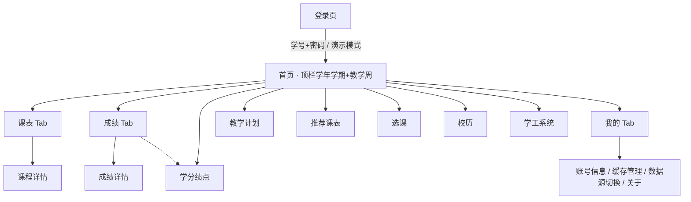

# 掌上唐师 · 产品需求文档（PRD）

| 项 | 内容 |
|---|---|
| 产品名称 | 掌上唐师（ZhangShangTangShi） |
| 文档语言 | 中文 |
| 目标平台 | Android（Capacitor 封装），移动端基准视口 **390×844** |
| 前端技术栈 | Vite + React + MUI + Tailwind CSS（团队默认，未另行指定） |
| 文档版本 | v1.0 / 2026-11-05 |
| 数据事实基准 | `docs/school-calendar.json`（唐山师范学院教务处 2026~2027 学年第 1 学期校历，已人工核对） |

## 1. 原始需求复述

> app 名称定为"掌上唐师"，要求有以下功能：接入学校教务系统（jwxt.tstc.edu.cn）并定制第三方页面，可以快速查询成绩、查询学分绩点、教学计划、个人课表、推荐课表、选课等常用功能，可以增加学工系统入口，学工系统以网页（http://sws.tstc.edu.cn/XGTSTC/Phone/#/login）运行即可，增加校历查询功能页面（https://jwc.tstc.edu.cn/xlcx.htm），并且结合系统时间和校历在首页顶栏展示所属教学周和学年、学期，例如学校教务处（https://jwc.tstc.edu.cn/）顶栏，设计风格要求统一，动画丝滑。

## 2. 产品目标

把分散在教务系统（PC 端表格化、手机端难用）、学工系统、教务处校历三个孤岛里的高频信息，收敛成一个"打开即见"的移动入口：**① 三秒内看到"现在第几教学周 + 今天上什么课"**，让教学周成为学生心中稳定的时间坐标系；**② 把成绩/绩点/教学计划/选课四个"必须去机房开电脑"的动作变成手机上两三次点击**，其中成绩与课表支持离线可读；**③ 用统一、克制、有质感的视觉与丝滑动效，做出一个学生愿意留在桌面的校园 App，而不是一个套壳浏览器**。成功标尺：核心查询路径（首页→目标数据）≤ 2 次点击，首屏可交互 ≤ 1.5s，动效无掉帧。

## 3. 用户画像与核心场景

- **画像**：唐山师范学院在校本科生（大一至大四），Android 手机为主，日常碎片时间（课间、宿舍、食堂）使用，流量敏感，对"加载转圈"和"页面错位"零容忍。
- **场景 1 · 周一起床确认**：早上 7:50 睁眼看手机，打开 App 首页直接知道"26~27学年第一学期 第 10 教学周，今天周四第 1-2 节 博学楼 A302 高等数学"。不需要登录。
- **场景 2 · 期末查分**：出分当晚 22:00 反复刷新，想看"这学期几门课出了、绩点涨了没、离毕业学分还差多少"。需要有缓存，弱网也能看到上次结果。
- **场景 3 · 选课开抢**：选课窗口开放前 10 分钟，翻可选课程列表、看余量、看推荐课表，临时改主意退一门再选一门。

## 4. 约束与运行模式（硬约束，不可绕过）

| # | 约束 | 对产品的影响（用户可感知） |
|---|---|---|
| C1 | **构建机无 Android SDK / Gradle，不能产出 APK** | 交付物 = 完整 Android 工程（Capacitor）+ **可直接在浏览器打开验证的 Web 版**。PRD 中所有交互必须在 390×844 浏览器视口下可验收；学生最终 APK 由用户装 Android Studio 后自行出包。 |
| C2 | **教务系统域名更正：真实入口是 `jwxt.tstc.edu.cn`（HTTPS），旧记录里多带数字 3 的那台主机不存在**（DNS 无记录）。系统仅校园网内可达，且程序化 POST 登录尚未打通 | 教务数据必须走**可插拔数据源（DataProvider 适配器）**：内置一套结构贴近真实教务系统的演示数据，接口层预留真实实现位。产品必须定义两种模式的用户感知（见 C2-a）。 |
| C2-a | 演示态 / 真实态 | **演示态**：顶部出现一条 36px 高的轻量提示条「演示数据 · 非真实教务信息」，右侧「×」可关闭（本次启动内不再出现），数据源为内置 mock；**真实态**：提示条不出现，数据来自教务接口。切换入口放在「我的」页，文案为「数据源：演示 / 教务系统」。 |
| C3 | **学工系统用 WebView 承载，不自研** | 只做「说明 + 打开」的入口页 + 加载失败兜底页，不解析也不伪造学工数据。注意 `http://` 明文地址，Android 需允许该域名明文访问。 |
| C4 | **无自建后端** | 账号凭据与缓存全部落本地（安全存储 + 本地缓存），不上传服务器。首启不联网也能进入首页（演示数据/缓存数据），仅学工 WebView 需真实网络。 |
| C5 | **校历数据为权威事实** | 教学周显示必须严格按 `school-calendar.json`：`week = floor((今天 − semesterStart)/7) + 1`。校验基准：**2026-11-05（周四）→ 第 10 教学周**。 |

**顶栏文本格式（复刻教务处，注意波浪号与中文数字）**：`26~27学年第一学期 第 10 教学周`
- 左侧：`{displayYear}学年{termLabel}`，`termLabel` 为中文数字（第一学期 / 第二学期）
- 右侧：`第 {week} 教学周`，数字与汉字间保留半角空格
- 学期外（week < 1 或 > 19）：左侧仍显示学年学期，右侧替换为 `假期中` / `距开学 X 天`，字号与色值不变，不得撑破一行

## 5. 信息架构

底部 Tab 4 个：`首页 / 课表 / 成绩 / 我的`；其余功能从首页宫格进入。



## 6. 页面规格表

### 6.1 目标 / 关键元素 / 交互

| 页面 | 目标 | 关键元素 | 关键交互 |
|---|---|---|---|
| **P01 登录** | 建立教务身份，同时为无校园网用户留后门 | 品牌区（校徽+掌上唐师）、学号输入、密码输入（可见切换）、登录按钮、演示模式文字按钮、隐私说明 | 输入校验（学号 10-12 位数字）；登录中按钮转 loading 且禁用；失败抖动+顶部 Toast；点「演示模式」直达首页并标记 C2-a 演示态；凭据「记住学号」 |
| **P02 首页** | 三秒回答"第几周 + 今天上什么" | 顶栏（学年学期+教学周）、演示提示条、今日课程卡（时间/课名/地点/教师）、快捷宫格（成绩/绩点/教学计划/选课/推荐课表/校历/学工）、关键节点倒计时（距期末考试 X 天 / 距寒假 X 天）、下拉刷新 | 顶栏滚动时轻微收缩（64→56px）；今日课程卡点击进课程详情；宫格交错入场（stagger 40ms）；倒计时数字滚动；下拉刷新旋转指示器 |
| **P03 成绩查询** | 按学期快速定位成绩 | 学期选择器（横向 chip 滚动）、成绩列表（课程名/学分/绩点/成绩/类型）、顶部概览（门数/学分合计/不及格门数）、搜索 | 切换学期列表整体淡入+位移；点击行进详情（共享元素过渡课程名）；下拉刷新；长按可复制成绩文本 |
| **P04 成绩详情** | 单科信息完整可核 | 课程名、课程号、学分、学时、教师、考核方式、成绩（大号数字）、绩点、成绩构成（平时/期中/期末，若演示数据提供）、备注（重修/缓考） | 返回手势/按钮；成绩数字入场滚动到目标值（350ms） |
| **P05 学分绩点**（学生学业情况查看） | 一眼看到教务给出的平均学分绩点 | **只展示一个 GPA 大号数字**（`3.16`）+ 统计时间 + 教务来源说明 + 教务免责原文 | 数字入场滚动 350ms；不做本地加权、不提供「重新计算」 |
| ~~**P06 教学计划**（教学执行计划查看）~~ | **已下线（2026-11-06 用户决定）** | — | 整条链路移除：页面、路由 `/plan`、首页宫格、数据槽 `slots.plan`、`getTeachingPlan()`、演示数据 `demo/plan.js` 全部删除 |

> **P05 / P06 口径更正（用户 2026-11-06 确认）**：教务「信息查询 → 学生学业情况查询」**只用来取 GPA**，页面上不展示七项门次统计，也不展示 21 节点学分构成树——虽然教务原文里有，但用户不需要。教务「我的应用 → 教学执行计划查看」**整条功能不做**。原 PRD 写的「P05 学分树 + P06 模块完成度 + 两页口径说明」全部作废。数据层仍完整解析教务原文（便于核对与将来扩展），但页面只消费 `gpa` 与 `statsAt`。
| **P07 我的课表** | 一屏看完一周 | 周次切换器（‹ 第 10 周 ›，可点开周次选择器）、星期表头、12 大节时间轴（三段分隔：上午 1-4 / 下午 5-9 / 晚间 10-12）、课程卡片（课名/地点/教师，按课程类型配色）、今日列高亮、第 18-19 周「复习考试周」空态 | 左右滑动切换周次；切换时卡片按时间顺序交错入场；点卡片弹出底部详情层（可下滑关闭）；「回到本周」浮按钮（仅非本周时出现） |

> **P07 的周次口径（已修正，勿再按旧描述实现）**：课程周次是**任意周次集合** `course.weeks: number[]`（可能只排 3/7/11 周），不是「范围 + 单双周」。因此**只渲染当前周命中的课程，不渲染、也不半透明保留其他周的课程**——若保留半透明，同一格会同时叠着整学期所有课，320px 下直接糊成一片。
> 旧版 PRD 写的「周次范围外课程半透明」是在 `weekRange + weekParity` 模型下写的，已作废。`weekRange` / `weekParity` 只用于列表文案（「1-16周」「单周」），是派生字段，不得反写。
| **P08 推荐课表** | 看清教务系统给出的推荐周课表 | **与个人课表 P07 同一套周网格**（星期表头 + 12 节时间轴 + 课程卡 + 周次切换器）、教务来源说明条（原文照抄）、本周课程数 | 左右滑切周；点卡片看课程详情；周次选择器；**不提供**选课动作 |

> **P08 口径（2026-11-06 用户确认，替换早期「推荐方案」设计）**：推荐课表是教务系统里**已有**的功能「我的应用 → 推荐课表打印」，它返回的就是一张按培养方案推荐的周课表，页面和「信息查询 → 个人课表查询」基本一样。App 只负责抓取 + 映射 + 用自己的 UI 渲染，**不做推荐算法、不算匹配度、不提供「一键参照此课表选课」**。早期 PRD 的方案卡 / matchRate / 冲突换课 / 参照选课全部作废——教务没有这些数据，实现了就是在编。
| **P09 选课** | 窗口期内完成选/退 | 选课轮次与时间窗口条（开放中/未开始/已结束 + 倒计时）、搜索、筛选（类型/院系/有余量）、课程行（课名/教师/学分/时间/余量进度/按钮） | 选/退按钮即时乐观更新+回滚；余量为 0 按钮置灰标注「已满」；窗口未开放时按钮禁用并提示开放时间；操作结果 Toast |
| **P10 校历** | 时间坐标的图形化底稿 | 月份切换（‹ 2026年11月 ›）、月历网格（日期+教学周角标）、今日高亮、关键节点色点（节假日/运动会/报到/考试周）、图例、底部「查看校历原图」、关键节点列表 | 月份左右滑动；点日期弹出当日事件浮层；点「校历原图」全屏看 `jwc.tstc.edu.cn/xlcx.htm` 存档图（可缩放） |
| **P11 学工系统** | 明确边界地把用户送过去 | 说明卡（这是什么/需要登录学工账号/数据不在本 App）、地址展示、「打开学工系统」主按钮、WebView 承载页（含返回/刷新/关闭） | 打开后 WebView 顶部有返回条；加载超时/失败显示兜底页（图标+「网络不可用或需校园网」+ 重试 + 复制地址） |
| **P12 我的 / 设置** | 账号、数据、关于 | 头像+姓名+学号+院系班级、数据源切换（演示/真实）、清除缓存（含占用体积）、深色模式开关（P1）、关于（版本/校历数据来源/教务处链接）、退出登录 | 清除缓存二次确认 + 成功 Toast；切换数据源需重新拉取并全量刷新 |

### 6.2 数据字段 / 空态 / 异常态

| 页面 | 数据字段 | 空态 | 异常态 |
|---|---|---|---|
| P01 | `studentNo, password, rememberId, dataSource` | — | 密码错：输入框红色+「学号或密码错误」；网络不可达：「当前网络无法访问教务系统，可先使用演示模式」 |
| P02 | `semester(displayYear,termLabel), teachingWeek, todayCourses[], quickEntries[], countdowns[]` | 今日无课：「今天没有课，好好休息」+ 插画 | 顶栏时间异常兜底为「假期中」；课程拉取失败只降级该卡片（卡片级错误提示+重试），不整页报错 |
| P03 | `grades[](courseName,credits,gradePoint,score,courseType,semesterId)` | 「本学期暂无成绩记录」+ 说明「成绩通常在考后 2-4 周公布」 | 加载骨架屏；失败显示重试；有缓存则展示缓存并标注「上次同步 11-05 22:10」 |
| P04 | 同 Grade 全字段 + `scoreDetail{平时,期中,期末}` | `score=null`：「成绩尚未录入」 | id 失效：「该课程记录已更新，请返回列表刷新」 |
| P05 | `gpa,gpaOrigin,statsAt,fetchedAt`（页面只消费 `gpa` 与 `statsAt`） | 无数据时 GPA 显示 `--` + 「教务暂未生成学业情况，请稍后再试」 | 拉取失败时展示缓存并标注「上次同步 H:mm」；**不得提供「重新计算」类按钮** |
| ~~P06~~ | **已下线**：数据槽、provider 方法、演示数据一并移除 | — | — |
| P07 | `weeks[1..19], weekCourses[](courseId,name,location,teacher,sections,dayOfWeek,weekRange,weekParity,courseType)` | 该周无课：「第 X 周没有排课」 | 课程时间冲突：两张卡并排各占 50% 宽并标注「冲突」 |
| P08 | `semesterId,weeks[],courses[]（Course，与个人课表同构）,sourceNote,fetchedAt` | 「教务暂未生成推荐课表」 | 抓取失败时展示缓存并标注上次同步时间；来源说明条必须原文显示，不得改写成「App 推荐」 |
| P09 | `round{label,openAt,closeAt,status},courses[](id,name,teacher,credits,capacity,enrolled,timeText,isSelected)` | 「当前无开放选课轮次」+ 下次开放时间 | 提交失败（余量抢空）：「很遗憾，该课程已选满」并回滚按钮；窗口刚关闭：禁用并提示 |
| P10 | `month, days[](date,weekNo,isToday,events[]), events[](date,title,type), calendarImage` | 非学期月：仍显示月历，仅无教学周角标 | 校历原图加载失败：显示占位+「在浏览器中打开教务处校历」链接 |
| P11 | `url, title, description` | — | 加载超时 15s / 白屏：兜底页（重试/复制地址）；证书或明文限制错误：提示「请使用校园网或允许不安全连接」 |
| P12 | `user{name,studentNo,college,className},dataSource,cacheSize,version,theme` | 未登录：显示「未登录」+ 去登录 | 清缓存失败：Toast「清除失败，请重试」 |

## 7. 需求池与验收标准

### P0 · 必须做（缺失则不可交付）

| ID | 需求 | 验收标准 |
|---|---|---|
| F-01 | 登录页（学号+密码+演示模式入口） | 空/格式错有内联提示；点演示模式 1 次点击进首页且出现演示提示条 |
| F-02 | 首页 + 教学周顶栏 | 系统时间设为 2026-11-05 时，顶栏精确显示 `26~27学年第一学期 第 10 教学周`；390px 宽不换行不截断；40 个不同日期抽样，教学周与 `school-calendar.json` 完全一致 |
| F-03 | 今日课程卡 | 显示当天全部课程，含课名/时间/地点/教师；无课显示空态 |
| F-04 | 快捷功能宫格 | **6 入口**（教学执行计划查看已下线，原 7 个减去 1 个）可点击且路由正确；stagger 入场 40ms/个 |
| F-05 | 成绩查询（列表+学期筛选+详情） | 至少 3 个学期演示数据；筛选切换后列表内容正确；单科详情字段与列表一致 |
| F-06 | 我的课表（周视图+周次切换） | 1-19 周可切换；第 10 周（11-02~11-08）课程与演示数据一致；今日列高亮正确；周次范围外课程不显示 |
| F-07 | 校历页（月历+教学周+节点） | 2026 年 11 月网格中 11-05 标注第 10 周且为今日高亮；秋季运动会/国庆/元旦节点有标记与事件浮层 |
| F-08 | 我的页（账号+清缓存+数据源+关于） | 清缓存有二次确认；数据源切换后提示条状态立即变化 |
| F-09 | 底部 Tab 导航（4 Tab） | 切换保持各 Tab 滚动位置；指示器滑动动画 250ms；返回键行为符合层级 |
| F-10 | 全局动效基线 | 页面转场统一使用定义好的缓动与时长；列表首屏骨架屏；无任何 >400ms 白屏转场；连续滚动 60fps 无可见卡顿（Chrome DevTools Performance 抽检） |
| F-11 | DataProvider 可插拔 | 同一套 UI 在 `demo` 与 `remote` 两个 provider 下均可渲染；`remote` 失败时降级并给出可见提示，不白屏 |

### P1 · 应该做

| ID | 需求 | 验收标准 |
|---|---|---|
| F-12 | 学分绩点页 | **页面只有一个 GPA 数字**，且值 == `OFFICIAL_GPA.gpa`（当前 `3.16`）；统计时间来自 `statsAt`；教务免责原文展示；**不得出现学分树、门次统计、进度条、重新计算按钮**；校验口径是「页面值 == `OFFICIAL_GPA.gpa`」，不再与成绩列表加权结果比对（实测本地加权 3.07 vs 教务 3.16） |
| ~~F-13~~ | ~~教学计划页~~ | **已下线**，不再验收 |
| F-14 | 选课页 | 选/退即时反馈且可回滚，三道闸（轮次未开放 / 本轮门数上限 / 余量已满）统一在 `actions.toggleSelection` 拦截；**按钮不做 disabled**，点击后 toast 说明具体原因（禁用按钮无法告诉用户为什么不能选）；冲突角标按星期+节次+周次三者全命中才显示 |
| F-15 | 推荐课表 | 与个人课表共用同一套周网格（12 节 / 7 天）；数据取自教务「推荐课表打印」而非本地生成；周次切换与课程详情可用；来源说明条原文展示 |
| F-16 | 学工 WebView 入口 + 兜底页 | 断网时 15s 内出现兜底页并有可点重试与复制地址 |
| F-17 | 深色模式 | 所有页面在深色下文字对比度 ≥4.5:1；切换即时生效无闪烁；偏好持久化 |

### P2 · 可以做（本版不阻塞）

| ID | 需求 | 验收标准 |
|---|---|---|
| F-18 | 成绩趋势图表增强（同分位对比/挂科预警） | 图表可交互，无数据时优雅降级 |
| F-19 | 课程提醒推送（课前 15 分钟） | 需 Capacitor 本地通知能力；权限拒绝时不反复弹窗 |
| F-20 | 多学期成绩归档与导出 | 可导出为图片/文本，内容含学期与 GPA |
| F-21 | 成绩单分享 | 生成分享卡片，含脱敏开关（隐藏学号） |

## 8. 设计语言规范

参考 **Material Design 3 色彩体系 + Apple HIG 间距（8pt 网格）+ Pinterest 级留白**。主色定调「唐师蓝」：深邃靛蓝体现师范院校稳重，暖金点缀拉质感，高饱和语义色保证可读性；大面积留白、统一圆角、克制阴影（最多 2 层）。

### 8.1 色彩 Token

| Token | 亮色值 | 深色值 | 用途 |
|---|---|---|---|
| `--brand-primary` | `#1B3A6B` | `#4A7BC8` | 主色：顶栏、主按钮、选中态 |
| `--brand-primary-deep` | `#12294D` | `#2E5590` | 按下态、渐变深端 |
| `--brand-primary-soft` | `#E8EEF7` | `#1C2E4A` | 主色浅底（chip/标签） |
| `--brand-accent` | `#C8A24A` | `#D9B96B` | 点缀：进度、重点数字、教学周徽标 |
| `--brand-accent-soft` | `#F7F0DF` | `#2A2418` | 暖金浅底 |
| `--bg-page` | `#F6F7F9` | `#0F1520` | 页面背景 |
| `--bg-surface` | `#FFFFFF` | `#17202E` | 卡片/浮层 |
| `--text-primary` | `#1A1F29` | `#E8ECF2` | 标题正文 |
| `--text-secondary` | `#5A6472` | `#A8B2C0` | 次级说明 |
| `--text-tertiary` | `#949CA8` | `#6E7887` | 占位/角标 |
| `--border-subtle` | `#E9ECF1` | `#26313F` | 分割线/描边 |
| `--success` | `#2E7D5B` | `#4CAF82` | 已选/通过 |
| `--warning` | `#E08A1E` | `#F0A73E` | 余量紧张/冲突 |
| `--danger` | `#C94F4F` | `#E07070` | 挂科/已满/删除 |
| `--info` | `#2F6FB5` | `#5B9AD9` | 提示/链接 |

课程卡片配色（按时段/类型，仅用主色与点缀的明度变体，避免花）：必修 `#1B3A6B` / 选修 `#2F6FB5` / 公共 `#4E8E7A` / 实践 `#C8A24A`，统一 12% 透明度填充 + 左侧 3px 实色条。

### 8.2 字号阶梯（390px 基准）

| Token | size/line-height | 字重 | 用途 |
|---|---|---|---|
| `display` | 28/34 | 700 | 绩点、成绩大数字 |
| `h1` | 22/28 | 600 | 页面标题 |
| `h2` | 18/24 | 600 | 区块标题、课程名 |
| `body` | 15/22 | 400 | 正文、列表主信息 |
| `body-strong` | 15/22 | 600 | 强调数值 |
| `caption` | 13/18 | 400 | 辅助说明、顶栏 |
| `micro` | 11/15 | 500 | 角标、图例 |

顶栏两段文本均用 `caption`（13px/600），避免长文本换行。

### 8.3 间距 / 圆角 / 阴影 Token

- 间距（8pt 网格）：`4 / 8 / 12 / 16 / 20 / 24 / 32 / 40`；页面左右安全边距 **16**；卡片内边距 **16**；卡片间距 **12**；区块间距 **24**。
- 圆角：`r-xs 8`（标签/小按钮）、`r-sm 12`（输入框/课程卡）、`r-md 16`（主卡片）、`r-lg 20`（底部弹层/大容器）、`r-full 999`（chip/胶囊/头像）。
- 阴影（克制，最多 2 层）：
  - `e1`: `0 1px 2px rgba(27,58,107,0.06)`
  - `e2`: `0 4px 16px rgba(27,58,107,0.08)`
  - 顶栏吸顶时用 `e1`；底部弹层用 `e2` + 24px 上圆角。
- 触控区域：任何可点元素**不小于 44×44px**（视觉尺寸可小，热区补足）。

### 8.4 动效规范（硬性验收项）

| 场景 | 曲线 | 时长 | 说明 |
|---|---|---|---|
| 页面/Tab 转场 | `standard` | 250ms | 淡入 + 8px 上位移，不做横向大位移 |
| 卡片入场交错 | `spring` | 350ms | stagger 40ms/个，位移 12px + 透明度 0→1，上限 8 个后不再延迟 |
| Tab 指示器滑动 | `standard` | 250ms | 位移 + 宽度同步插值 |
| 数字滚动 | `standard` | 350ms | 缓出，末位对齐 |
| 下拉刷新 | `standard` | 200ms | 指示器旋转 + 释放回弹 |
| 骨架屏 | `linear` | 1200ms 循环 | 微光扫过，不用纯灰块闪烁 |
| 底部弹层 | `spring` | 350ms | 位移 + 背景遮罩透明度 0→0.4 |
| 按钮按下 | `standard` | 150ms | scale 0.97 + 背景加深 |

缓动曲线：`spring = cubic-bezier(0.34,1.56,0.64,1)`；`standard = cubic-bezier(0.2,0,0,1)`；`linear = linear`。时长档位仅允许 **150 / 250 / 350ms**。
全局约束：所有动效必须可被系统「减弱动态效果」关闭（降级为直接显示）；不得因动画阻塞点击。

## 9. 数据模型（TypeScript 草案）

> 字段命名贴近真实教务系统，注释为中文说明。

```ts
/** 学期（校历与教务系统统一口径） */
interface Semester {
  id: string;                 // "2026-2027-1"
  academicYear: string;       // "2026-2027" 学年
  displayYear: string;        // "26~27" 顶栏展示用（波浪号不可替换为 -）
  term: 1 | 2;                // 学期序号
  termLabel: string;          // "第一学期" 中文数字，教务处原文格式
  semesterStart: string;      // "2026-08-31" 第 1 教学周周一（ISO）
  semesterEnd: string;        // "2027-01-10"
  totalWeeks: number;         // 19 总周数
  teachingWeeks: number;      // 17 上课周
  examWeeks: number[];        // [18,19] 复习考试周
  statusRegisterWeek: number; // 3 学籍注册所在教学周
  winterBreakStart: string;   // "2027-01-11" 寒假开始
}
/** 课程（教学班维度，一次开课） */
interface Course {
  id: string;                 // 教学班 ID "2026-1-0831042-01"
  code: string;               // 课程号 "0831042"
  name: string;               // "高等数学 A(上)"
  teacher: string;            // 任课教师
  teacherTitle?: string;      // 职称
  credits: number;            // 学分 3.5
  hours: number;              // 总学时 56
  courseType: 'required' | 'elective' | 'public' | 'practice'; // 必修/选修/公共/实践
  assessment: 'exam' | 'check'; // 考核方式：考试/考查
  campus?: string;            // 校区
  location?: string;          // 上课地点 "博学楼 A302"
  classNo?: string;           // 教学班号 "01"
  capacity: number;           // 容量（选课用）
  enrolled: number;           // 已选人数（选课用）
  weekRange: [number, number]; // 起止教学周 [1,17]
  weekParity?: 'all' | 'odd' | 'even'; // 全周/单周/双周
  dayOfWeek: 1 | 2 | 3 | 4 | 5 | 6 | 7; // 星期（1=周一）
  sections: number[];         // 节次 [1,2] 第 1-2 大节
  startTime: string;          // "08:00"
  endTime: string;            // "09:40"
  isSelected: boolean;        // 是否已选（选课页状态）
}
/** 成绩单条记录 */
interface Grade {
  id: string;
  courseId: string;           // 关联 Course.id
  courseCode: string;
  courseName: string;
  credits: number;            // 学分
  score: number | null;       // 百分制成绩；null 表示未录入
  scoreText?: string;         // 文字成绩 "优秀" / "合格"
  gradePoint: number | null;  // 绩点；缓考/缺考为 null
  courseType: 'required' | 'elective' | 'public' | 'practice';
  assessment: 'exam' | 'check';
  semesterId: string;         // 所属学期
  examType: 'normal' | 'retake' | 'makeup'; // 正考/重修/补考
  isRetake: boolean;          // 是否重修（影响绩点计算口径）
  remark?: string;            // "缓考" / "缺考" 等
  scoreDetail?: {             // 成绩构成（若教务返回）
    usual?: number;           // 平时
    midterm?: number;         // 期中
    final?: number;           // 期末
  };
}
/** 学分构成树节点（教务「学生学业情况查询」原样输出，扁平 + depth 表达层级） */
interface GpaModule {
  name: string;               // "必修课公共部分"
  depth: number;              // 0 = 主修，依次 +1
  requireCredits: number;     // 要求学分
  earnedCredits: number;      // 获得学分
  missingCredits: number;     // 未获得学分
  requiredCount?: number;     // 要求门次
  reachedRaw?: string;        // 到达要求，原样串（教务会给 "0.60"）
  unreachedRaw?: string;      // 未达到要求，原样串
  courseTotal?: number;       // 共（N）门
  coursePassed?: number;      // 通过（N）门
  logic?: '并且' | '或者' | '缺省';
}
/** 学分绩点汇总 —— 全部字段来自教务原样输出，客户端零计算 */
interface GPA {
  gpa: number;                // 平均学分绩点（当前 3.16）
  gpaOrigin: 'official';      // 来源固定为教务权威值
  statsAt: string;            // 教务标注的统计时间 "2026-11-06 00:36:27"
  courseCount: {
    planned: number;          // 计划总课程 99
    passed: number;           // 通过 82
    failed: number;           // 未通过 0
    notTaken: number;         // 未修 11
    inProgress: number;       // 在读 6
    extraPassed: number;      // 计划外通过 0
    extraFailed: number;      // 计划外未通过 0
  };
  modules: GpaModule[];       // 21 节点
  disclaimer: string;         // "此页面信息仅做学业修读情况参考。"
  fetchedAt: string;          // ISO 8601
}
/** 教学执行计划查看（P06）已整条下线，TeachingPlan / TeachingPlanModule 接口定义一并删除 */
/** 选课轮次 + 课程池 */
interface CourseSelection {
  semesterId: string;
  roundLabel: string;         // "第一轮选课"
  openAt: string;             // 开放时间 ISO
  closeAt: string;            // 截止时间 ISO
  status: 'pending' | 'open' | 'closed';
  courses: Course[];          // 可选课程（含 isSelected / capacity / enrolled）
}
/** 推荐课表：教务「推荐课表打印」返回的一张周课表，与个人课表同构 */
interface RecommendedTimetable {
  semesterId: string;
  weeks: number[];             // 覆盖周次
  courses: Course[];           // 字段与 Course 完全一致，直接交给网格渲染
  sourceNote: string;          // 教务来源说明，页面照抄
  fetchedAt: string;           // 抓取时间 ISO
}
/** 校历事件 / 关键节点 */
interface CalendarEvent {
  id: string;
  date: string;               // 起始日期 ISO
  endDate?: string;           // 结束日期（跨天事件）
  title: string;              // "秋季运动会"
  type: 'holiday' | 'event' | 'enroll' | 'teaching' | 'vacation' | 'exam';
  week?: number;              // 所属教学周（若有）
  note?: string;
}
/** 顶栏上下文（首页顶部聚合结果，由系统时间+校历计算） */
interface TermHeaderContext {
  displayYear: string;        // "26~27"
  termLabel: string;          // "第一学期"
  week: number | null;        // 10；null 表示不在学期内
  phase: 'inTerm' | 'beforeTerm' | 'vacation';
  text: string;               // 组装后的展示文本
}
```

## 10. 非功能要求

| 维度 | 要求 |
|---|---|
| 性能 | 首屏可交互 ≤1.5s（本地数据）；路由切换 ≤250ms；列表滚动 60fps；动效不掉帧；单页 DOM 节点尽量 <1500 |
| 离线 | 顶栏教学周、课表、上次拉取的成绩均需离线可读；离线时顶部有轻量「离线」标识；恢复联网自动重试一次 |
| 存储与安全 | 凭据存 Android Keystore / WebCrypto 加密存储，**禁止明文落 localStorage**；不上传任何服务端；退出登录即清除凭据；缓存可按页清除 |
| 兼容 | Android 8.0+（WebView 等效 Chrome 80+）；390×844 为主基准，320-430 宽度自适应；安全区适配（刘海/底部手势条） |
| 可访问性 | 文字对比度 ≥4.5:1；触控 ≥44px；支持系统字号放大 130% 不破版；动效可关闭 |
| 兜底 | 任一数据卡片失败仅降级该卡片；全局 ErrorBoundary 防白屏；网络错误文案统一、可操作（重试/演示模式） |

## 11. 待确认问题

| # | 问题 | 影响 | 建议默认 |
|---|---|---|---|
| Q1 | 真实教务登录的校验方式（验证码 / 密码加密参数 / 是否需要 CAS）？公网不可达，无法抓包确认 | 决定 `remote` provider 能否真正落地 | v1 交付 `demo` + 预留 provider 接口；真实实现待校园网内抓包后补 |
| Q2 | 选课是否允许真实提交？脚本化提交存在被封号/违规风险 | 决定 P1 选课页是「只读浏览」还是「真选课」 | v1 只做浏览 + 本地标记「我的意向」，不做真实提交 |
| Q3 | 推荐课表的推荐口径（同专业高年级课表 / 培养方案未修课程 / 空档最少）？ | 影响 P08 数据字段与信任度 | 演示态用「培养方案未修 + 不冲突」口径，并在页面写明依据 |
| Q4 | 校历原图如何承载：内嵌 `jwc.tstc.edu.cn/xlcx.htm` 网页，还是本地存档图片？外链有防盗链与失效风险 | 影响 P10「校历原图」可用性 | 优先本地存档图 + 「在浏览器打开教务处页面」备用链接 |
| Q5 | 是否需要多账号（如帮同学查分）与多学期历史归档？P2 已列但优先级待定 | 影响数据层设计（单例 vs 多 profile） | v1 单账号；数据层预留 `profileId` 字段 |
