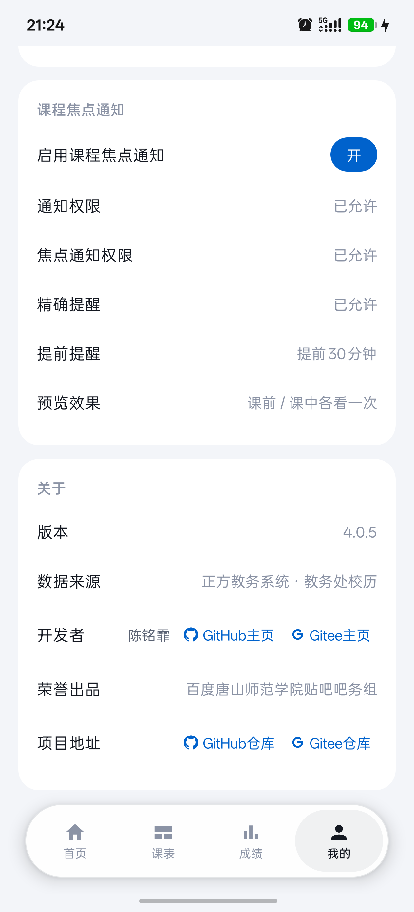
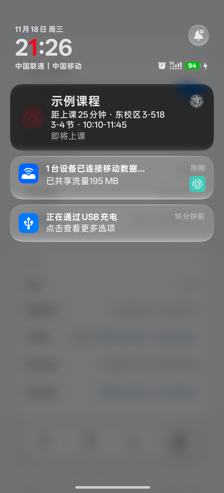

<div align="center">

<picture>
  <source media="(prefers-color-scheme: dark)" srcset="../docs/assets/school-logo-dark.png" />
  
</picture>

# 掌上唐师 · 鸿蒙专版

**把正在上的课推进鸿蒙实况窗 · 兼容层加固 · 与标准版分叉独立演进**

<p>
  <a href="native/version.properties">
    
  </a>
  <a href="native/version.properties">
    
  </a>
  <a href="https://developer.harmonyos.com">
    
  </a>
  <a href="https://developer.android.com">
    
  </a>
  <a href="native/build.sh">
    
  </a>
  <a href="../LICENSE">
    
  </a>
</p>

<p>
  <a href="../README.md">项目主页</a> · <a href="../README.en.md">English</a> · <a href="../native/">标准版源码</a>
</p>

</div>

---

> 这一版只做两件事，都只针对鸿蒙：
>
> 1. **课程实况窗** —— 正在上 / 即将上的课推到实况窗，收起态看课程名与地点，展开态看走秒倒计时；
> 2. **修掉标准版在鸿蒙上的崩溃** —— 「一点登录就闪退」「登录报 `URLEncoder` 错误」。
>
> **代码分叉、独立演进。** 鸿蒙兼容层的写法（能力探测 + 逐级降级）和标准版（可以直接假设
> Android 16 接口存在）本来就不一样，强行共用只会让两边都写满对方不需要的判断。
> 业务逻辑（课表 / 教务 / 公交）保持同步，平台能力各自实现。

---

## 📸 效果

| 课程实况窗设置 | 实况窗（展开态） |
| :---: | :---: |
|  |  |

> 截图取自演示账号；实况窗形态为 ColorOS 流体云，鸿蒙上位置与样式由系统决定，字段是一致的。

---

## 📥 我该下哪个版本

**先看你的手机是什么系统。**

| 你的手机 | 下载 | 说明 |
| --- | --- | --- |
| **鸿蒙 / HarmonyOS**<br>华为、荣耀新机型 | **[⬇ 鸿蒙专版](../releases/tag/harmony-v4.1.0)**<br>`zstangshi-harmony-4.1.0.apk` | 就是本目录这版，登录问题已修 |
| **普通安卓**<br>小米 / OPPO / vivo / 三星等 | **[⬇ 标准版](../releases/tag/v4.0.5)**<br>`zstangshi-v4.0.5.apk` | 走 Android 16 实况通知协议 |

### 不确定自己是不是鸿蒙？

打开手机 **设置 → 关于手机**：

- 看到 **「HarmonyOS 版本」** 或 **「鸿蒙版本」** → 下**鸿蒙专版**
- 看到 **「Android 版本」** 或 **「MIUI / ColorOS / OriginOS」** → 下**标准版**

> 也可以在拨号盘输入 `*#*#2846579#*#*` 看系统信息（部分机型支持）。

---

## ⚠️ 安装前必读

### 版本标识

装好后在 App 里 **「我的」→ 最下面「关于」** 可以确认：

| | 标准版 | 鸿蒙专版 |
| --- | --- | --- |
| 桌面图标下的名字 | 掌上唐师 | **掌上唐师·鸿蒙版** |
| 关于 → 版本 | 4.0.5 | **4.1.0-harmony** |
| 关于 → 版本类型 | 无此行 | **鸿蒙专版 · HarmonyOS 适配** |

看到「鸿蒙专版」就说明下对了。

### 关于覆盖安装

两个版本**包名相同**（`com.tstc.zstangshi`），这是故意的：

- ✅ **好处**：登录态、课表、设置都能保留，不用重新弄
- ⚠️ **但是**：因为签名不同，**手机上已有另一版时会提示「签名冲突」，无法覆盖**

**遇到签名冲突怎么办**：

1. 先备份（可选）：截图课表，或记下账号密码
2. 卸载原来的掌上唐师
3. 安装鸿蒙专版
4. 重新登录一次（**卸载会清掉本地课表和登录态**）

---

## 🆕 课程实况窗

「我的 → 课程实况窗」打开后，课表里的课会自动出现在鸿蒙的**实况窗**上：

```text
┌──────────────────────────────────────┐
│ [校徽] 高等数学 A                      │
│        距上课 25 分钟 · 东校区 3-518   │
│        即将上课                        │
│        3-4 节 · 10:10-11:45           │
└──────────────────────────────────────┘
```

- **收起态**：课前是「课程名 · 地点」，上课后变成走秒倒计时
- **三阶段**：即将上课 / 上课中 / 课间（连堂课中间的休息单独计时）
- **地点永远显示**，没有「显不显示地点」开关（那个开关会让岛上的信息变得没用）
- **划掉通知** = 本节不再提醒，下节课照常
- **提前多久** 可选：上课时 / 5 / 10 / 15 / 30 分钟，默认 10 分钟

### 鸿蒙上分两档呈现

鸿蒙的 Android 兼容层版本跨度很大，所以本版不写死版本号，而是**探测能力再决定形态**：

| 你的机器 | 判定 | 呈现 |
| --- | --- | --- |
| HarmonyOS 5.x（兼容层 API 36+） | `MODE_LIVE` | **实况窗 · 协议直连**，与原生 Android 16 同一条通道 |
| HarmonyOS 4.x / 3.x（API 29~33） | `MODE_PERSISTENT` | **常驻倒计时 · 等效实况窗**：常驻通知 + 系统计时器，通知划不掉、倒计时实时走秒 |
| 通知被系统关闭 | `MODE_NONE` | 设置页提示去开通知 |

判定代码在 [`native/app/src/main/kotlin/com/tstc/zstangshi/notif/HarmonyLive.kt`](native/app/src/main/kotlin/com/tstc/zstangshi/notif/HarmonyLive.kt)：

```kotlin
fun mode(ctx: Context): Int {
    val nm = ctx.getSystemService(Context.NOTIFICATION_SERVICE) as? NotificationManager
        ?: return MODE_NONE
    if (Build.VERSION.SDK_INT >= 24 && !nm.areNotificationsEnabled()) return MODE_NONE
    return if (Api36.supported()) MODE_LIVE else MODE_PERSISTENT
}
```

> **为什么不能直接做「鸿蒙实况窗」？**
> 鸿蒙原生的实况窗是 ArkTS 能力（LiveViewKit / WantAgent + 服务卡片），**APK 触发不了**。
> 本版能走的是 Android 实况通知协议；协议不可用时用「常驻通知 + 系统计时器」做等效呈现 ——
> 视觉位置由系统决定，但「看得到课上到几点」这件事是一样的。

设置页会直接告诉你当前是哪一档（**显示形态**那一行），不用猜。

### 第一次用要开两个权限

| 权限 | 在哪开 | 说明 |
| --- | --- | --- |
| 通知权限 | App 内弹窗 → 允许 | 没开则通知发不出来 |
| 实况窗 / 显示实时动态 | 系统设置 → 通知 | **与通知权限是两个独立开关**，只有走 `MODE_LIVE` 时才需要 |

> `POST_PROMOTED_NOTIFICATIONS` 的保护级别是 `normal|appop`：安装即授予，运行时申请无效，
> 只能在系统设置里开。所以「我的」页把它做成状态行 —— 未允许时点一下直接跳对应设置页，
> 从设置页返回会自动续上流程，不用再点一次开关。

### 想验效果，不用等真实课程

「我的 → 课程实况窗 → 预览效果」会弹两项：

- **还没上课（课程名 + 地点）** —— 看收起态的课程名与地点
- **已上课（倒计时）** —— 看走秒倒计时

发出去的是 25 分钟 / 2 分钟的示例通知，看完可以直接划掉。

---

## 🔧 修了什么

### 问题一：一点登录就闪退

**不是密码问题。** 全工程搜过，没有 `SecureRandom`、没有 `AndroidKeyStore`，
密码存的就是明文 `SharedPreferences`。

根因是**三处 Android 专有 API 在鸿蒙上不存在**，抛出的又是
`NoClassDefFoundError` / `NoSuchMethodError` —— 这些是 **Error 不是 Exception**，
`catch (e: Exception)` 根本抓不住，异常一路抛到 UI 线程顶层 → 进程被杀。

| # | 位置 | 原来怎么崩 |
| --- | --- | --- |
| ① | `LoginActivity` → `TodayWidget.refreshAll()` | 登录成功后**在 UI 线程同步**调 `AppWidgetManager.updateAppWidget`。鸿蒙没有 appwidget 服务，直接抛；这段**没有 try/catch** |
| ② | `BackGestures` 内部类 `Animated` | 继承 `OnBackAnimationCallback`（API 34 才有的类）。和 `BackGestures` 同文件 → ART 验证方法体时连父类一起解析 → 类加载即失败 |
| ③ | `MainActivity.applyInsets()` | `WindowInsets.Type.systemBars()` / `window.statusBarColor` 不是鸿蒙 API |

三处全在「点登录 → 进主页」路径上，所以启动页、课表、实时公交不碰它们，
那些功能是好的 —— 和当时的反馈完全一致。

### 问题二：登录报 URLEncoder 错误

真机实测发现：

```text
No static method encode(String;Charset;)String in class java.net.URLEncoder
```

`URLEncoder.encode(String, Charset)` 是 **Java 10** 才加的重载。
用 **JDK 17** 编译，编译期完全合法；但鸿蒙的 `core-oj.jar` 只有 Java 8 那批 API。

```kotlin
// ❌ 原来
URLEncoder.encode(key, StandardCharsets.UTF_8)   // 匹配 Charset 重载

// ✅ 现在
URLEncoder.encode(key, "UTF-8")                  // String 重载，Java 8 就有
```

**为什么只有登录坏、公交却正常**：全工程只有 `JwClient.encodeForm()` 用了 `Charset` 重载，
公交的 `ChelaileClient` / `MygolbsClient` 用的都是 `"UTF-8"` 字符串版。

---

## 🛡️ 加固清单

修完上面两条还不够 —— 鸿蒙兼容层到底缺什么没法穷举，所以又加了几层保险：

| 位置 | 做了什么 |
| --- | --- |
| `widget/TodayWidget.kt` | `refreshAll` / `render` / `scheduleTick` / `cancelTick` 全链路 `catch (Throwable)`，失败静默 |
| `ui/AnimatedBackCallback.kt` | **新建**，把 `OnBackAnimationCallback` 隔离到独立文件，只有真正 `new` 时才加载 |
| `ui/BackGestures.kt` | 不再只看 `SDK_INT`，改用 `Class.forName` 真探测；装不上退化成普通返回 |
| `MainActivity.kt` | insets 三级降级：现代 API → 量状态栏高度 → 0 内边距 |
| `ui/PageSlide.kt` | `setDecorFitsSystemWindows` 失败退回老 flag |
| `ui/Sheet.kt` | `syncSystemBars` 整段兜底 |
| `LoginActivity.kt` | 登录流程逐段隔离，**保证 `goMain()` 一定执行** |
| `BaseActivity.kt` | `attachBaseContext` / `applyOverrideConfiguration` 兜底（生命周期咽喉） |
| `pages/MinePage.kt` | `pinWidget` 兜底 + 关于页加「版本类型」 |
| `harmony/CrashGuard.kt` | **新建**，全局 `UncaughtExceptionHandler`，漏网异常写日志后吞掉 |
| `harmony/ZstsApp.kt` | **新建**，`Application` 入口，只负责装 CrashGuard |

### 崩溃日志在哪

万一还是崩了，日志在：

```text
Android/data/com.tstc.zstangshi/files/crash/harmony-*.log
```

里面记录了设备型号、系统和完整堆栈。发 Issue 时贴上来能快速定位。

---

## 🔨 自己编译

工程零第三方依赖，只用 Android framework API。

### 环境要求

- JDK 17
- Android SDK build-tools 34.0.0（`aapt2` / `d8` / `zipalign` / `apksigner`）
- Kotlin 编译器 1.9.24（`kotlinc19`，带 coroutines 1.7.3）
- bash（Windows 上可用 Git Bash）

### 编译

```bash
cd harmony-android
bash native/build.sh
```

产物：`harmony-android/android/build/app-debug.apk`（脚本里 `OUT` 指向本目录，不会覆盖标准版产物）。

版本号只在一处维护：

```properties
# harmony-android/native/version.properties
versionCode=64
versionName=4.1.0-harmony
```

> **⚠️ 路径不能有中文** —— `aapt2` 会报 `failed to open directory`。放到纯 ASCII 路径下再编：
>
> ```bash
> cp -r . /c/build/zstangshi && cd /c/build/zstangshi && bash harmony-android/native/build.sh
> ```

### 构建后自检

这个脚本会解析 dex 的方法引用表，扫出所有 **Java 9+ 的 API**（就是第二个问题的成因）：

```bash
node scripts/check-java-api.js native/build/dex/classes.dex
```

期望输出：

```text
dex 方法引用总数：13174
✓ 没有发现 Java 9+ 的 API 引用
```

> 仓库根 `package.json` 是 `"type": "module"`，而脚本用的是 CommonJS 的 `require`。
> 若报 `require is not defined`，复制成 `.cjs` 再跑：`cp scripts/check-java-api.js /tmp/x.cjs && node /tmp/x.cjs native/build/dex/classes.dex`。

---

## 🏗️ 目录结构

```text
harmony-android/
├── native/
│   ├── build.sh                    aapt2 + kotlinc + d8 + apksigner
│   ├── typecheck.sh
│   ├── version.properties          4.1.0-harmony (64)
│   └── app/src/main/
│       ├── AndroidManifest.xml     已声明 android:name=".harmony.ZstsApp"
│       ├── res/                    字符串/颜色/图标/布局
│       └── kotlin/com/tstc/zstangshi/
│           ├── LoginActivity.kt    ★ 登录流程逐段隔离
│           ├── MainActivity.kt     ★ insets 三级降级
│           ├── BaseActivity.kt     ★ 生命周期咽喉兜底
│           ├── pages/              四个主页面 + 编辑器
│           ├── widget/             ★ 小组件全链路吞异常
│           ├── ui/                 ★ BackGestures 拆类 / PageSlide / Sheet
│           ├── jw/                 ★ JwClient 修 URLEncoder
│           ├── bus/                实时公交（车来了 + 掌上公交）
│           ├── data/               课表/校历/作息/存储/合并
│           ├── harmony/            ★ 鸿蒙专版新增：CrashGuard + ZstsApp
│           └── notif/              ★ 课程实况窗：HarmonyLive + Api36 + 计划/构建/调度
├── scripts/
│   └── check-java-api.js           dex 方法引用扫描
└── README.md
```

★ = 鸿蒙专版的改动。规模：64 个 Kotlin 文件 · 24,725 行 · 41 个资源文件 · APK 1,744,002 字节（约 1.66 MiB）。

---

## 📌 和标准版的关系

- 这版**包含标准版的全部功能**，没有删任何东西
- **代码分叉，独立演进**：鸿蒙侧按兼容层能力写（探测 + 降级），不与标准版强行共用一份实现
- 业务逻辑（课表 / 教务 / 公交 / 同步合并规则）两边保持一致
- 安卓机上也能跑（所有 `try/catch` 在安卓上都不会触发，实况窗会走 `MODE_LIVE` 通道）
- 与标准版**同包名、不同签名**，不能共存：装这个要先卸载那个

| | 标准版 | 鸿蒙专版 |
| --- | --- | --- |
| 源码 | [`../native/`](../native/) | 本目录 |
| 版本 | 4.0.5（63） | 4.1.0-harmony（64） |
| 实况窗 | Android 实况通知协议 | 实时协议 + 常驻倒计时**双档降级** |
| 鸿蒙登录兼容 | 会闪退 | 已修复 |
| 体积 | 3.55 MiB | 1.66 MiB |

---

## ❓ 常见问题

**Q：装了鸿蒙专版，还能收到标准版的更新吗？**
A：不能。这是独立的分支版本，更新要手动下载新 APK。

**Q：为什么桌面名字变了？**
A：为了让你一眼分清装的是哪个版本。包名没变，数据互通。

**Q：鸿蒙 4.x 能装吗？**
A：能。鸿蒙 4.x 走的就是 Android 兼容层，装 APK 这条路没变，实况窗会自动降级成常驻倒计时。

**Q：实况窗上不显示课程？**
A：按顺序查三件事 —— ①「我的 → 课程实况窗」开关是否打开；②通知权限是否允许；
③「我的」页的**焦点通知 / 显示实时动态**那一行是否允许（这是独立开关）。
都不行就看「显示形态」那行，`MODE_NONE` 说明通知被系统关了。

**Q：还是闪退 / 登录失败怎么办？**
A：发 Issue，附上 `Android/data/com.tstc.zstangshi/files/crash/` 里的日志。

---

## 🔗 相关文档

| 文档 | 内容 |
| --- | --- |
| [主 README](../README.md) | 功能、下载、构建、实况窗实现原理（可直接套用） |
| [README.en.md](../README.en.md) | English version |
| [native/](../native/) | 标准版源码与自绘控件说明 |
| [CHANGELOG.md](../CHANGELOG.md) | 逐版本改动 |
| [release-notes-harmony-v4.1.0.md](../release-notes-harmony-v4.1.0.md) | 本版发布说明 |

---

个人开发项目，**非学校官方发布**。
内置校历数据来源：唐山师范学院教务处（jwc.tstc.edu.cn）。

本项目以 **GPL-3.0** 协议开源，全文见 [LICENSE](../LICENSE)。
