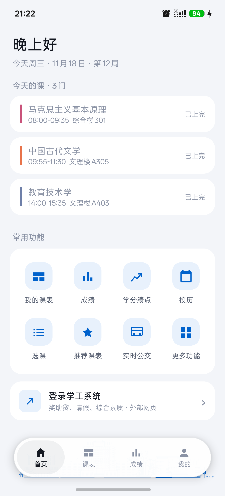
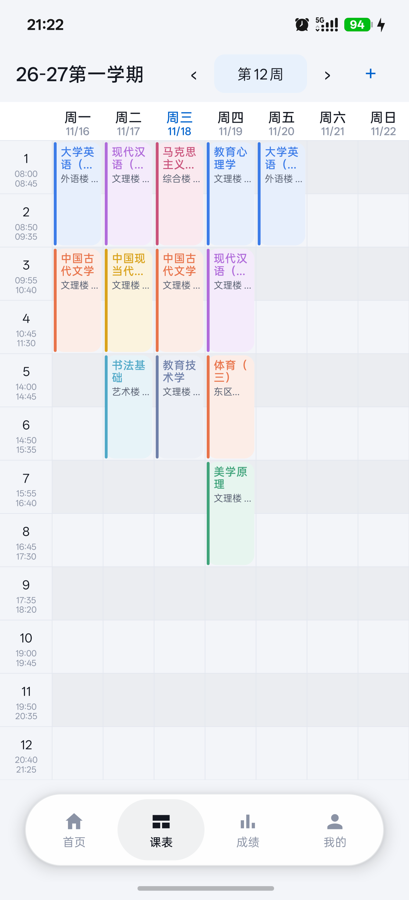
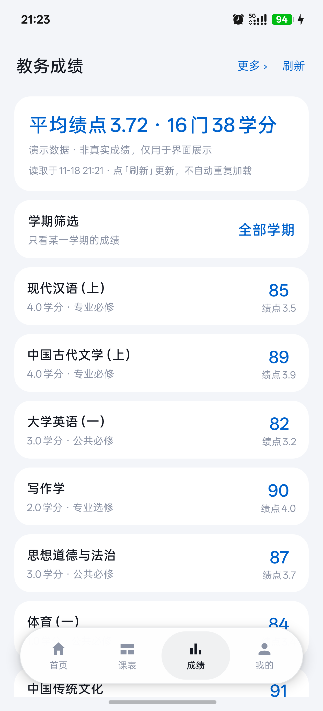
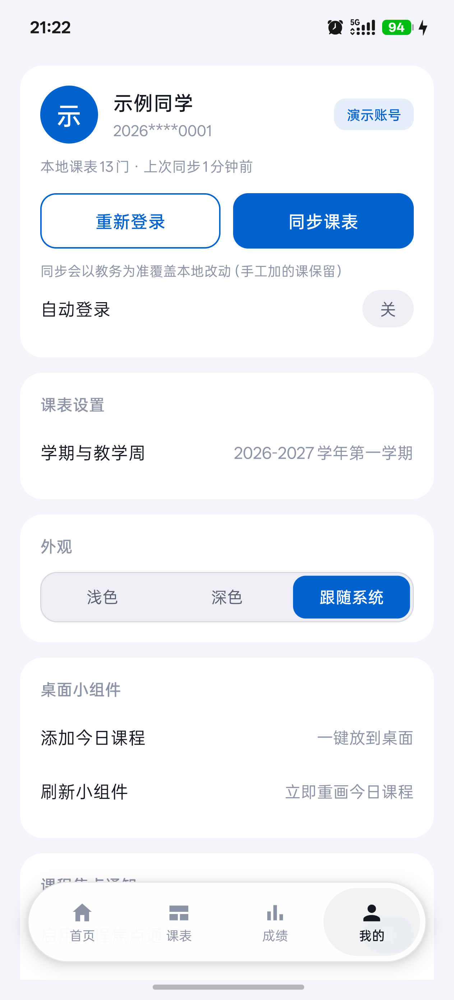

<div align="center">

<picture>
  <source media="(prefers-color-scheme: dark)" srcset="../docs/assets/school-logo-dark.png" />
  
</picture>

# 掌上唐师 · 标准版源码

**纯 Kotlin 手写 Android framework · 零第三方依赖 · 一条命令出 APK**

<p>
  <a href="version.properties">
    
  </a>
  <a href="version.properties">
    
  </a>
  <a href="https://developer.android.com">
    
  </a>
  <a href="https://kotlinlang.org">
    
  </a>
  <a href="build.sh">
    
  </a>
  <a href="../LICENSE">
    
  </a>
</p>

<p>
  <a href="../README.md">项目主页</a> · <a href="../README.en.md">English</a> · <a href="../harmony-android/">鸿蒙专版</a>
</p>

</div>

---

> 这里是**标准版（普通安卓）**的完整源码 —— 也是仓库的主线。
> 64 个 Kotlin 文件、25,588 行，不引 androidx、不引 Gradle、运行时零第三方依赖。
>
> 鸿蒙机型请走 [`../harmony-android/`](../harmony-android/)（代码已分叉，见文末对比）。

---

## 📸 界面预览

| 首页 | 课表 | 成绩 | 我的 |
| :---: | :---: | :---: | :---: |
|  |  |  |  |

> 截图取自演示账号，姓名、学号、成绩均为示例数据。

---

## ⚡ 快速开始

需要 **JDK 17** + **Android SDK**（`build-tools;34.0.0` + `platforms;android-34`）+ **Kotlin 编译器 1.9.24**。

```bash
bash native/typecheck.sh    # 只做类型检查，快，改完先跑这个
bash native/build.sh        # 完整出包
```

脚本依次执行：

```text
aapt2 compile → aapt2 link → javac(R.java) → kotlinc → d8 → zipalign → apksigner
```

产物固定落在 `android/build/app-debug.apk`（目录名沿用 v2 的 `android/`，但里面是新包）。

安装：

```bash
adb install -r android/build/app-debug.apk
# 或把 APK 拷到手机，允许「未知来源」后点开
```

### 环境变量

脚本里的路径都有默认值，换成自己机器的：

| 变量 | 默认 | 用途 |
| --- | --- | --- |
| `ANDROID_SDK_ROOT` | `C:/Android/sdk` | SDK 根目录 |
| `JDK` | `C:/Android/jdk17/...` | javac / kotlinc 运行所用 JDK |
| `KEYSTORE` / `KEY_ALIAS` | 本地调试密钥 | 签名（证书 CN=ZSTS） |

> **⚠️ 工程路径不能含中文** —— `aapt2` 会报 `failed to open directory`，先挪到纯 ASCII 路径再编。

### 版本号

只在一处维护 —— `native/version.properties`：

```properties
versionCode=63
versionName=4.0.7
```

改了跑一遍 `build.sh`，`aapt2 link` 会把两个值同时写进 manifest 与包信息。

### 出包后自检

```bash
BT=C:/Android/sdk/build-tools/34.0.0
"$BT/apksigner.bat" verify --print-certs android/build/app-debug.apk
"$BT/aapt2.exe" dump badging android/build/app-debug.apk | head -2
```

---

## 📦 版本与包信息

| 项 | 值 |
| --- | --- |
| 版本 | **4.0.7**（versionCode 66） |
| 包名 | `com.tstc.zstangshi` |
| 桌面名 | 掌上唐师 |
| minSdk | 26（Android 8.0） |
| targetSdk | 34（Android 14，编译 SDK 同为 34） |
| 权限 | `INTERNET`、`ACCESS_NETWORK_STATE`、一对定位权限、`REQUEST_INSTALL_PACKAGES` —— 定位只用于实时公交取一次附近站点（拒绝也能手动搜线路）；安装包权限只用于装更新 |
| 规模 | 64 个 Kotlin 文件 · 25,588 行 · 41 个资源文件 · 0 行 Java |
| 体积 | 3,771,518 字节（约 3.60 MiB），含 kotlin-stdlib，未做 R8 裁剪 |

> API 36 的实况通知接口（`requestPromotedOngoing` 等）编译期不存在，
> 全部走 `notif/Api36.kt` 反射调用 —— 这是编译 SDK 锁在 34 的代价，也是能在 Android 12~16 上跑同一份包的原因。

---

## 🏗️ 目录

```text
native/
├── build.sh                     一条命令出 APK
├── typecheck.sh                 只做类型检查
├── version.properties           版本号唯一真源
└── app/src/main/
    ├── AndroidManifest.xml
    ├── kotlin/com/tstc/zstangshi/
    │   ├── SplashActivity       启动页：开了自动登录就在这儿登，否则去登录页
    │   ├── LoginActivity        登录（教务 / 仅学工两种口径）
    │   ├── MainActivity         四页容器：PageDeck + 胶囊底栏 + 返回手势调度
    │   ├── FeatureActivity      二级功能页（成绩 / 绩点 / 推荐课表 / 选课…）
    │   ├── BusActivity          实时公交：首页 / 站点 / 线路三层共用这一个 Activity
    │   ├── CalendarActivity     校历
    │   ├── WebViewActivity      应用内浏览器（仓库链接、长尾教务功能）
    │   ├── BaseActivity         深色模式注入（applyOverrideConfiguration）
    │   ├── jw/                  正方教务：Auth / JwClient / JwApi
    │   ├── bus/                 公交数据层：车来了 + 掌上公交两套协议
    │   ├── data/                课表模型、周次换算、校历、作息、Store 快照
    │   ├── notif/               课程实况窗：计划 / 通知 / 调度 / 广播 / 反射
    │   ├── pages/               四个主页面 + 课程编辑器
    │   ├── ui/                  自绘控件：PageDeck / PageSlide / CapsuleDock / Sheet …
    │   ├── update/              检查更新、多源测速下载、启动自动检查
    │   └── widget/              桌面小组件（今日课程 4×2）
    └── res/                     主题、颜色（含 values-night）、图标、校园插画
```

代码分布：

```text
jw/        3 文件  1,745 行   正方教务接口
bus/       7 文件  4,543 行   实时公交（两套协议）
data/     15 文件  2,928 行   课表 / 校历 / 作息 / 周次 / 存储
notif/     5 文件    953 行   课程实况窗
pages/     6 文件  3,474 行   主页面与编辑器
ui/       15 文件  3,485 行   自绘控件
update/    2 文件    607 行   检查更新 / 自动检查
widget/    3 文件    337 行   桌面小组件
根目录      8 文件  7,516 行   Activity 壳与生命周期
```

---

## 🧩 自绘控件：几个关键实现

这些都是 framework 没有现成 API、只能自己写的地方，也是从 v2（WebView + H5 套壳）换原生的主要收益：
课表的横滑翻周、底栏切页的连续平移、二级页的预测性返回跟手，在 WebView 里只能用 JS 模拟手势，
跟不上系统动画，也做不出「手指拖到哪、画面跟到哪」的手感。

### `ui/PageDeck.kt` —— 横向页面带

四个主页面按底栏顺序**同时**排在一条横向带子上（每页宽度 = 屏宽），整体靠
`translationX = (slot - position) × slotWidth` 定位，切页时平移整条带子。

为什么不直接平移一个装四个页面的容器：容器本身只有一屏宽，平移它会被自己的 bounds 裁掉，
触摸也失效。所以每个子页各自 `layout` 在 `[0, 0, w, h]`，用各自的 `translationX` 表达位置 ——
看起来是一条带子在动，实际是四个页面在同一个坐标系里排队。

时长公式（`MainActivity.show()`）：`290ms + 45ms × (剩余格数 - 1)`，夹在 `[160, 400]`。
首页→课表 290、→成绩 335、→我的 380，极差 90ms，是同一套节奏；同时因为跨三格时中间两页
是真的从眼前掠过，不会「一糊而过」。

### `ui/PageSlide.kt` —— 二级页的圆角卡片转场

系统只在**返回**方向画圆角卡片（AOSP `CrossActivityBackAnimation` 取设备圆角半径，把正在关闭的
窗口裁圆角再缩到 90%），**进入**方向走的是窗口动画，framework 的窗口动画只有 alpha / translate /
scale，没有圆角属性，也没有任何公开 API 能给应用窗口设圆角。于是同一个页面进来是直角、出去是圆角。

做法：主题 `windowIsTranslucent` + 窗口底色透明，在 `android.R.id.content` 里插一层自建
`FrameLayout` 当卡片，把页面根视图搬进去；圆角靠 `setClipToOutline` + `ViewOutlineProvider`，
投影靠 `setElevation`。位移 = `p × 屏宽`，圆角 = 系统圆角 × `clamp(p / 0.28)`，落位归 0，
静止状态与普通页面逐像素一致。系统窗口动画用 `overrideActivityTransition(OPEN, 0, 0)` 关掉。

> **踩过的坑**：圆角一开始裁在 **DecorView** 上，`setClipToOutline` 对窗口根节点不生效，
> 结果进出都是没有边界、没有投影的矩形。必须是普通 View 才裁得出来。

### `ui/BackGestures.kt` —— 预测性返回

manifest 开 `enableOnBackInvokedCallback`，API 33+ 走 `OnBackInvokedDispatcher`，
API 34+ 用 `OnBackAnimationCallback` 的 `onBackProgressed` 做跟手。一级页把返回进度喂给
`PageDeck.jumpTo(position × (1 - progress))`，整条带子跟着手指回滑；二级页喂给 `PageSlide`。
API 32 及以下没有这套机制，退回 `onBackPressed` + 自绘滑动。

### `ui/Sheet.kt` —— 底部弹层

`Dialog` + `Theme_Translucent_NoTitleBar`，进场/退场自己用 `ValueAnimator` 做。
一个容易漏的点：Dialog 的窗口是独立的，不继承宿主的状态栏颜色，必须在 `onStart` 里把宿主的
`statusBarColor` / `navigationBarColor` / `LIGHT_STATUS_BAR` 抄过去，否则弹窗一出来状态栏就变黑。

### 其他

- `PullRefreshLayout`：下拉刷新，`scrollY == 0` 时才拦截纵向手势。
- `CapsuleDock`：悬浮胶囊底栏，选中块内缩小胶囊 + 回弹滑移。
- `TimetableGridView`：课表网格，按周次渲染、课程块自适应高度、长按进入编辑。
- 深色模式：manifest 声明了 `configChanges="uiMode"`，系统不会重建 Activity，所以在
  `applyOverrideConfiguration` 这个切口里重新注入夜间位（见 `BaseActivity`），
  否则切主题时 `values-night/colors.xml` 不会生效。

---

## 🗄️ 数据层

- `data/Store.kt`：本地快照。`feature(type)` / `featureAt(type)` 读缓存，按登录时刻
  `KEY_LOGIN_AT` 判断新鲜度，`studentName(owner)` 按学号隔离姓名（换账号不会串）。
- `jw/JwClient.kt`：正方登录。密码用教务页面下发的 RSA 公钥加密后再 POST；
  会话 `JSESSIONID` 复用，超时自动重登。
- `jw/JwApi.kt`：成绩 / 绩点 / 推荐课表 / 选课。成绩走两个 POST（主表 + 分项），
  绩点解析学业情况页 HTML，最后统一成「标题 + 副标题 + 数值 + 备注」的行模型，界面只写一套渲染。
- `data/WeekMath.kt`：周次换算。起始日兜底链为「教务下发 → 本地课表起始日 → 内置校历 → 今天所在周的周一」，
  这是 v3.0.13 修掉「把本周当第 1 周」的关键。
- `data/TimetableMerge.kt`：同步课表时保留手工课（`source == custom` 或 `custom_` 前缀）与调课记录；
  切账号是整体覆盖，不走合并 —— 两件事的口径不同。
- 刷新策略：首页下拉只重新登录（`Auth.loginOnly`）并更新登录态，**不覆盖本地课表**；
  成绩 / 绩点进页面才加载，下拉才真正拉取。
- `bus/BusClient.kt`：实时公交。参数按插入顺序拼 `k=v&` + 固定盐 → MD5 → `cryptoSign`，
  响应剥 `**YGKJ{…}` 壳后 AES/ECB 解密。到站预测只有一个口径 `predict(cityId, lineId, order, …)`，
  首页 / 站点详情 / 线路详情全走它 —— 上游「附近站点」接口只对最近几站算实时，直接用会得到
  「首页说没车、点进去有车」。批量补数据限 3 并发、每条间隔 70ms，否则会被上游掐连接。
  虚拟站组（上游把一段路拆成多站、`order` 全为 999，真实站序藏在 `sId` 的 `999$30$1` 里）
  由 `orderLabel` / `effectiveOrder` 还原。
- 公交刷新策略：进页面即拉一次，之后每 20 秒静默轮询，只换行内文字（`etaBinders` 行级绑定），
  不动滚动位置和已选候车站；首页下拉重新定位并换一批站点，线路详情下拉只更新车辆位置。

---

## 🔔 课程实况窗

`notif/` 五个文件干完这件事：

| 文件 | 职责 |
| --- | --- |
| `FocusPlan.kt` | 从课表算出三阶段（即将上课 / 上课中 / 课间）与提醒候选 |
| `FocusNotification.kt` | 组装通知：标题、`contentText`、`subText`、计时器、`shortCriticalText` |
| `FocusController.kt` | 开关、提前分钟数、预览、跨进程 reconcile、边界闹钟 |
| `FocusReceiver.kt` | 边界广播 / 划掉通知 / 每分钟 tick |
| `Api36.kt` | API 36 反射封装 + 两套权限的探测与跳转 |

字段落位、三个系统限制、两套权限的完整说明写在主文档
**[「课程实况窗的实现」](../README.md#-课程实况窗的实现)** 里，可直接套到别的项目。

---

## ⚠️ 已知限制

- 二级页返回时，系统那套「下层页面从 90% 放大回 100%」是**对 opening activity 的
  SurfaceControl 变换**，应用拿不到对方窗口句柄，自绘不出来。当前是卡片右移 + 圆角 + 投影，
  下层保持原尺寸。
- APK 用本地调试密钥签名，仅供自用与测试；正式分发需要换签名。
- 只在 Android 14 的 ColorOS 上做过真机点测，其他 ROM 的状态栏行为（尤其透明窗口 + 全屏布局）
  可能需要微调。
- 实时公交没有官方 API：走的是车来了的公开查询接口，字段或签名随上游改动可能失效；
  「附近站点」接口不返回经纬度，继续下滑加载更远站点时得逐个查站点详情补坐标（已加内存缓存）。
- 实况窗的 `setUsesChronometer` 是全局开关，同时管展开态大倒计时与收起态胶囊，没有 API 单独关闭。

---

## 🔗 相关文档

| 文档 | 内容 |
| --- | --- |
| [主 README](../README.md) | 功能、下载、构建、实况窗实现原理 |
| [README.en.md](../README.en.md) | English version |
| [harmony-android/](../harmony-android/) | 鸿蒙专版（实况窗适配 + 兼容层加固） |
| [android/](../android/) | v2 WebView 套壳（归档） |
| [docs/](../docs/) | 架构、PRD、接口实测、协议映射 |
| [CHANGELOG.md](../CHANGELOG.md) | 逐版本改动 |

---

本项目以 **GPL-3.0** 协议开源，全文见 [LICENSE](../LICENSE)。
个人开发项目，**非学校官方发布**。
